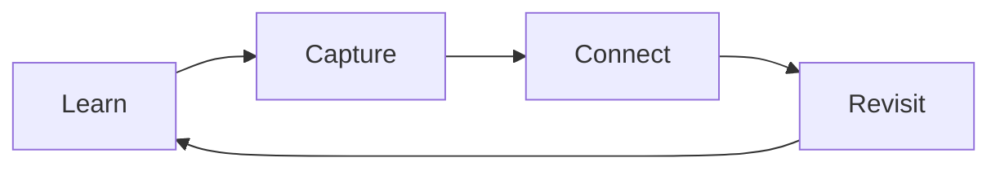

# Writing notes

## Organize by subject

Use paths such as `docs/mathematics/linear-algebra/eigenvectors.md`. Add an
`index.md` within each folder when you want a subject overview. The sidebar follows
the folder hierarchy automatically. Use tags to connect notes across subjects.

## Metadata

Begin each note with YAML front matter. Use `title` and `tags`; `description` is
optional. Reuse existing tag spellings: tags are case-sensitive, so `Docker`
and `docker` would create separate entries.
Git history records when content changes, so notes do not need date fields.

```yaml
---
title: Eigenvectors
description: Directions preserved by a linear transformation.
tags:
  - mathematics
  - linear-algebra
---
```

Copy `templates/note.md` from the repository root as a starting point. Templates
are outside `docs/` so they do not appear in the published site or search results.

Tags normally appear above the page title. Add `hide: [tags]` to front matter
to hide that row while keeping the note in tag listings and search filters.

## Headings and section numbers

Use one `#` heading for the page title, then `##`, `###`, and `####` for sections,
subsections, and sub-subsections. These three levels appear in the table of
contents with matching indentation. Deeper headings still render in the page
but are not included in the table of contents.

Section numbers are part of the Markdown text, not automatic counters:

```markdown
## 1. Primer
### 1.1. Build an image
#### 1.1.1. Name the image
## 2. Large images
```

Update those numbers when reorganizing a note. Heading links are generated from
the heading text, so changing a heading or its number also changes its anchor.

## Code blocks

Give fenced code blocks a language such as `python`, `sh`, `json`, or
`dockerfile` to enable syntax highlighting. The renderer supports its common
language set plus Dockerfile; unknown languages remain plain text. Unlabelled
blocks are not automatically detected. Each code block has a Copy button.

## Equations

Use `$...$` for inline math, such as $A\mathbf{v} = \lambda\mathbf{v}$.
Use `$$` on separate lines for display equations:

```latex
$$
\int_0^1 x^2\,dx = \frac{1}{3}
$$
```

$$
\int_0^1 x^2\,dx = \frac{1}{3}
$$

## Diagrams

Diagrams use the page's default font and text size. Wide diagrams scroll instead
of scaling the text. Use Source to inspect the Mermaid definition, or Fullscreen
for more room. Press Escape or Exit fullscreen to return to the page. Their colors
follow the selected light or dark appearance.

Use a fenced block with the language `mermaid`:

````markdown

````


## Images and plots

Store images in `docs/assets/images/` or next to the note that uses them. Embed
them with a relative path and meaningful alt text:

```markdown

```


For Python plots, export an SVG or PNG and embed it the same way. For example,
in a separate environment with Matplotlib installed:

```python
from pathlib import Path
import matplotlib.pyplot as plt

output = Path("docs/assets/images/my-plot.svg")
output.parent.mkdir(parents=True, exist_ok=True)
fig, ax = plt.subplots()
ax.plot([0, 1, 2], [0, 1, 2])
fig.savefig(output, bbox_inches="tight")
plt.close(fig)
```

## Link ideas and sources

Use relative Markdown links, such as `[Akashic](index.md)`, to connect notes.
Link sources near the claims they support; a Sources section can also collect
references for further reading.

## Find notes

Use the Library tab's sidebar for the subject hierarchy and Search for text.
The [Tags tab](../tags.md) groups related notes across subjects. Its sidebar
shows note counts and jumps to each tag's section.

## Preview changes

Run `make dev` and open <http://127.0.0.1:8056>. Saving a Markdown file updates
the page, navigation, and search index automatically. Code blocks include a Copy
button, and the Appearance icon toggle lets you follow the system or choose light or
dark mode.
