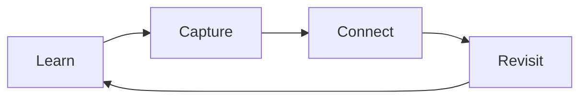
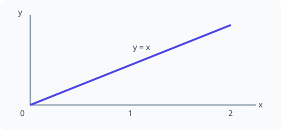

# Writing notes

## Organize by subject

Use paths such as `docs/mathematics/linear-algebra/eigenvectors.md`. Add an
`index.md` within each folder when you want a subject overview. The sidebar follows
the folder hierarchy automatically. Use tags to connect notes across subjects.

## Metadata

Begin each note with YAML front matter. Use `title` and `tags`; `description` is
optional. Reuse existing tag spellings: tags are case-sensitive, so `Docker`
and `docker` would create separate entries.
Git history records when content changes, so notes do not need date fields.

```yaml
---
title: Eigenvectors
description: Directions preserved by a linear transformation.
tags:
  - mathematics
  - linear-algebra
---
```

Copy `templates/note.md` from the repository root as a starting point. Templates
are outside `docs/` so they do not appear in the published site or search results.

Tags normally appear above the page title. Add `hide: [tags]` to front matter
to hide that row while keeping the note in tag listings and search filters.

## Headings and section numbers

Use one `#` heading for the page title, then `##`, `###`, and `####` for sections,
subsections, and sub-subsections. These three levels appear in the table of
contents with matching indentation. Deeper headings still render in the page
but are not included in the table of contents.

Section numbers are part of the Markdown text, not automatic counters:

```markdown
## 1. Primer
### 1.1. Build an image
#### 1.1.1. Name the image
## 2. Large images
```

Update those numbers when reorganizing a note. Heading links are generated from
the heading text, so changing a heading or its number also changes its anchor.

Headings below the page title form a collapsible tree in the rendered note.
Click the arrow icon to fold its content and nested sections; clicking the
heading text does not toggle it. Reviewed sections start collapsed and pending
sections start expanded, in both the note and the table of contents. **Expand all** and **Collapse all**
control the whole note. Reopening a parent preserves its children's fold states.
Table-of-contents links open the destination section and its parents automatically.
The table of contents has its own arrow buttons for folding branches; its text
links navigate to sections. The link icon beside a section heading updates the
page URL so a refresh returns to that section.

Each section also has a review status before its number: ⏳ Pending or ✅ Reviewed.
When running `npm run dev` or the local build preview (`npm start`), click the emoji
to switch status and save it directly in the source Markdown. New sections default
to Pending. The status is stored directly in the heading:

```markdown
## ✅ 1. Primer
```

The emoji stays with the section when it is renamed or moved. Change it to ⏳
to reset the status manually; a heading without either emoji is Pending.
Akashic excludes the status emoji when generating anchors and table-of-contents labels. Published
static pages display the saved statuses but cannot edit local files. Rebuild and
publish to update those pages after reviewing locally.

The **Review mode** switch in Settings is on by default. Turn it off to hide
review emojis in headings and the table of contents. Sections then start
expanded regardless of their saved status, and you can still fold them manually.
Changing the mode resets both trees to that mode's default fold states. The
preference is saved in your browser; the Markdown review markers stay intact.

Open the gear button at the top right for settings. The card contains switches
for the left navigation and right table of contents, plus an appearance selector. Their visibility is saved in this browser and
restored after refresh. On narrow screens, opened panels appear above the content.

On desktop, drag either side-panel divider to resize it. The divider runs from
below the top navigation to the bottom of the viewport. Widths are saved in this
browser. Focus a divider and use the arrow keys to adjust it, or double-click it
(or press Enter) to restore the default width. Stacked panels on narrow screens
use the available width instead.

## Code blocks

Give fenced code blocks a language such as `python`, `sh`, `json`, or
`dockerfile` to enable syntax highlighting. The renderer supports its common
language set plus Dockerfile; unknown languages remain plain text. Unlabelled
blocks are not automatically detected. Each code block has a Copy button.

## Admonition cards

Use a blockquote with a marker on its own first line to call out an example:

```markdown
> [!GOOD]
> Introduce a project before explaining how to use it.

> [!BAD]
> Assume readers already know the project.
```

> [!GOOD]
> Introduce a project before explaining how to use it.

> [!BAD]
> Assume readers already know the project.

`GOOD` produces a green card and `BAD` a red card, with visible labels in both
light and dark themes. Also supported: `NOTE` (blue), `TIP` (green), `IMPORTANT`
(purple), `WARNING` (amber), and `CAUTION` (red). Use uppercase markers.

Keep every line inside the blockquote, including a `>` on blank lines between
paragraphs. Cards support ordinary Markdown such as links, lists, and code
blocks. Unmarked blockquotes keep their usual appearance.

This is blockquote-based syntax; MkDocs' `!!!` and `???` syntax, custom titles,
and collapsible cards are not supported.

## Equations

Use `$...$` for inline math, such as $A\mathbf{v} = \lambda\mathbf{v}$.
Use `$$` on separate lines for display equations:

```latex
$$
\int_0^1 x^2\,dx = \frac{1}{3}
$$
```

$$
\int_0^1 x^2\,dx = \frac{1}{3}
$$

## Diagrams

Diagrams use the page's default font and text size. Wide diagrams scroll instead
of scaling the text. Use Source to inspect the Mermaid definition, or Fullscreen
for more room. Press Escape or Exit fullscreen to return to the page. Their colors
follow the selected light or dark appearance.

Use a fenced block with the language `mermaid`:

````markdown

````


## Images and plots

Store images in `docs/assets/images/` or next to the note that uses them. Embed
them with a relative path and meaningful alt text:

```markdown

```


### Image arrays and lightbox albums

Use an `images` fence for compact, clickable images. Put ordinary Markdown image
links inside it, one per line:

````markdown
```images


```
````

A single image occupies half the content width. Two or four images use two
columns; three images or five and above use three columns, reduced to two on
narrow screens. Preview height follows each image's natural aspect ratio.
Click a preview to open the
album, then use its thumbnails, Previous/Next buttons, or arrow keys to browse.
Press Escape or Close to return to the page. Alt text appears as the caption;
an optional image title overrides that caption and also labels its preview.

For Python plots, export an SVG or PNG and embed it the same way. For example,
in a separate environment with Matplotlib installed:

```python
from pathlib import Path
import matplotlib.pyplot as plt

output = Path("docs/assets/images/my-plot.svg")
output.parent.mkdir(parents=True, exist_ok=True)
fig, ax = plt.subplots()
ax.plot([0, 1, 2], [0, 1, 2])
fig.savefig(output, bbox_inches="tight")
plt.close(fig)
```

## Link ideas and sources

Use relative Markdown links, such as `[Akashic](index.md)`, to connect notes.
Link sources near the claims they support; a Sources section can also collect
references for further reading.

## Find notes

Use the Library tab's sidebar for the subject hierarchy and Search for text.
The [Tags tab](../tags.md) groups related notes across subjects. Its sidebar
shows note counts and jumps to each tag's section.

## Preview changes

Run `make dev` and open <http://127.0.0.1:8056>. Saving a Markdown file updates
the page, navigation, and search index automatically. Code blocks include a Copy
button, and the Appearance icon toggle lets you follow the system or choose light or
dark mode.
