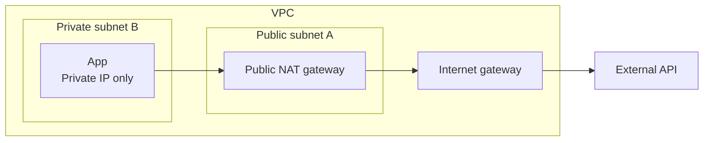
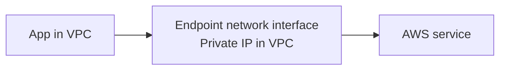

# AWS networking: build a network one piece at a time

Start with a network that has no internet connection. Put a server inside it. Then add only what that server needs to communicate.

We'll use one example throughout: a VPC with address range `10.0.0.0/16`. These notes cover ordinary regional VPCs and IPv4; the addresses are illustrative.

## 1. Start with an empty VPC

A **VPC** is your own logically isolated network in an AWS Region. Think of it as the boundary around the network you are building.

Give it an address range:

```text
VPC: 10.0.0.0/16
  No servers yet
  No internet connection
```

`10.0.0.0/16` is CIDR notation: it describes the range `10.0.0.0` through `10.0.255.255`. You don't need the bit arithmetic yet. Read it as “the pool of private addresses available to this network.”

For this example, we deliberately start without an internet gateway or connections to other networks. AWS's default VPC and setup wizards may already include internet connectivity, so they may not look like this starting point. See [AWS internet gateway documentation](https://docs.aws.amazon.com/vpc/latest/userguide/VPC_Internet_Gateway.html).

**So far:** we have a network boundary and an address pool. We have not created a path to the internet.

## 2. Add a subnet and a server

A **subnet** takes a smaller address range from the VPC. This is where you place resources such as EC2 instances.

```text
VPC: 10.0.0.0/16
  Subnet A: 10.0.1.0/24
    App server: 10.0.1.25
```

`10.0.1.0/24` covers `10.0.1.0` through `10.0.1.255`. AWS reserves some addresses in a subnet, so not every address is available for servers.

The app gets its private IP through a virtual network interface, called an **ENI**. For now, think of that as the server's network card.

A VPC belongs to one Region. Each subnet belongs to one **Availability Zone (AZ)** within that Region. An AZ is a separate location for running resources; a VPC can contain subnets in several AZs. See [AWS subnet concepts](https://docs.aws.amazon.com/vpc/latest/userguide/configure-subnets.html).

**So far:** the app has an address inside our network. It still has no internet path.

## 3. Add a second subnet: how does traffic find its way?

Put a database in another subnet:

```text
VPC: 10.0.0.0/16
  Subnet A: 10.0.1.0/24
    App:      10.0.1.25
  Subnet B: 10.0.2.0/24
    Database: 10.0.2.30
```

When the app connects to `10.0.2.30`, AWS needs to know where to send the traffic. A **route table** supplies that answer.

Read each route as: “For this destination range, send traffic to this target.” Our starting table has one route:

| Destination | Target | Meaning |
|---|---|---|
| `10.0.0.0/16` | `local` | Keep traffic for this VPC inside this VPC |

The database address falls within that range, so the app has a local path to it. Neither an internet gateway nor NAT is needed.

Each subnet uses one subnet route table at a time. Subnets can share a table; without an explicit association, a subnet uses the VPC's main table. AWS creates a local route for the VPC's address range. See [AWS subnet route tables](https://docs.aws.amazon.com/vpc/latest/userguide/subnet-route-tables.html).

**Separate subnets do not automatically block communication.** A subnet divides addresses and determines placement. Traffic restrictions are a separate concern.

## 4. Add permission to use the path

A route answers **“Where does traffic go?”** A **security group** answers **“Is this traffic allowed?”**

For the app to connect to the database, we need both:

- A path to the database's private IP, supplied here by the local route.
- Security rules allowing the connection: app outbound traffic and database inbound traffic on the database port.

For example, the database's security group could allow inbound TCP `5432` from the app's security group. The database must also be listening on that port.

Security groups are **stateful**: replies to an allowed connection are automatically permitted. They contain allow rules, rather than explicit deny rules. See [AWS security groups](https://docs.aws.amazon.com/vpc/latest/userguide/vpc-security-groups.html).

There is also a subnet-level filter called a **network ACL**. We'll assume the default allow-all ACL for our example and return to it later.

**So far:** the app and database can communicate privately when the rules allow it. Neither needs internet access for this connection.

## 5. Add an internet gateway: public versus private subnets

Suppose we now want the app to communicate directly with the internet.

Attach an **internet gateway (IGW)** to the VPC. Then add a route to Subnet A's table:

| Destination | Target | Meaning |
|---|---|---|
| `10.0.0.0/16` | `local` | VPC destinations stay local |
| `0.0.0.0/0` | Internet gateway | Send other IPv4 traffic toward the internet |

`0.0.0.0/0` means all IPv4 addresses. It acts as the fallback because routing chooses the **most specific matching range**. The database's `10.0.2.30` address still matches the more specific local route.

Subnet A is now a **public subnet** because it has a direct route to the IGW. Keep Subnet B on a separate, local-only table, and it remains **private**.

| Subnet description | What its routes mean |
|---|---|
| Public | Has a direct route to an internet gateway |
| Private | Has no direct route to an internet gateway |
| Isolated | Has no routes to destinations outside the VPC |

Our local-only Subnet B is isolated as well as private. A private subnet can gain other connections later without becoming public. See [AWS subnet types](https://docs.aws.amazon.com/vpc/latest/userguide/configure-subnets.html).

For direct IPv4 internet communication, the app also needs a public IPv4 address, such as an Elastic IP, and suitable security rules. The IGW maps between the app's private and public IPv4 addresses. Inbound connections additionally require an application listening on the requested port. See [AWS internet gateway documentation](https://docs.aws.amazon.com/vpc/latest/userguide/VPC_Internet_Gateway.html).

**The distinction:** “public” describes a subnet's route. It does not mean every resource in it is reachable from the internet. Attaching an IGW alone also does not make all subnets public.

## 6. Keep the app private, but let it call the internet

Now change the requirement: the app should call an external API, but it should have only a private IP.

Move the app into private Subnet B. Use Subnet A for a **public NAT gateway**. This example uses a zonal NAT gateway with an Elastic IP.



Keep the public subnet's route to the IGW. Add a default route to the private subnet:

| Subnet | Destination | Target |
|---|---|---|
| Private B | `10.0.0.0/16` | `local` |
| Private B | `0.0.0.0/0` | NAT gateway |
| Public A | `10.0.0.0/16` | `local` |
| Public A | `0.0.0.0/0` | Internet gateway |

NAT translates addresses and tracks connections. The external API sees the NAT gateway's Elastic IP, and its replies return to the app through NAT.

An external host cannot use this NAT path to start an unsolicited connection to the app. The app can initiate a connection and receive its responses. See [AWS NAT gateways](https://docs.aws.amazon.com/vpc/latest/userguide/vpc-nat-gateway.html).

**So far:** the app can call the internet while its subnet remains private. Its default route points to NAT, not directly to the IGW.

## 7. Reach one AWS service without internet access

Suppose the app only needs S3. Must we give it a general internet path through NAT?

No. A **VPC endpoint** provides a connection to a particular service without requiring an internet gateway or NAT for that connection.

First, separate two uses of “endpoint”:

- An **API endpoint** is the address you call, usually a hostname or URL.
- A **VPC endpoint** is a networking resource you create to reach a service.

An endpoint for one service does not provide general internet access. There are two common mechanisms to understand.

### Gateway endpoint: add a service-specific route

For S3, we can create a **gateway endpoint** and associate it with the app subnet's route table:

| Destination | Target |
|---|---|
| `10.0.0.0/16` | `local` |
| Regional S3 prefix list | S3 gateway endpoint |

A **prefix list** is a collection of IP ranges; AWS maintains this one for the service. Traffic matching it follows the endpoint route.

With this table, the app can reach matching S3 destinations, but it still cannot call an arbitrary external API. If we also keep a default route to NAT, the more specific S3 route takes precedence for matching traffic.

S3 has not moved into our subnet. Its hostname can still resolve to public service IPs; the route provides the private service path. Gateway endpoints support S3 and DynamoDB and do not use AWS PrivateLink. See [AWS gateway endpoints](https://docs.aws.amazon.com/vpc/latest/privatelink/gateway-endpoints.html).

### Interface endpoint: add a private address for a service

Many other services, such as Secrets Manager and ECR, support **interface endpoints**, powered by AWS PrivateLink.

An interface endpoint creates network interfaces with private IP addresses in selected subnets. The app connects to those addresses to reach the service.



This introduces **DNS**, which turns a hostname into an IP address. With private DNS enabled for the endpoint, the service's usual hostname resolves inside the VPC to the endpoint's private IPs.

The app can usually keep using the same service hostname. Its traffic now goes to the private interface. You do not add an S3-style service route: the destination IP is already reachable inside the VPC.

Private DNS requires VPC DNS support and DNS hostnames to be enabled. The endpoint's security group must allow client connections, commonly inbound HTTPS on TCP `443`. See [AWS interface endpoints](https://docs.aws.amazon.com/vpc/latest/privatelink/create-interface-endpoint.html).

**Remember the mechanism:** a gateway endpoint changes the route for service traffic; an interface endpoint provides private IPs to connect to.

## 8. Put the pieces together: pull a container image from ECR

Keep the app private and remove its NAT path. We want it to pull a private container image from ECR in the same Region.

A typical EC2 or EKS image pull needs three service paths:

| Needed for | Connection |
|---|---|
| Authentication and ECR API calls | `ecr.api` interface endpoint |
| Registry requests, such as fetching the image manifest | `ecr.dkr` interface endpoint |
| Downloading image layers stored in S3 | S3 gateway endpoint |

The endpoint service names are `com.amazonaws.<region>.ecr.api`, `com.amazonaws.<region>.ecr.dkr`, and `com.amazonaws.<region>.s3`.

This is why “I created an ECR endpoint” may not be enough. One operation can involve several services. Each needs a working path and the necessary permissions.

Use private DNS for the ECR endpoints, allow HTTPS to their interfaces, and associate the S3 endpoint with the client's route table. The caller also needs permission to pull the image.

This example covers the image pull, not every dependency of an EKS cluster or application. Special cases, including an initial pull-through-cache fetch or externally hosted Windows layers, can need additional connectivity. See [AWS ECR endpoint requirements](https://docs.aws.amazon.com/AmazonECR/latest/userguide/vpc-endpoints.html).

## 9. Add the remaining permission checks

We already used security groups. Two more layers explain many failures:

| Layer | Question it answers | What to remember |
|---|---|---|
| Security group | May this resource send or receive the traffic? | Stateful; allows replies to an allowed connection |
| Network ACL | May this traffic cross the subnet boundary? | Stateless; rules must allow both request and response traffic |
| IAM and resource policies | May this caller perform the AWS operation? | Network reachability does not grant service access |
| Endpoint policy, where supported | May this request pass through the endpoint? | Adds a restriction; does not replace service authorization |

Custom ACLs can block replies if they do not allow the applicable return ports. The default ACL initially allows inbound and outbound traffic. See [AWS network ACLs](https://docs.aws.amazon.com/vpc/latest/userguide/vpc-network-acls.html).

For EC2, omitting a security group means AWS uses the VPC's default group. Its original rules allow inbound traffic from resources associated with that same group and allow outbound traffic. They do not allow arbitrary inbound internet traffic. Those rules can be edited, and launch tools may select a different group, so check the actual association. See [AWS default security groups](https://docs.aws.amazon.com/vpc/latest/userguide/default-security-group.html).

**A path and permission are separate requirements.** Allowing HTTPS does not create a route. Creating an endpoint does not grant access to every resource behind it.

## 10. Trace any connection with the same questions

Once the pieces are familiar, follow one request from start to finish:

1. **Where is the client?** Find its VPC, subnet, and private IP.
2. **What address is it calling?** Resolve the hostname, if it uses one.
3. **Which route matches?** Look at the subnet's route table and choose the most specific match.
4. **Where does that route lead?** Follow the local path, IGW, NAT, or endpoint, including any onward connection.
5. **Is the connection allowed?** Check security groups, ACLs, and the destination's listening port. Include the response path.
6. **Is the operation allowed?** For AWS services, check credentials, IAM, resource policies, and endpoint policies.

For example, an S3 request can use a gateway endpoint even when DNS returns a public IP. An ECR request can use an interface endpoint because private DNS returns a private IP. An external API request can use NAT because it matches the default route.

The network becomes easier to reason about when you follow a specific destination instead of trying to memorize the whole architecture at once.
