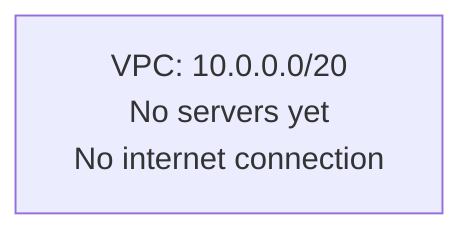
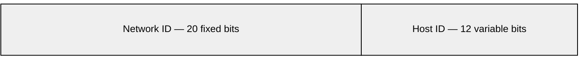
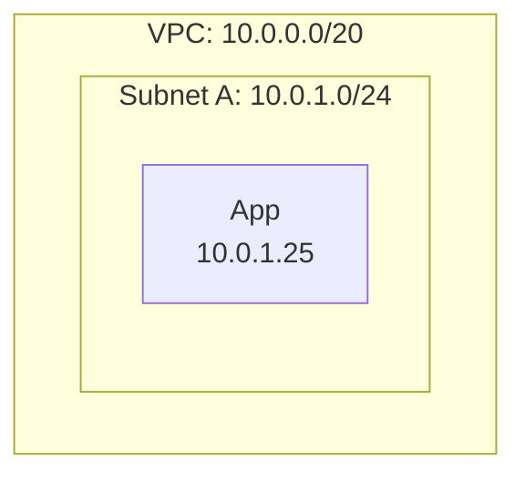
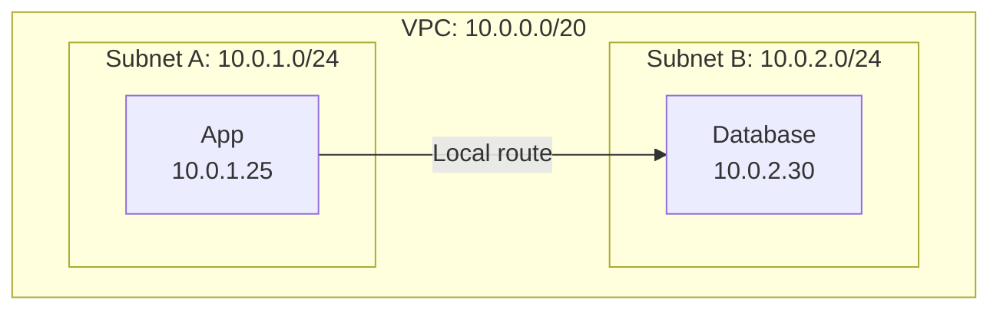
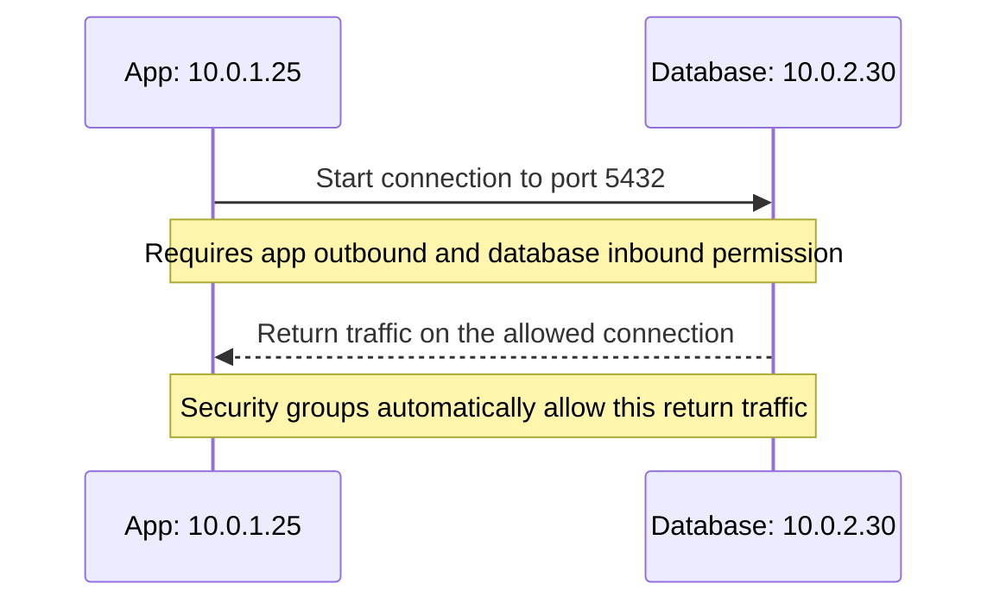
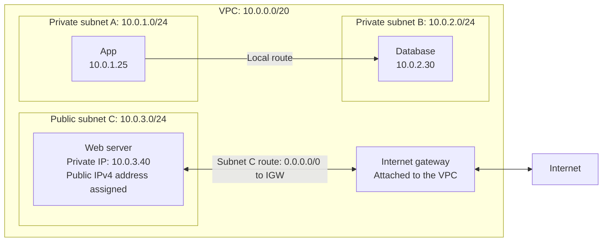
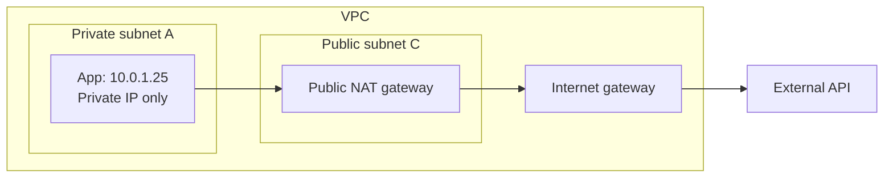
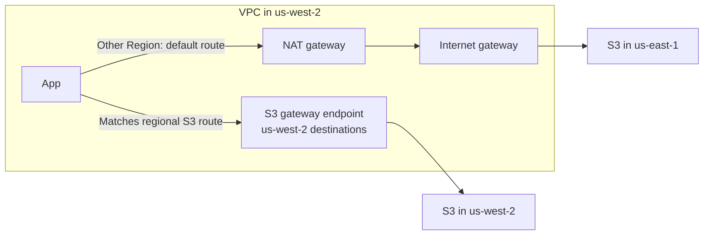
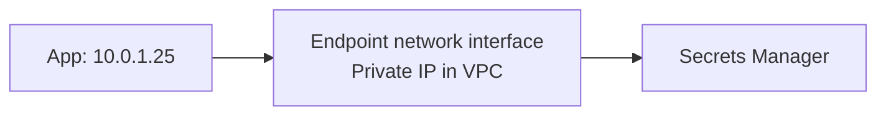
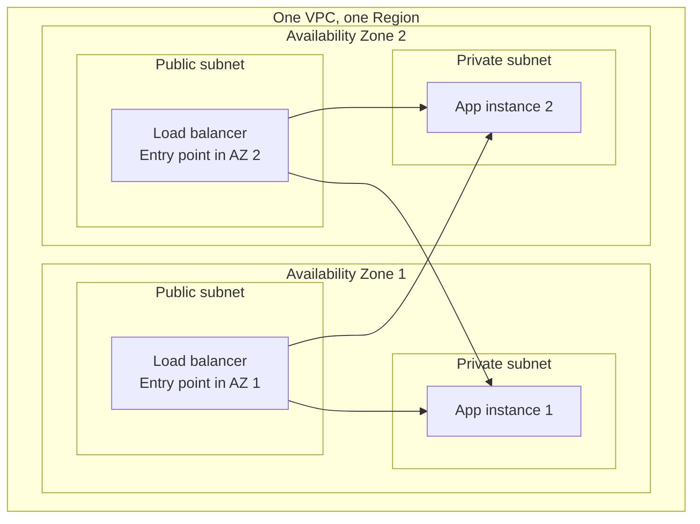

# AWS networking

Start with a network that has no internet connection. Put a server inside it. Then add only what that server needs to communicate.

We'll use one example throughout: a VPC with address range `10.0.0.0/20`. These notes cover ordinary regional VPCs and IPv4; the addresses are illustrative.

## 1. Start with an empty VPC

A **VPC (Virtual Private Cloud)** is your own logically isolated network in an AWS Region. Think of it as the boundary around the network you are building.

Give it an address range:



For this example, we deliberately start without an internet gateway or connections to other networks. AWS's default VPC and setup wizards may already include internet connectivity, so they may not look like this starting point. See [AWS internet gateway documentation](https://docs.aws.amazon.com/vpc/latest/userguide/VPC_Internet_Gateway.html).

**So far:** we have a network boundary and an address pool. We have not created a path to the internet.

## 2. Understand the address range: CIDR

`10.0.0.0/20` is **CIDR notation**, a compact way to describe a range of IP addresses. Each number between the dots is an **octet**: a group of 8 bits. Four octets make a 32-bit IPv4 address.



**`/20` means 20 fixed network bits**, leaving `32 − 20 = 12` variable host bits. It fixes the first two octets (`10.0`) and the first four bits of the third octet. The third octet can range from `0` to `15`, and the last from `0` to `255`: the full range is `10.0.0.0` through `10.0.15.255`.

The larger the number after `/`, the fewer bits can vary—and the smaller the address pool:

| Example | Fixed part | Part that can vary | Total addresses |
|---|---|---|---|
| `10.0.0.0/20` | First 20 bits | Last 12 bits | 4,096 |
| `10.0.1.0/24` | First 24 bits: `10.0.1` | Last number | 256 |
| `10.0.1.25/32` | All 32 bits | None | 1 |

The `/24` and `/32` boundaries line up with the dots because they are multiples of 8. Our `/20` boundary falls inside the third octet. The rule is always the same: **`/n` fixes the first `n` bits**, leaving `2^(32 − n)` total addresses.

For now, our `/20` is the VPC's address pool. Next, we'll take a smaller `/24` range from it for a subnet.

## 3. Add a subnet and a server

A **subnet** takes a smaller address range from the VPC. This is where you place a server, such as an **EC2 instance**, AWS's virtual machine.



`10.0.1.0/24` covers `10.0.1.0` through `10.0.1.255`. AWS reserves some addresses in a subnet, so not every address is available for servers.

A VPC belongs to one Region. Each subnet belongs to exactly one **Availability Zone (AZ)** within that Region. A VPC can contain many subnets, including several in the same AZ or subnets in different AZs. See [AWS subnet concepts](https://docs.aws.amazon.com/vpc/latest/userguide/configure-subnets.html).

An AZ is one or more data centers with separate power and networking infrastructure. Its purpose is **failure isolation**: a problem in one AZ is less likely to affect another. AZs within a Region have fast network connections so an application can run across them. See [AWS Availability Zones](https://docs.aws.amazon.com/whitepapers/latest/aws-fault-isolation-boundaries/availability-zones.html).

We start with one subnet to learn the pieces. For a production application that must survive an AZ outage, we'll need subnets and working copies of the application in multiple AZs. Creating extra subnets alone does not create those copies.

**So far:** the app has an address inside our network. It still has no internet path.

## 4. Add a second subnet: how does traffic find its way?

Put a database in another subnet:



When the app connects to `10.0.2.30`, AWS needs to know where to send the traffic. A **route table** supplies that answer.

Read each route as: “For this destination range, send traffic to this target.” Our starting table has one route:

| Destination | Target | Meaning |
|---|---|---|
| `10.0.0.0/20` | `local` | Keep traffic for this VPC inside this VPC |

The database address falls within that range, so the app has a local path to it. This connection stays inside the VPC.

Each subnet uses one subnet route table at a time. Subnets can share a table; without an explicit association, a subnet uses the VPC's main table. AWS creates a local route for the VPC's address range. See [AWS subnet route tables](https://docs.aws.amazon.com/vpc/latest/userguide/subnet-route-tables.html).

**Separate subnets do not automatically block communication.** A subnet divides addresses and determines placement. Traffic restrictions are a separate concern.

## 5. Add permission to use the path

A route answers **“Where does traffic go?”** A **security group** answers **“Is this traffic allowed?”**

For the app to connect to the database, we need both:

- A path to the database's private IP, supplied here by the local route.
- Security rules allowing the connection: app outbound traffic and database inbound traffic on the database port.

For example, the database's security group could allow inbound TCP `5432` from the app's security group. A **port** identifies the service receiving a connection; PostgreSQL commonly listens on port `5432`. The database must actually be running and listening there.

Security groups contain allow rules, rather than explicit deny rules.

### 5.1. What does “stateful” mean? Can traffic go both ways?

**Traffic can flow both ways within an allowed connection. Permission to start a new connection is a separate question.**

Suppose the app starts a database connection on TCP port `5432`:



The security groups track the connection. The database's replies are allowed even without a matching outbound rule on its security group, and the app can receive those replies without a matching inbound rule on its security group. This connection tracking is what **stateful** means. See [AWS security groups](https://docs.aws.amazon.com/vpc/latest/userguide/vpc-security-groups.html).

Now suppose the database tries to start a **separate connection** to a service running on the app. That is not a reply. It needs database outbound permission and app inbound permission for that new connection.

| Traffic | What the security groups require |
|---|---|
| App starts a connection to the database | App outbound and database inbound rules must allow it |
| Database sends replies on that connection | Automatically allowed as return traffic |
| Database starts a separate connection to the app | Database outbound and app inbound rules must allow it |

The same principle applies when the app calls an external API: its response can return without an inbound security-group rule specifically allowing it. This automatic permission applies to security groups; it does not create a missing route or bypass other network filters.

There is also a subnet-level filter called a **network ACL**. We'll assume the default allow-all ACL for our example and return to it later.

**So far:** the app and database can communicate privately when the rules allow it. Neither needs internet access for this connection.

## 6. Add an internet gateway: public versus private subnets

Suppose we want to add a web server that visitors can reach from the internet. Keep the app and database where they are, and add Subnet C for the web server.

An **internet gateway (IGW)** connects a VPC to the internet. Attach one to the VPC and give Subnet C a route to it. This makes Subnet C public; Subnets A and B keep their local-only routes:



The IGW attaches to the VPC, not to an individual subnet. The arrows show the web server's internet path; security rules still control which connections are allowed.

Subnet C's route table now contains:

| Destination | Target | Meaning |
|---|---|---|
| `10.0.0.0/20` | `local` | VPC destinations stay local |
| `0.0.0.0/0` | Internet gateway | Send other IPv4 traffic toward the internet |

`0.0.0.0/0` means all IPv4 addresses. It acts as the fallback because routing chooses the **most specific matching range**. The database's `10.0.2.30` address still matches the more specific local route.

Subnet C is now a **public subnet** because it has a direct route to the IGW. Keep Subnets A and B on their local-only table, and they remain **private**.

| Subnet description | What its routes mean |
|---|---|
| Public | Has a direct route to an internet gateway |
| Private | Has no direct route to an internet gateway |
| Isolated | Has no routes to destinations outside the VPC |

Our local-only Subnets A and B are isolated as well as private. A private subnet can gain other connections later without becoming public. See [AWS subnet types](https://docs.aws.amazon.com/vpc/latest/userguide/configure-subnets.html).

To make the web server reachable, give it a public IPv4 address and allow its web port in its security group. It keeps its private address too: the IGW maps between the two addresses. The web application must be listening on that port. See [AWS internet gateway documentation](https://docs.aws.amazon.com/vpc/latest/userguide/VPC_Internet_Gateway.html).

**The distinction:** “public” describes a subnet's route. It does not mean every resource in it is reachable from the internet. Attaching an IGW alone also does not make all subnets public.

## 7. Keep the app private, but let it call the internet

Now the app at `10.0.1.25` needs to call an external API. We want to keep it in private Subnet A with only its private IP.

Add a **public NAT gateway** to public Subnet C. NAT means **Network Address Translation**: it lets the app use a shared outward-facing address. This example uses a zonal NAT gateway with an **Elastic IP**, a public IPv4 address allocated to your AWS account.



Keep Subnet C's route to the IGW. Give Subnet A its own table with a default route to NAT; leave the database's Subnet B on its local-only table:

| Subnet | Destination | Target | Meaning |
|---|---|---|---|
| Private A | `10.0.0.0/20` | `local` | Traffic to other VPC addresses stays inside the VPC |
| Private A | `0.0.0.0/0` | NAT gateway | Other IPv4 traffic goes to NAT in public Subnet C |
| Public C | `10.0.0.0/20` | `local` | Traffic to other VPC addresses stays inside the VPC |
| Public C | `0.0.0.0/0` | Internet gateway | Other IPv4 traffic, including traffic forwarded by NAT, goes toward the internet |

NAT translates addresses and tracks connections. The external API sees the NAT gateway's Elastic IP, and its replies return to the app through NAT.

An external host cannot use this NAT path to start an unsolicited connection to the app. The app can initiate a connection and receive its responses. See [AWS NAT gateways](https://docs.aws.amazon.com/vpc/latest/userguide/vpc-nat-gateway.html).

**So far:** the app can call the internet while its subnet remains private. Its default route points to NAT, not directly to the IGW.

## 8. Reach S3 through a gateway endpoint

Suppose the app now needs to read files from **Amazon S3**, AWS's object storage service. It could reach S3 through NAT, but we can give S3 traffic a dedicated path that does not need NAT or an internet gateway.

### 8.1. What is a gateway endpoint?

Suppose our VPC and a bucket named `bucket` are both in `us-west-2`. The app wants to read `report.csv`, so it sends an HTTPS request to `https://bucket.s3.us-west-2.amazonaws.com/report.csv`. The hostname identifies the bucket and Region; the path identifies the object. A bucket is a logical collection of objects, not a server with its own dedicated IP. See [S3 bucket hostnames](https://docs.aws.amazon.com/AmazonS3/latest/userguide/VirtualHosting.html).

Before connecting, the app needs an IP address for that hostname. Assuming the VPC uses AWS's default DNS configuration, the instance asks the **Amazon-provided DNS resolver**, also called Route 53 Resolver, to resolve the name. The resolver obtains the DNS answer and returns S3 service IP addresses. With the gateway endpoint path described here, these are **public S3 IP addresses**, not private addresses allocated from our subnet. The app connects to one of them on HTTPS port `443`. See [Amazon DNS](https://docs.aws.amazon.com/vpc/latest/userguide/AmazonDNS-concepts.html).

The destination IP tells AWS's VPC routing infrastructure which route to use. Once we associate an S3 gateway endpoint with Subnet A's route table, that table contains a route for the Region's S3 address ranges. The resolved S3 IP matches this route, which is more specific than the default NAT route. AWS therefore carries the traffic through the **gateway endpoint path** to S3, without using NAT or the internet gateway. The destination IP is public, but the route keeps this connection on the AWS network. DNS supplies the address; the route table selects the path. See [AWS gateway endpoint routing](https://docs.aws.amazon.com/vpc/latest/privatelink/gateway-endpoints.html).

At S3, the request's hostname identifies `bucket` and its path identifies `report.csv`. S3 checks access permissions and handles finding and returning the object through its own internal infrastructure. Your VPC route gets the request to the S3 service; S3 handles the machines and storage behind it. Neither DNS nor your route table gives you the address of a particular disk or machine storing that object.

The **gateway endpoint** is the VPC resource that makes this service-specific route available. It has an endpoint ID, such as `vpce-example`, and an access policy, but no subnet private IP, network interface (ENI), or server for you to manage. “Gateway” describes its role in providing a path out to S3. AWS implements that path in its managed network, and the route points to the endpoint ID rather than to a gateway machine's IP.

### 8.2. Add the S3 route and keep NAT

Create the S3 gateway endpoint in our VPC and select Subnet A's route table. AWS automatically adds the S3 route to that table. Keep the existing default route to NAT:

| Destination | Target | Meaning |
|---|---|---|
| `10.0.0.0/20` | `local` | Traffic to VPC addresses stays inside the VPC |
| Regional S3 prefix list | S3 gateway endpoint | Matching S3 traffic uses the VPC's endpoint |
| `0.0.0.0/0` | NAT gateway | Other IPv4 traffic continues through NAT |

A **prefix list** is a collection of IP ranges; AWS maintains this one for the service. Traffic matching it follows the endpoint route.

To give another subnet the same path, associate its route table with this endpoint too. If two subnets share an associated route table, both already use its endpoint route. You do not need one gateway endpoint per subnet. See [S3 gateway endpoint route-table associations](https://docs.aws.amazon.com/vpc/latest/privatelink/vpc-endpoints-s3.html#associate-route-tables-s3).

The more specific S3 route takes precedence over the default NAT route for matching traffic. An external API still uses NAT. Adding the endpoint gives S3 its own path without removing the app's existing internet access.

S3 has not moved into our subnet. The endpoint gives us a route to the AWS-managed service. Gateway endpoints support S3 and DynamoDB. See [AWS gateway endpoints](https://docs.aws.amazon.com/vpc/latest/privatelink/gateway-endpoints.html).

**So far:** the app reaches the database locally, S3 through the VPC's gateway endpoint, and external APIs through NAT.

### 8.3. Access a bucket in another Region

Suppose the app remains in `us-west-2`, but now needs an object from a bucket in `us-east-1`. It calls that bucket's regional hostname, such as `bucket.s3.us-east-1.amazonaws.com`. DNS resolves the name to an S3 service IP for the destination Region. That address does not match the `us-west-2` S3 prefix list in our route table, so the default route to NAT takes over.



The existing NAT and internet gateway provide this path; adding another S3 gateway endpoint in our VPC would not extend it to another Region. Gateway endpoints are regional, and their S3 routes cover the service in that Region. Although the cross-Region request uses the internet gateway, AWS documents that this S3 traffic stays on the AWS network. See [AWS gateway endpoint routing](https://docs.aws.amazon.com/vpc/latest/privatelink/gateway-endpoints.html).

The app still needs permission to access the remote bucket, and its network rules must allow the connection. If we removed NAT without providing another suitable path, the local gateway endpoint would continue to serve matching local-Region S3 traffic, but it would not make the remote bucket reachable.

### 8.4. Control access with a gateway endpoint policy

The S3 route selects traffic by destination IP range, so it can carry requests for many buckets in the Region. An **endpoint policy** narrows what callers may do through that path. It is attached to the gateway endpoint and can restrict the calling identity, S3 actions, and resources. The default policy places no additional restriction on endpoint access; it does not make buckets public or grant callers S3 permissions.

Suppose our app should only read objects in `bucket`. We could give the endpoint this policy, shown as a decoded JSON policy document:

```json
{
    "Version": "2012-10-17",
    "Statement": [
        {
            "Effect": "Allow",
            "Principal": "*",
            "Action": [
                "s3:GetObject"
            ],
            "Resource": [
                "arn:aws:s3:::bucket/*"
            ]
        }
    ]
}
```

`Principal: "*"` applies this endpoint allowance to any caller using the endpoint; it does not make the bucket public. The action permits reading objects, and the resource covers object keys inside `bucket`. A request for `report.csv` can pass this endpoint check, but the caller still needs S3 authorization through the applicable IAM and bucket policies. Uploading an object, listing the bucket, or reading another bucket would fail the endpoint check under this policy.

A rejected request does not fall back to NAT: routing has already selected the endpoint path. Conversely, this policy does not govern requests that use a different path, such as our cross-Region NAT connection. Restricting a bucket to requests from a particular endpoint requires a bucket policy. See [AWS endpoint policies](https://docs.aws.amazon.com/vpc/latest/privatelink/vpc-endpoints-access.html).

## 9. Reach another service through a private IP

Now the app needs to retrieve a password from **Amazon Secrets Manager**, an AWS service for storing and retrieving secrets. It supports a different kind of VPC endpoint: an **interface endpoint**.

An interface endpoint creates a virtual network interface, called an **ENI**, with a private IP in each selected subnet. Think of it as a private entry point to the service. The underlying connectivity technology is called **AWS PrivateLink**; gateway endpoints use a different mechanism.



The app normally calls the service by its hostname. **DNS** turns that name into an IP address. With private DNS enabled for the endpoint, the service's usual hostname resolves inside the VPC to the endpoint's private IPs.

The app can usually keep using the same service hostname. Its traffic now goes to the private interface. You do not add an S3-style service route: the destination IP is already reachable inside the VPC.

Private DNS requires VPC DNS support and DNS hostnames to be enabled. The endpoint's security group must allow client connections, commonly inbound HTTPS on TCP `443`. See [AWS interface endpoints](https://docs.aws.amazon.com/vpc/latest/privatelink/create-interface-endpoint.html).

**Remember the mechanism:** a gateway endpoint changes the route for service traffic; an interface endpoint provides private IPs to connect to.

This also explains why a public destination IP does not always mean traffic goes through the internet. S3's hostname can resolve to public service IPs while the matching traffic follows the gateway endpoint route.

### 9.1. Why use a gateway endpoint for S3? Is it about performance?

**S3 supports both gateway and interface endpoints.** We chose a gateway endpoint for this example because the app is inside the VPC and needs same-Region S3 access. It gives us a simple route-based path with no additional gateway-endpoint charge. See [AWS S3 endpoint comparison](https://docs.aws.amazon.com/AmazonS3/latest/userguide/privatelink-interface-endpoints.html).

The two designs connect to the service differently:

| Design | What changes in your VPC | How traffic reaches the service |
|---|---|---|
| Gateway endpoint | A service-specific route is added to selected route tables | Matching service IP ranges use the endpoint route |
| Interface endpoint | ENIs with private IPs are created in selected subnets | The app connects to those private IPs, usually through DNS |

AWS offers gateway endpoints specifically for S3 and DynamoDB. Many other AWS services, including Secrets Manager and ECR, offer interface endpoints through PrivateLink. You choose from the endpoint types the service supports; you cannot turn an arbitrary service's interface endpoint into a gateway endpoint. See [AWS gateway endpoints](https://docs.aws.amazon.com/vpc/latest/privatelink/gateway-endpoints.html).

**Do not read this as “storage needs a fast gateway; other APIs use slower ENIs.”** The AWS documentation describes different connectivity options, not a universal performance ranking or a performance-based reason for that service split. Interface endpoints have documented bandwidth limits and scaling behavior, so throughput-sensitive workloads should check those limits and measure their actual path. See [AWS PrivateLink quotas](https://docs.aws.amazon.com/vpc/latest/privatelink/vpc-limits-endpoints.html).

For S3, the practical choice is usually about **where the client is and what connectivity it needs**. A gateway endpoint fits our in-VPC example. An S3 interface endpoint can also serve clients on premises through VPN or Direct Connect, which cannot use the VPC's S3 gateway endpoint directly. Interface endpoints incur endpoint charges. Both paths keep S3 traffic on the AWS network. See [AWS S3 endpoint comparison](https://docs.aws.amazon.com/AmazonS3/latest/userguide/privatelink-interface-endpoints.html).

## 10. Put the pieces together: pull a container image from ECR

Keep the app in Subnet A with both its S3 endpoint route and its NAT route. We want its EC2 instance to pull a private container image from **Amazon ECR**, AWS's container image registry, in the same Region, using endpoints for the image pull while retaining NAT for other internet traffic.

A typical EC2 image pull through endpoints needs three service paths:

| Needed for | Connection |
|---|---|
| Authentication and ECR API calls | `ecr.api` interface endpoint |
| Registry requests, such as fetching the image manifest | `ecr.dkr` interface endpoint |
| Downloading image layers stored in S3 | S3 gateway endpoint |

The endpoint service names are `com.amazonaws.<region>.ecr.api`, `com.amazonaws.<region>.ecr.dkr`, and `com.amazonaws.<region>.s3`.

This is why “I created an ECR endpoint” may not be enough to keep the whole pull on endpoint paths. One operation can involve several services. Each needs a working path and the necessary permissions. NAT may provide a public service path where an endpoint is missing, but that traffic would then depend on NAT.

Use private DNS for the ECR endpoints, allow HTTPS to their interfaces, and associate the S3 endpoint with the client's route table. The caller also needs permission to pull the image.

This example covers the image pull; the application may need other services once it starts. Special cases, including an initial pull-through-cache fetch or externally hosted Windows layers, can need additional connectivity. See [AWS ECR endpoint requirements](https://docs.aws.amazon.com/AmazonECR/latest/userguide/vpc-endpoints.html).

## 11. Add the remaining permission checks

We already used security groups. Once the path exists, additional controls can still block traffic or deny a service operation:

**IAM (Identity and Access Management)** controls who may perform AWS operations. For example, a network path to S3 lets the app send a request, but its identity still needs permission to read the requested object.

| Layer | Question it answers | What to remember |
|---|---|---|
| Security group | May this resource send or receive the traffic? | Stateful; allows replies to an allowed connection |
| Network ACL | May this traffic cross the subnet boundary? | Stateless; rules must allow both request and response traffic |
| IAM and resource policies | May this caller perform the AWS operation? | Network reachability does not grant service access |
| Endpoint policy, where supported | May this request pass through the endpoint? | Adds a restriction; does not replace service authorization |

Custom ACLs can block replies if they do not allow the applicable return ports. The default ACL initially allows inbound and outbound traffic. See [AWS network ACLs](https://docs.aws.amazon.com/vpc/latest/userguide/vpc-network-acls.html).

For EC2, omitting a security group means AWS uses the VPC's default group. Its original rules allow inbound traffic from resources associated with that same group and allow outbound traffic. They do not allow arbitrary inbound internet traffic. Those rules can be edited, and launch tools may select a different group, so check the actual association. See [AWS default security groups](https://docs.aws.amazon.com/vpc/latest/userguide/default-security-group.html).

**A path and permission are separate requirements.** Allowing HTTPS does not create a route. Creating an endpoint does not grant access to every resource behind it.

## 12. Extend the design across Availability Zones

Our example explains connectivity. To keep serving requests when an AZ fails, repeat the needed parts of the application in another AZ within the same VPC.

A common production web layout uses at least two AZs, with a public subnet and a private application subnet in each:



The two entry points belong to one load balancer spanning both AZs. The arrows show how it can reach app instances in either AZ.

A **load balancer** sends requests to healthy app instances. If one AZ becomes unavailable, the other must have enough capacity to keep serving requests. AWS's [production VPC example](https://docs.aws.amazon.com/vpc/latest/userguide/vpc-example-private-subnets-nat.html) uses this layout with an Auto Scaling group to maintain application instances.

The distinction is simple: **subnets provide places to run resources; redundant resources and failover provide availability.** Two subnets in the same AZ do not protect against an AZ outage. Putting the only app server in one AZ and the only database in another does not either: losing either one still breaks the application.

Include dependencies in the design: the database needs replication and failover, and each surviving app instance needs working network paths. With the zonal NAT gateways used in our example, a common resilient layout gives each AZ its own NAT gateway instead of making both depend on one AZ.

One subnet can be enough for a learning environment or a workload that accepts downtime. Choose the production layout based on availability needs; the goal is surviving failures, not reaching a particular subnet count.

## 13. Trace any connection with the same questions

Once the pieces are familiar, follow one request from start to finish:

1. **Where is the client?** Find its VPC, subnet, and private IP.
2. **What address is it calling?** Resolve the hostname, if it uses one.
3. **Which route matches?** Look at the subnet's route table and choose the most specific match.
4. **Where does that route lead?** Follow the local path, IGW, NAT, or endpoint, including any onward connection.
5. **Is the connection allowed?** Check security groups, ACLs, and the destination's listening port. Include the response path.
6. **Is the operation allowed?** For AWS services, check credentials, IAM, resource policies, and endpoint policies.

For example, an S3 request can use a gateway endpoint even when DNS returns a public IP. An ECR request can use an interface endpoint because private DNS returns a private IP. An external API request can use NAT because it matches the default route.

The network becomes easier to reason about when you follow a specific destination instead of trying to memorize the whole architecture at once.
