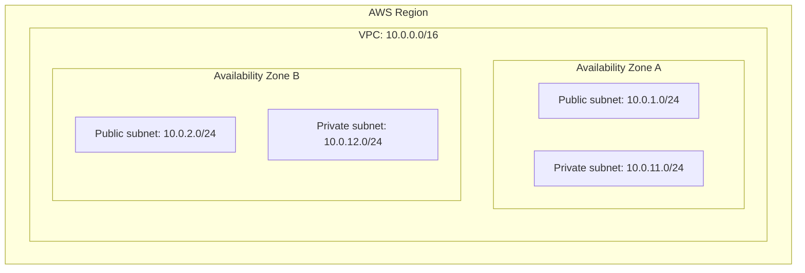
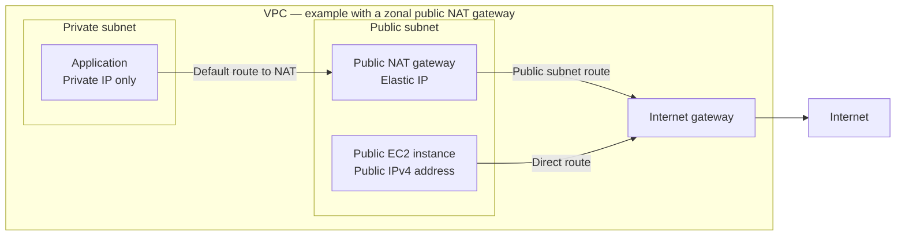
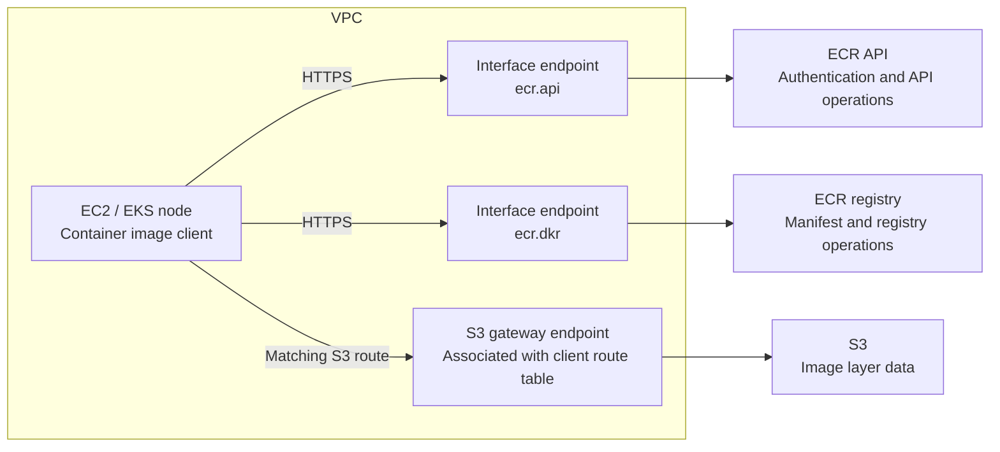

# AWS networking: VPCs, subnets, routes, gateways, and endpoints

These notes focus on ordinary regional AWS VPCs and IPv4. All addresses and layouts below are illustrative, not a description of a deployed environment. Documentation checked on October 14, 2026.

## 1. The core mental model

To understand a connection, ask five questions:

1. **Placement:** Which VPC and subnet contain the resource?
2. **Naming:** What IP address does the destination hostname resolve to?
3. **Routing:** Which route matches that destination IP?
4. **Network permission:** Do security groups and network ACLs allow the traffic?
5. **Service permission:** Does the caller have the required IAM and resource permissions?

A working route does not grant permission. Permission does not create a route.

| Component | What it does | Example |
|---|---|---|
| VPC | Defines a logically isolated network in one AWS Region | `10.0.0.0/16` |
| Subnet | Allocates an address range inside a VPC, in one Availability Zone | `10.0.1.0/24` |
| ENI | Elastic Network Interface: a resource's virtual network interface | EC2 interface with private IP `10.0.1.25` |
| Route table | Selects the next hop for a destination | `0.0.0.0/0 → NAT gateway` |
| Internet gateway | Connects a VPC to the internet | Direct internet access for appropriately configured resources |
| NAT gateway | Translates source addresses for connections initiated through it | Private instances reaching external APIs |
| VPC endpoint | Provides a service-specific connection from the VPC | Private access to ECR or S3 |
| Security group | Stateful allow rules associated with supported resources/network interfaces | Allow HTTPS from application servers |
| Network ACL | Stateless allow/deny rules at subnet boundaries | Subnet-level traffic filtering |

## 2. VPC, subnet, Availability Zone, and CIDR

A VPC is regional and can contain subnets in multiple Availability Zones (AZs). Each subnet belongs to exactly one AZ. See [AWS subnet concepts](https://docs.aws.amazon.com/vpc/latest/userguide/configure-subnets.html).

**Subnets are not automatically isolated from each other:** placing two resources in different subnets does not, by itself, prevent them from communicating. By default, the VPC's `local` route provides a path between private IP addresses in its subnets. For example, an EC2 instance at `10.0.1.25` in subnet `10.0.1.0/24` can connect to an instance at `10.0.2.30` in subnet `10.0.2.0/24` when security groups and network ACLs allow the traffic and the destination application is listening on the requested port. This communication does not require a NAT gateway or internet gateway.

A subnet defines an address range and an Availability Zone; it is not an automatic security barrier. To isolate workloads, configure explicit traffic restrictions, such as security-group or network-ACL rules. Likewise, a **private subnet** has no direct route to an internet gateway—it is not necessarily inaccessible from other subnets in the VPC.

CIDR notation specifies an IP address range. For IPv4, `/n` fixes the first `n` bits, leaving `32 - n` bits for addresses:

- `10.0.0.0/16`: 65,536 total addresses, from `10.0.0.0` to `10.0.255.255`.
- `10.0.1.0/24`: 256 total addresses, from `10.0.1.0` to `10.0.1.255`.
- `10.0.1.25/32`: exactly one address.
- `0.0.0.0/0`: all IPv4 destinations.

These are total address counts, not counts of addresses available to workloads. AWS reserves addresses in ordinary subnets.

## 3. Routes determine whether a subnet is public or private

A **public subnet** has a direct route to an internet gateway. A **private subnet** does not; it may still reach the internet through a NAT gateway. An **isolated subnet** has no route outside its VPC, though it can communicate within the VPC as allowed.

A name such as `public-subnet` does not control networking. Its routes do. An EC2 instance in a public subnet also needs a public IPv4 address or Elastic IP for direct IPv4 internet communication, plus appropriate security rules. See [AWS internet gateway documentation](https://docs.aws.amazon.com/vpc/latest/userguide/VPC_Internet_Gateway.html).

Each subnet uses one subnet route table at a time. Multiple subnets can share a table. Without an explicit association, the subnet uses the VPC's main route table. Routing normally chooses the **most specific matching destination**, also called longest-prefix matching. See [AWS subnet route tables](https://docs.aws.amazon.com/vpc/latest/userguide/subnet-route-tables.html).

### Example: public subnet route table

| Destination | Target | Purpose |
|---|---|---|
| `10.0.0.0/16` | `local` | Traffic within this VPC |
| `0.0.0.0/0` | `igw-example` | Other IPv4 traffic goes to the internet gateway |

### Example: private subnet route table

| Destination | Target | Purpose |
|---|---|---|
| `10.0.0.0/16` | `local` | Traffic within this VPC |
| Regional S3 prefix list | `vpce-s3-example` | Matching S3 traffic uses the gateway endpoint |
| `0.0.0.0/0` | `nat-example` | Other IPv4 traffic uses NAT |

With this table, `10.0.12.25` uses the local route, matching regional S3 traffic uses its endpoint route, and an ordinary external API uses NAT. A prefix list is a named collection of IP ranges maintained here by AWS.

## 4. Internet gateway versus NAT gateway

An **internet gateway (IGW)** attaches to a VPC. For an EC2 instance's IPv4 traffic, it maps between the instance's private IPv4 address and its public IPv4 address. Having an IGW does not make every subnet public or open every resource to inbound traffic.

A **public NAT gateway** lets private resources initiate connections outside the VPC and receive the responses. It does not permit an external host to initiate an unsolicited connection to those resources. A conventional zonal deployment places it in a public subnet with an Elastic IP, with internet traffic routed onward through the IGW. AWS also offers private NAT gateways for private connectivity; they do not provide internet access through an IGW. See [AWS NAT gateways](https://docs.aws.amazon.com/vpc/latest/userguide/vpc-nat-gateway.html).

Arrows show outbound paths; responses return along the corresponding path. For public EC2, new inbound connections are possible only when addressing, routing, security rules, and the listening application all allow them.

For IPv6, distinguish an ordinary IGW from an **egress-only internet gateway**, which supports outbound-initiated IPv6 internet communication and its responses. This is not IPv4 NAT. See [AWS dual-stack example](https://docs.aws.amazon.com/vpc/latest/userguide/vpc-migrate-ipv6-example.html).

## 5. What does “endpoint” mean?

An **API endpoint** is an address used to call a service, usually a hostname or URL. A **VPC endpoint** is an AWS networking resource that provides connectivity to a particular service. The words are related but not interchangeable.

Two common VPC endpoint types:

| Property | Gateway endpoint | Interface endpoint |
|---|---|---|
| Mechanism | Service prefix-list route points to an endpoint | Endpoint ENIs with private IPs in selected subnets |
| Common services | S3 and DynamoDB | ECR, Secrets Manager, CloudWatch Logs, and many others |
| Uses AWS PrivateLink? | No | Yes |
| How clients reach it | Matching service traffic follows the route | Clients connect to the endpoint's private IP, often through private DNS |
| Security group on endpoint? | No | Yes |
| Placement | Associated with route tables | Network interfaces in selected subnets |
| Endpoint charges | No additional gateway-endpoint charge | Hourly and data-processing charges apply |

Gateway endpoints do not turn S3 into a server inside your subnet. The service remains AWS-managed outside your VPC; a service-specific route provides access without NAT or an IGW. Public service IP addresses can still be used with this private routing path. See [AWS gateway endpoints](https://docs.aws.amazon.com/vpc/latest/privatelink/gateway-endpoints.html).

For an interface endpoint, private DNS can make the service's usual hostname resolve to endpoint private IPs. VPC DNS support and DNS hostnames must be enabled for this feature. The endpoint security group must allow the expected client traffic, commonly inbound TCP 443. You normally do not add a special service-prefix route as you would for a gateway endpoint: traffic is addressed to the ENI. See [AWS interface endpoints](https://docs.aws.amazon.com/vpc/latest/privatelink/create-interface-endpoint.html).

**An endpoint provides access to its service, not general internet access.** Creating an ECR endpoint will not provide connectivity to arbitrary package repositories or external APIs.

## 6. Example: pulling a private ECR image without NAT

For a typical same-Region private ECR image pull from EC2 or EKS, plan for three paths:

The common endpoint names are `com.amazonaws.<region>.ecr.api`, `com.amazonaws.<region>.ecr.dkr`, and `com.amazonaws.<region>.s3`.

ECR stores image layers in S3, so registry connectivity alone is insufficient. Check DNS, endpoint security groups, S3 route-table associations, IAM permissions, and endpoint policies. Special cases such as an initial pull-through-cache fetch or externally hosted Windows layers can require additional connectivity. See [AWS ECR endpoint requirements](https://docs.aws.amazon.com/AmazonECR/latest/userguide/vpc-endpoints.html).

## 7. Security groups, network ACLs, and IAM

| Control | Scope | Behavior |
|---|---|---|
| Security group | Associated resources / network interfaces | Stateful, allow rules only; return traffic for allowed connections is automatically permitted |
| Network ACL | Subnet boundary | Stateless, ordered allow/deny rules; return traffic must also be permitted |
| IAM and resource policies | AWS API actions and resources | Decide whether the caller may perform an operation |
| Endpoint policy | Requests passing through an endpoint, where supported | Adds an access constraint; does not replace service authorization |

Security groups do not supply routes. An outbound rule allowing HTTPS cannot fix a missing NAT path or endpoint. Network ACLs also need to allow response traffic, including the applicable ephemeral ports. See [AWS security groups](https://docs.aws.amazon.com/vpc/latest/userguide/vpc-security-groups.html) and [AWS network ACLs](https://docs.aws.amazon.com/vpc/latest/userguide/vpc-network-acls.html).

### What happens if I do not specify a security group?

For EC2, if no security group is specified, AWS associates the VPC's default security group. With its original rules:

- Inbound traffic is allowed from resources associated with that same security group.
- Outbound traffic is allowed.
- Arbitrary inbound internet traffic is not allowed.

The default rules can be edited. Console launch flows or infrastructure tools may create and select a different group, so inspect the actual association. Sharing a VPC does not by itself satisfy the default group's inbound rule. See [AWS default security groups](https://docs.aws.amazon.com/vpc/latest/userguide/default-security-group.html).

## 8. Other gateways and connections to recognize

| Term | Purpose |
|---|---|
| Virtual private gateway | A VPC-side gateway used for connectivity such as Site-to-Site VPN |
| Transit Gateway | A routing hub connecting multiple VPCs and other networks |
| VPC peering | A direct private connection between two VPCs; not a general transitive routing hub |
| Gateway Load Balancer endpoint | Sends traffic through network appliances; different from an S3/DynamoDB gateway endpoint |

“Gateway” describes several different networking roles. Always identify the full resource type before reasoning about a route. See [AWS route table concepts](https://docs.aws.amazon.com/vpc/latest/userguide/RouteTables.html).

## 9. Troubleshooting checklist

Follow the actual destination and path:

1. Resolve the hostname. Is the client connecting to the expected public or private IP?
2. Find the source resource's subnet and its associated route table.
3. Identify the most specific route matching the destination.
4. Verify the route target and onward path: endpoint, NAT, IGW, or another connection.
5. Check security-group rules at the source and destination, where applicable.
6. Check network ACLs in both directions.
7. Check the application's listener, protocol, and port.
8. For AWS APIs, check credentials, IAM, endpoint policies, and resource policies.

| Symptom | Useful first checks |
|---|---|
| Private instance cannot reach an external API | NAT route, NAT's onward internet path, DNS, outbound rules |
| Public EC2 cannot be reached | Public IP, IGW route, inbound rules, application listener |
| Interface endpoint requests time out | Private DNS resolution, endpoint ENI reachability, endpoint inbound HTTPS |
| ECR metadata works but layers fail | S3 connectivity and permissions |
| AWS API returns `AccessDenied` | IAM, resource policies, endpoint policy, organization controls |

These symptoms guide investigation; they do not uniquely identify the cause.

## 10. Quick recall

- **VPC:** Which network?
- **Subnet:** Which address range and AZ?
- **DNS:** Which destination IP?
- **Route table:** Which next hop?
- **IGW:** Direct internet connectivity for correctly configured resources.
- **Public NAT gateway:** Outbound-initiated IPv4 internet connectivity for private resources.
- **Gateway endpoint:** Route-based service access to S3 or DynamoDB.
- **Interface endpoint:** Private-IP access to a particular service through PrivateLink.
- **Security group / ACL:** Is this network traffic allowed?
- **IAM / resource policy:** Is this operation allowed?
