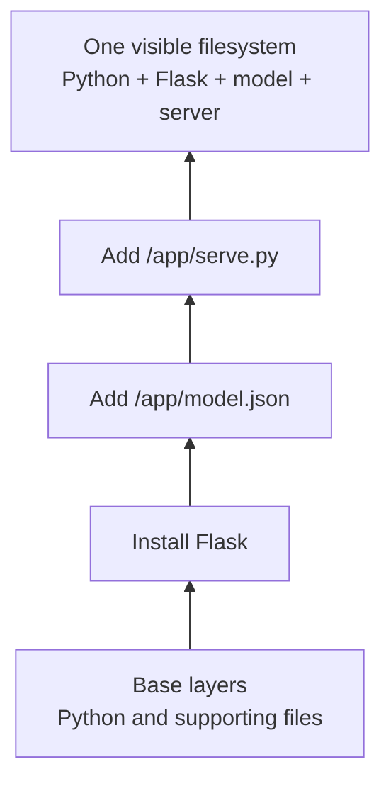
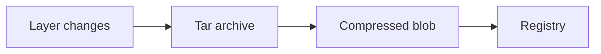
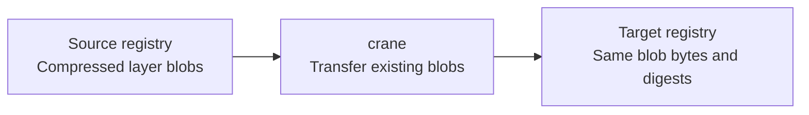

# Docker


## 1. Primer

Suppose we have a small model that predicts `y = weight * x + bias`. We want to
package its code and parameters, send them to another machine, and serve
predictions there without manually recreating the Python environment.

We will use a toy CPU model with fixed parameters and Flask for the HTTP endpoint.
There is no training step, GPU, or external model download. The example keeps the
packaging visible; a larger inference service follows the same path.


### 1.1. Start with a Dockerfile

Create a folder named `tiny-inference` with three files:

```text
tiny-inference/
├── Dockerfile
├── serve.py
└── model.json
```

The **Dockerfile** tells Docker how to assemble the service:

```dockerfile
# Start with Python and its supporting Linux files.
FROM python:3.13-slim

# Set the working directory for the build and running program.
WORKDIR /app

# Install the HTTP framework before copying application files.
RUN pip install --no-cache-dir "Flask>=3.1,<4"

# Add the model parameters and serving code.
COPY model.json ./model.json
COPY serve.py ./serve.py

# Document the application's port; this does not open a host port.
EXPOSE 8000

# Set the startup command; building the image does not run it.
CMD ["python", "serve.py"]
```

See the [Dockerfile overview](https://docs.docker.com/build/concepts/dockerfile/).

#### 1.1.1. Give it something to serve

In `model.json`, store the model parameters:

```json
{"weight": 2.0, "bias": 1.0}
```

In `serve.py`, load them once and answer prediction requests:

```python
import json
import math
from pathlib import Path
from flask import Flask, request

app = Flask(__name__)
model = json.loads(Path("model.json").read_text())


@app.get("/predict")
def predict():
    x = request.args.get("x", type=float)
    if x is None or not math.isfinite(x):
        return {"error": "Provide a finite numeric x"}, 400
    y = model["weight"] * x + model["bias"]
    if not math.isfinite(y):
        return {"error": "Prediction is outside the supported range"}, 400
    return {"x": x, "prediction": y}


if __name__ == "__main__":
    app.run(host="0.0.0.0", port=8000)
```

For `x=3`, inference computes `2 * 3 + 1 = 7`. Flask handles routing and turns
the returned dictionary into a JSON response. Its built-in server is used here
for the local demonstration. See the [Flask quickstart](https://flask.palletsprojects.com/en/stable/quickstart/).

### 1.2. Build an image: the packaged service

With Docker installed and running, execute this from `tiny-inference/`:

```sh
docker build -t tiny-inference:1.0 .
```

The final `.` supplies the **build context**, the directory whose files the
builder can use. The result is an **image**: an immutable package of filesystem
content and runtime configuration. It contains Python, Flask, `model.json`, and
`serve.py`, plus the instruction to run `python serve.py`.

The Dockerfile describes how to make the package. The image is the package that
was actually built. No inference server is running yet.

#### 1.2.1. Name the image: tag versus digest

In `tiny-inference:1.0`, `tiny-inference` is the repository name and `1.0` is a
**tag**. A tag is a convenient label. Rebuilding with that same name can point
it at a different image; the text `1.0` does not enforce immutability. Likewise,
`latest` is an ordinary tag, not a guarantee of the newest build.

A **digest**, such as `sha256:…`, identifies specific content. When distributing
an image, a reference such as `repository@sha256:…` pins a particular manifest
or image index. Changing that object's bytes changes its digest. The local
image ID identifies the image configuration and is not interchangeable with
that registry reference. We will capture the registry digest after publishing.

See [Docker image references and digest pulls](https://docs.docker.com/reference/cli/docker/image/pull/).

#### 1.2.2. How Docker stores the image: layers

Docker does not need to copy a complete Python installation for every service.
The image reuses the base image's **layers**, then adds our changes. A layer is a
filesystem changeset, not a full filesystem snapshot.



This diagram omits incidental filesystem changes such as creating `/app`.
The actual number of layers depends on the base and build. Configuration
instructions such as `CMD` do not need a filesystem layer.

An image **manifest** lists the layers in order and references a configuration
object holding defaults such as the command and working directory. Applying
the layers in order produces the files the program sees. See
[Docker image layers](https://docs.docker.com/get-started/docker-concepts/building-images/understanding-image-layers/)
and the [OCI manifest format](https://github.com/opencontainers/image-spec/blob/main/manifest.md).

### 1.3. Publish the image to a registry

The image currently exists on our development machine. To let another machine
retrieve it, publish it to a **registry**, a service that stores images. Docker
Hub and Amazon ECR are examples. A **repository** groups named image versions
inside that registry.

For Docker Hub, replace `YOUR_DOCKERHUB_USER` below with your account name and
create a `tiny-inference` repository in that account with your intended visibility:

```sh
docker login
docker tag tiny-inference:1.0 YOUR_DOCKERHUB_USER/tiny-inference:1.0
docker push YOUR_DOCKERHUB_USER/tiny-inference:1.0
```

`docker tag` gives the existing local image another reference; it does not
rebuild or duplicate its contents. `docker push` uploads the content needed by
the registry and associates the tag with it. These are walkthrough commands;
adding this note does not publish an image.

After the push, inspect the remote reference:

```sh
docker buildx imagetools inspect YOUR_DOCKERHUB_USER/tiny-inference:1.0
```

Record its reported digest to deploy exactly that published version later.
See [pushing images](https://docs.docker.com/reference/cli/docker/image/push/)
and [inspecting registry images](https://docs.docker.com/reference/cli/docker/buildx/imagetools/inspect/).

#### 1.3.1. What gets uploaded, and where compression fits

Layers are represented as tar archives of filesystem changes. They are commonly
compressed individually before distribution. OCI supports uncompressed tar,
gzip, and zstd layer formats; support for particular encodings depends on the
tools involved. The registry stores these layer **blobs** along with image
metadata. See [OCI layer media types](https://github.com/opencontainers/image-spec/blob/main/media-types.md).



Our JSON model is tiny. Imagine instead that its layer were 300 MB uncompressed
and 90 MB compressed. Sending that missing blob would transfer roughly 90 MB,
plus protocol overhead. These numbers are illustrative: model weights and
already-compressed files may compress much less effectively than repetitive text.

Compression preserves the recovered files; it does not remove unwanted files
or shrink the model's runtime memory requirements. Docker push progress can
show uncompressed sizes even though the transferred data is compressed.
Existing blobs can be reused, so a push need not upload the entire image again.
See [Docker push behavior](https://docs.docker.com/reference/cli/docker/image/push/).

### 1.4. Pull it on the serving machine

On another Docker host, retrieve the package:

```sh
docker pull YOUR_DOCKERHUB_USER/tiny-inference:1.0
```

Authenticate there too if the repository is private. Docker retrieves the
metadata and missing layers, then prepares the filesystem for execution.
For a pinned deployment, replace the placeholder below with the full digest
recorded after publishing:

```text
docker pull YOUR_DOCKERHUB_USER/tiny-inference@sha256:FULL_DIGEST
```

A pull by tag resolves whatever that tag points to at that time; a digest
reference selects the recorded content. See [pulling images](https://docs.docker.com/reference/cli/docker/image/pull/).

#### 1.4.1. The serving machine must support the image's platform

For the simplest walkthrough, use the same CPU architecture on both machines.
An image built for an ARM laptop is not automatically a native AMD64 image.
A multi-platform image index can point to separate platform-specific manifests,
letting Docker select the appropriate one. Building for other architectures may
require emulation or suitable builders. See [Docker multi-platform builds](https://docs.docker.com/build/building/multi-platform/).

### 1.5. Run a container and request a prediction

On the serving machine:

```sh
docker run --rm --name tiny-inference \
  -p 127.0.0.1:8000:8000 \
  YOUR_DOCKERHUB_USER/tiny-inference:1.0
```

Docker creates a **container**, an instance of the image, and starts the recorded
command. Python loads `model.json` and listens on port 8000 inside the container.
For a pinned deployment, use the same `repository@sha256:FULL_DIGEST` reference
here as in the pull command.

The `-p` mapping connects port 8000 on the host's loopback address to port 8000
in the container. The application listens on `0.0.0.0` inside the container so
traffic reaching its network interface can reach the server. `EXPOSE` alone
would not create this mapping. See [Docker run](https://docs.docker.com/reference/cli/docker/container/run/).

In another terminal **on that serving machine**:

```sh
curl 'http://127.0.0.1:8000/predict?x=3'
```

Expected response:

```json
{"x": 3.0, "prediction": 7.0}
```

The image supplies the files and defaults; the running container executes the
inference. Two containers can use the same immutable image layers while running
separate processes. The loopback mapping makes this a local demonstration;
serving remote clients requires an appropriate host binding and network setup.

#### 1.5.1. What if the server writes a file?

Each container has its own writable layer above the image. A new output file
goes there unless its destination is mounted elsewhere. With an overlay-style
backend, changing an image file copies it into the writable layer before
modification: **copy-on-write**. The original image remains unchanged.

A stopped container normally retains this layer, but our `--rm` option removes
the container when it exits. For persistent prediction results, use a **volume**
whose lifetime is independent of the container, or a **bind mount** exposing a
host directory. See [Docker storage](https://docs.docker.com/engine/storage/).

### 1.6. Change the model and publish version 1.1

Change `weight` in `model.json` from `2.0` to `3.0`, then build and publish a new
version:

```sh
docker build -t YOUR_DOCKERHUB_USER/tiny-inference:1.1 .
docker push YOUR_DOCKERHUB_USER/tiny-inference:1.1
```

The rebuilt service predicts `10` for `x=3`. Updating a tag or publishing version
1.1 does not change an already-running container. Pull the new version and
replace the running container to serve the new model.

During rebuilding, the **build cache** lets Docker reuse work whose instruction
and inputs are unchanged. Our Python base can be reused; the changed model
invalidates its `COPY` step and following steps in that build sequence. The
registry may still reuse blobs whose content is unchanged.

For a larger inference service, install stable dependencies before copying
frequently edited code. Use `.dockerignore` to exclude local caches and unused
checkpoints from the build context. Cache reuse makes builds faster; it does
not by itself make the final image smaller. See [Docker cache optimization](https://docs.docker.com/build/cache/optimize/).

## 2. When the real model is large

### 2.1. Deleting an earlier layer's file does not remove its bytes

Suppose we package a model archive this way:

```dockerfile
COPY model.tar /tmp/model.tar
RUN mkdir /models && tar -xf /tmp/model.tar -C /models
RUN rm /tmp/model.tar
```

The archive remains in the `COPY` layer, even though it is absent from the final
visible filesystem. Later layers hide earlier files; they do not rewrite them.
Deletion uses special entries called **whiteouts**. Replacing a file generally
stores the replacement, not a byte-level patch. See the [OCI layer specification](https://github.com/opencontainers/image-spec/blob/main/layer.md).

A **multi-stage build** can keep the archive out of the final image:

```dockerfile
FROM python:3.13-slim AS unpack
COPY model.tar /tmp/model.tar
RUN mkdir /out && tar -xf /tmp/model.tar -C /out

FROM python:3.13-slim
WORKDIR /app
RUN pip install --no-cache-dir "Flask>=3.1,<4"
COPY --from=unpack /out/model.json ./model.json
COPY serve.py ./serve.py
EXPOSE 8000
CMD ["python", "serve.py"]
```

Assume this example archive contains `model.json` at its root. The final stage
copies only the extracted model, rather than inheriting the unpack stage's
archive layer. The intermediate stage may still occupy builder cache space.
See [multi-stage builds](https://docs.docker.com/build/building/multi-stage/).

### 2.2. Registry size, local disk use, and RAM measure different things

| Question | What to count |
|---|---|
| How much must a fresh machine download? | Missing encoded blobs, often compressed, plus metadata and overhead |
| How much filesystem data is unpacked? | Expanded layer contents, including content hidden by later layers |
| How much disk space does Docker consume? | Shared blobs, filesystem snapshots, container writes, caches, and overhead |
| How much memory does inference require? | Loaded model, runtime, and working data; measure the running service |

The containerd image store retains compressed blobs and unpacked data. Images
can also share layers, so summing individual image sizes can double-count data.
See [containerd disk usage](https://docs.docker.com/engine/storage/containerd/#disk-space-usage).

Use these commands to investigate an actual image or host:

```sh
docker image history --no-trunc tiny-inference:1.0
docker image inspect tiny-inference:1.0
docker system df -v
docker buildx du
```

History helps locate large build contributions; it is not a complete filesystem
audit. `system df` reports Docker storage accounting, while `buildx du` focuses
on builder cache.

### 2.3. Transporting large images

Suppose our inference image now includes large model weights and already lives
in one registry. We want the same image in another registry, without changing
its contents. Use `crane copy` to transfer the published image:

```sh
# Install crane and authenticate to both registries before copying.
# Replace these example references with your actual image locations.
SOURCE_IMAGE='source.example.com/team/inference:1.0'
TARGET_IMAGE='target.example.com/team/inference:1.0'

crane copy "$SOURCE_IMAGE" "$TARGET_IMAGE"

# For an unchanged copy, these should report the same digest.
crane digest "$SOURCE_IMAGE"
crane digest "$TARGET_IMAGE"
```

`crane` works with registry images without requiring a Docker daemon. The copy
preserves the image's digest rather than rebuilding it. By default it copies
the full image index for a multi-platform image; selecting one platform changes
what is copied. See the [crane copy documentation](https://github.com/google/go-containerregistry/blob/main/cmd/crane/doc/crane_copy.md).

**Why can this be faster than pulling, tagging, and pushing with Docker?**
Crane transfers the existing layer blobs in their stored form. For compressed
layers, it can carry the compressed bytes from source to destination without
unpacking them into a local container filesystem or recompressing them. This
avoids CPU work and local disk I/O that a Docker image-store workflow may incur.
See [crane's registry copy implementation](https://github.com/google/go-containerregistry/blob/main/pkg/crane/copy.go).



For example, if a layer is 10 GB unpacked but 4 GB compressed, the copy can
transfer the existing 4 GB blob without materializing the 10 GB filesystem.
These numbers are illustrative. The destination still needs any missing blobs,
and data normally passes through the machine running crane; this is not a
server-side transfer between unrelated registries.

The benefit is avoiding unnecessary processing, not making the network faster.
If the destination's upload bandwidth is the bottleneck, transferring those
4 GB still takes time. Nor does every Docker push recompress: the containerd
image store retains compressed blobs, so the performance difference depends on
the backend and cached content. See [Docker image-store storage behavior](https://docs.docker.com/engine/storage/containerd/#disk-space-usage).

Use this when transporting an existing image unchanged. If the application or
model changes, build a new image first, then copy that published result.

## Related notes

- [AWS networking](../aws/networking.md): When this image lives in ECR, pulling its metadata and downloading its layers require the appropriate ECR and S3 network paths.
