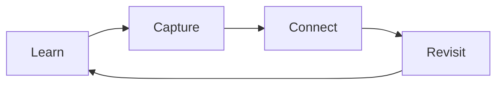
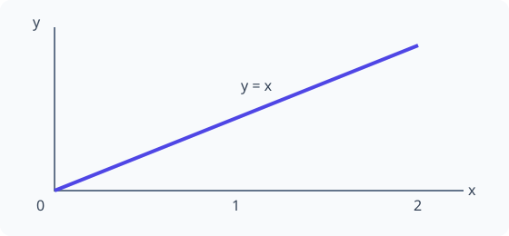

# Writing notes

## Organize by subject

Use paths such as `docs/mathematics/linear-algebra/eigenvectors.md`. Add an
`index.md` within each folder when you want a subject overview. The sidebar follows
the folder hierarchy automatically. Use tags to connect notes across subjects.

## Metadata

Begin each note with YAML front matter. Use `title` and `tags`; `description` is
optional. Prefer consistent lowercase tags, using hyphens between words.
Git history records when content changes, so notes do not need date fields.

```yaml
---
title: Eigenvectors
description: Directions preserved by a linear transformation.
tags:
  - mathematics
  - linear-algebra
---
```

Copy `templates/note.md` from the repository root as a starting point. Templates
are outside `docs/` so they do not appear in the published site or search results.

## Equations

Use `$...$` for inline math, such as $A\mathbf{v} = \lambda\mathbf{v}$.
Use `$$` on separate lines for display equations:

```latex
$$
\int_0^1 x^2\,dx = \frac{1}{3}
$$
```

$$
\int_0^1 x^2\,dx = \frac{1}{3}
$$

## Diagrams

Diagrams use the page's default font and text size. Wide diagrams scroll instead
of scaling the text. Use Source to inspect the Mermaid definition, or Fullscreen
for more room. Press Escape or Exit fullscreen to return to the page. Their colors
follow the selected light or dark appearance.

Use a fenced block with the language `mermaid`:

````markdown

````


## Images and plots

Store images in `docs/assets/images/` or next to the note that uses them. Embed
them with a relative path and meaningful alt text:

```markdown

```


For Python plots, export an SVG or PNG and embed it the same way. For example,
in a separate environment with Matplotlib installed:

```python
from pathlib import Path
import matplotlib.pyplot as plt

output = Path("docs/assets/images/my-plot.svg")
output.parent.mkdir(parents=True, exist_ok=True)
fig, ax = plt.subplots()
ax.plot([0, 1, 2], [0, 1, 2])
fig.savefig(output, bbox_inches="tight")
plt.close(fig)
```

## Link ideas and sources

Use relative Markdown links, such as `[Guides](index.md)`, to connect notes.
Keep references in a Sources section so you can return to the original material.

## Find notes

Use the sidebar for the subject hierarchy, the search box for text, and the
[tag index](../tags.md) for related notes across subjects.

## Preview changes

Run `make dev` and open <http://127.0.0.1:8056>. Saving a Markdown file updates
the page, navigation, and search index automatically. Code blocks include a Copy
button, and the Appearance menu lets you follow the system or choose light or
dark mode.
