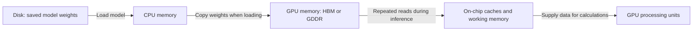

# Understanding NVIDIA GPUs

A GPU runs a workload by storing data, moving that data to its processing units,
and performing calculations. Each step can limit performance. A workload may be
too large for memory, spend most of its time moving data, or demand more arithmetic
than the GPU can execute. When several GPUs cooperate, communication introduces
another limit.

These limits give GPU specifications their meaning:

- **Memory size** describes what fits.
- **Bandwidth** describes how quickly data moves.
- **Compute throughput** describes how quickly calculations run.

Product names become easier to interpret once these relationships are clear.

This tutorial follows a language model running on one GPU, then considers what
changes as it serves more requests or uses several GPUs. NVIDIA's Ampere, Ada
Lovelace, Hopper, and Blackwell families provide concrete examples of different
hardware choices.

## 1. A model needs somewhere to live

Suppose we want to run a language model with **8 billion parameters**. Parameters
are the learned numbers, also called weights, used to calculate its output.
Running an already-trained model is **inference**; changing its weights by learning
from examples is **training**.

At 16 bits, each weight takes 2 bytes. Our example therefore needs approximately:

```text
8 billion weights × 2 bytes = 16 GB for weights alone
```

It also needs working memory and a **KV cache**, which stores attention information
from earlier tokens. A token is a piece of text the model processes. Longer
conversations and more simultaneous requests increase cache memory. NVIDIA explains
these costs in its [LLM inference guide](https://developer.nvidia.com/blog/mastering-llm-techniques-inference-optimization/).

An L40 has 48 GB of GPU memory, so the 16 GB weights fit, with room left for other
allocations. That does not promise every context length or batch size will fit.
This gives us a first feasibility check: the weights must fit alongside the memory
needed to run the model. Capacity determines which configurations are possible
before performance enters the comparison.

## 2. Memory bandwidth: moving weights to processing units

Memory **capacity**, measured in GB, tells us how much fits. Memory **bandwidth**,
measured in GB/s or TB/s, tells us how quickly the GPU can move data between its
memory and processing units.

### 2.1. Loading the model and reading its weights

Consider the 16 GB of weights in our example. Loading the model places those
weights in GPU memory. Performing calculations then requires reading pieces of
those weights into the GPU's processing units, through smaller on-chip memories.
These are different transfers:



The loading path runs when placing the model in GPU memory. The path from GPU
memory to the processing units remains active while the model runs. This diagram
shows the forward movement of weights; intermediate results also produce memory
writes.

| Transfer | Purpose | When it happens |
| --- | --- | --- |
| Storage / CPU memory → GPU memory | Load the model | Usually once, assuming the model remains fully resident |
| GPU memory → on-chip memory and processing units | Supply weights and other data for calculations | Repeatedly during inference |

The GPU's on-chip caches are much smaller than its main memory. For example,
NVIDIA lists a 40 MB L2 cache for A100, compared with up to 80 GB of HBM. Our
16 GB of weights cannot all remain in that cache. Keeping a model loaded in HBM
therefore avoids reloading it from the host, but does not eliminate reads from
HBM during computation. See NVIDIA's
[GPU performance background](https://docs.nvidia.com/deeplearning/performance/pdf/GPU-Performance-Background-User-Guide.pdf).

Two sequential requests therefore reuse the loaded model but still read its weights from GPU memory for their own calculations.

### 2.2. Small inputs can cause large memory traffic

The input token IDs are usually small compared with the weights. The expensive
traffic also includes model weights, the KV cache, and intermediate results.
Memory bandwidth here describes movement within the GPU's memory system, rather
than just sending a prompt to the server.

During **decoding**, the model generates tokens one step at a time. For a dense
model serving one request, a useful approximation is a pass over the weights for
each generated token. This can mean roughly 16 GB of weight reads to produce one
token in our example, before counting other traffic. Actual reads depend on the
model and implementation. NVIDIA explains the difference between processing a
prompt and decoding in its [LLM inference guide](https://developer.nvidia.com/blog/mastering-llm-techniques-inference-optimization/).

### 2.3. Comparing advertised bandwidth

Our model's weights fit on both L40 and H100. If decoding spends much of its time
waiting for memory, more bandwidth can help even when extra capacity is
unnecessary.

The distinction appears clearly in real hardware. The table below uses specific
configurations and **per-GPU** values. Bandwidth figures are advertised limits,
not measured application throughput. The architecture column identifies the
underlying hardware design; the next section explains its role.

| Model and configuration | Architecture | Memory | Memory bandwidth |
| --- | --- | --- | --- |
| A100 80 GB SXM | Ampere | 80 GB HBM2e | 2.039 TB/s |
| L40 / L40S | Ada Lovelace | 48 GB GDDR6 | 0.864 TB/s |
| H100 SXM | Hopper | 80 GB HBM3 | 3.35 TB/s |
| H200 SXM | Hopper | 141 GB HBM3e | 4.8 TB/s |
| B200 in DGX B200 | Blackwell | 180 GB HBM3e | 8 TB/s |

Sources: [A100](https://www.nvidia.com/en-us/data-center/a100/),
[L40](https://www.nvidia.com/content/dam/en-zz/Solutions/design-visualization/support-guide/NVIDIA-L40-Datasheet-January-2023.pdf),
[L40S](https://www.nvidia.com/en-us/data-center/l40s/),
[H100](https://www.nvidia.com/en-us/data-center/h100/),
[H200](https://www.nvidia.com/en-us/data-center/h200/), and
[DGX B200](https://www.nvidia.com/en-us/data-center/dgx-b200/).
The B200 values divide DGX B200's published 1,440 GB and 64 TB/s across eight GPUs.
Other product variants can have different specifications.

**GDDR6** is graphics-oriented memory; **HBM** means high-bandwidth memory, using
stacked memory close to the GPU. In these products, the HBM-equipped accelerators
provide substantially more bandwidth. Neither memory type alone predicts the
speed of an entire application.

For example, H100 SXM has about 3.9 times L40's advertised memory bandwidth.
That is a bandwidth ratio, not a claim that every workload runs 3.9 times faster.

## 3. An architecture determines how the work gets done

Memory supplies the numbers, but processing hardware must perform calculations
on them. A GPU's **architecture** is its underlying hardware design, including
the operations it accelerates and how its components exchange data. A **model**
is a particular product built using that design. H100 and H200, for example, are
different models based on the Hopper architecture.

Three kinds of processing hardware explain why GPUs with similar memory capacity
can suit different work:

- **CUDA cores** execute general GPU arithmetic.
- **Tensor Cores** accelerate matrix operations, central to neural networks.
- **RT cores** accelerate ray tracing, used to render lighting and geometry.

NVIDIA describes these roles on its [L40S architecture overview](https://www.nvidia.com/en-us/data-center/l40s/).

For the language model, Tensor Cores are particularly relevant because much of
its arithmetic consists of matrix operations. A rendering application also needs
hardware suited to tracing rays and shading scenes. An architecture's priorities
therefore matter alongside its generation.

### 3.1. Ampere: a starting point for the comparison

**A100 uses Ampere**, an earlier data-center generation. It supports Tensor Core
formats such as BF16 and FP16, HBM, and NVLink. BF16 and FP16 both use 16 bits but
allocate those bits differently between range and precision. Either format gives
the example model the same 16 GB raw weight size.
See [NVIDIA's A100 specifications](https://www.nvidia.com/en-us/data-center/a100/).

The later architectures illustrate several ways to extend this foundation:
specialize for a mix of workloads, increase memory performance, or accelerate
arithmetic using fewer bits.

### 3.2. Ada Lovelace: graphics and AI together

**Ada Lovelace**, often shortened to **Ada**, powers L40 and L40S. These GPUs
combine Tensor Cores, RT cores, and video hardware. They can render
3D scenes and run neural networks. Both have 48 GB of memory, but **L40S is a
separate model with substantially higher advertised Tensor Core throughput**;
the “S” does not mean more memory or a new architecture. Compare the
[L40 datasheet](https://www.nvidia.com/content/dam/en-zz/Solutions/design-visualization/support-guide/NVIDIA-L40-Datasheet-January-2023.pdf)
and [L40S specifications](https://www.nvidia.com/en-us/data-center/l40s/).

### 3.3. Hopper: compute and communication at scale

H100 emphasizes AI and scientific computing. It combines HBM, fast NVLink GPU
connections, and a **Transformer Engine**, which helps supported software use
lower-precision matrix math. Hopper supports FP8, an 8-bit floating-point format.
[NVIDIA's H100 overview](https://www.nvidia.com/en-us/data-center/h100/)
describes these features.

**H200 is still Hopper.** Its major difference from H100 is larger, faster memory.
More capacity can hold bigger models or more requests; more bandwidth can feed
computation faster. A higher model number does not necessarily mean a new
architecture. See [NVIDIA's H200 overview](https://www.nvidia.com/en-us/data-center/h200/).

### 3.4. Blackwell: more capacity and newer AI math

B200 moves to Blackwell. It combines two silicon dies into one logical GPU and
adds a second-generation Transformer Engine, FP4 capabilities, and fifth-generation
NVLink. FP4 uses a 4-bit floating-point representation; supported low-precision
workloads can reduce data movement and increase math throughput.
See [NVIDIA's Blackwell architecture overview](https://www.nvidia.com/en-us/data-center/technologies/blackwell-architecture/).

For our example, storing every weight in 4 bits would have a raw payload of
4 GB instead of 16 GB. Real formats add metadata, and some tensors may remain at
higher precision. Converting to fewer bits is **quantization**: software support
and acceptable model accuracy determine whether it is useful. Having FP4 hardware
does not automatically convert an existing model or speed up every operation.

Ada and Hopper are separate design branches with different priorities. Treating
all these names as one performance ladder loses that distinction.

## 4. Several GPUs introduce communication

Suppose our model serves more users. We could run an independent copy on each GPU.
Alternatively, we could split a larger workload across GPUs, making communication
between them part of each request.

**NVLink** is NVIDIA's fast GPU interconnect; **NVSwitch** connects groups of GPUs
through a switching fabric. H100 and B200 systems use these technologies to move
data between cooperating GPUs. L40S has no NVLink, so its multi-GPU communication
depends on other system paths such as PCIe. See the
[H100](https://www.nvidia.com/en-us/data-center/h100/),
[DGX B200](https://www.nvidia.com/en-us/data-center/dgx-b200/), and
[L40S](https://www.nvidia.com/en-us/data-center/l40s/) specifications.

Two 48 GB GPUs do not automatically become one ordinary 96 GB GPU. Software must
distribute the work and data. This is why connections matter much more for a model
split across GPUs than for independent model copies. NVIDIA's
[model-parallelism explanation](https://developer.nvidia.com/blog/mastering-llm-techniques-inference-optimization/)
describes ways to perform that split.

## 5. From a GPU to a complete system

Once memory, computation, and communication are clear, a hardware listing can be
read at several levels. “Hopper” identifies a design family. “H100” identifies a
product. “H100 SXM” specifies a module variant. A server name describes a larger
assembly containing GPUs and other components.

These levels matter because a published memory or performance figure may describe
one GPU or an entire machine. The following terms identify what is being measured.

| Name or suffix | What it tells you |
| --- | --- |
| A100, H100, B200 | Here, A, H, and B correspond to Ampere, Hopper, and Blackwell. The numbers are product identifiers, not memory sizes or performance ratios. |
| L40 versus L40S | Distinct Ada products. Check the full name. |
| PCIe | A card using the server's PCI Express expansion interface. |
| SXM | A GPU module for a purpose-built server baseboard. Check its specifications separately from a PCIe variant. |
| H100 NVL | A distinct H100 offering; NVIDIA lists 94 GB per GPU, versus 80 GB for H100 SXM. |
| GB200 | Grace Blackwell Superchip: one Grace CPU plus two Blackwell GPUs. It is not another spelling of one B200 GPU. |
| DGX B200 | A complete NVIDIA server containing eight B200 GPUs, CPUs, networking, and other components. |

Sources: [H100 variants](https://www.nvidia.com/en-us/data-center/h100/),
[Grace Blackwell system overview](https://docs.nvidia.com/multi-node-nvlink-systems/multi-node-tuning-guide/overview.html),
and [DGX B200 system specifications](https://www.nvidia.com/en-us/data-center/dgx-b200/).
Always distinguish per-GPU specifications from totals for a pair, server, or rack.

## 6. Reading a specification through the workload

Return to the 8-billion-parameter model. At 16 bits, its weights occupy about
16 GB. That number helps check capacity, but it cannot predict latency or the
number of users a server can support. Those depend on how the workload uses the
rest of the hardware.

A practical comparison follows the work through the system:

1. **Capacity:** can weights, cache, and working memory fit at the desired concurrency?
2. **Bandwidth:** is token generation waiting on memory traffic?
3. **Compute:** which numerical formats can the actual software use efficiently?
4. **Communication:** does one request require several GPUs to cooperate?
5. **Measured cost:** what does the workload cost at the required latency and throughput?

L40/L40S stand out when graphics or video accompanies AI. H100/H200 bring HBM and
connections suited to cooperating GPUs; H200 particularly expands memory headroom.
B200 adds another jump in memory and low-precision AI capability. These are
workload-fit conclusions from the specifications above, not universal rankings.

When comparing **TFLOPS** (trillions of floating-point operations per second), match
the numerical format, Tensor Core versus ordinary arithmetic, and **dense versus
sparse** operation. Sparse peak figures assume a supported pattern of zero values.
An FP4 sparse figure and a BF16 dense figure do not measure the same work. NVIDIA's
[A100 specifications](https://www.nvidia.com/en-us/data-center/a100/) explicitly
separate ordinary and sparsity-assisted rates.

Training adds gradients, intermediate results, and optimizer state, so the 16 GB
weight calculation is not a training memory estimate. Full training and adapter
tuning also have different requirements; see NVIDIA's
[model customization guide](https://developer.nvidia.com/blog/selecting-large-language-model-customization-techniques).

## Reference: models and architectures

| Architecture | Example models | Distinction to remember |
| --- | --- | --- |
| Ampere | A100 | An earlier AI and scientific-computing accelerator with HBM and NVLink |
| Ada Lovelace | L40, L40S | Graphics, video, and AI capabilities in the same product family |
| Hopper | H100, H200 | Compute-focused accelerators; H200 expands memory capacity and bandwidth within the same architecture |
| Blackwell | B200 | Newer low-precision AI math and faster GPU connections, alongside more memory |

The examples cover selected NVIDIA families rather than the full product lineup.
Specifications were checked against the linked NVIDIA sources on October 26, 2026.
When revisiting a comparison, use the exact product variant and system
configuration: the architecture name alone does not specify either.
