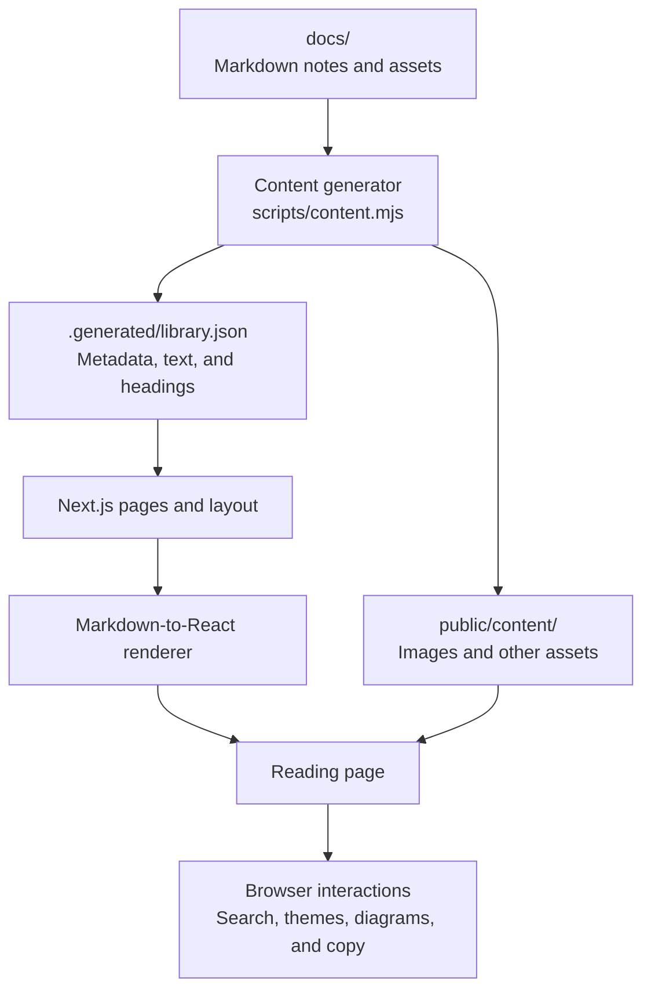
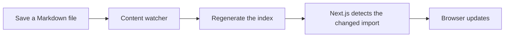

# Akashic

A place to collect, connect, and revisit what I learn.

Browse topics in the sidebar, search for a concept, or explore the [tag index](tags.md).

## Start writing

Add Markdown notes under `docs/`, grouping related subjects into folders. Each
folder can have an `index.md` introducing the subject. New notes appear in the
sidebar automatically.

The [writing guide](guides/writing-notes.md) demonstrates metadata, equations,
diagrams, images, and links. A reusable note template lives in `templates/note.md`
at the repository root.

## Architecture

Akashic has three main layers: **Markdown content, a generated content index,
and a Next.js application**. Notes stay in portable text files, while the app
controls their layout, rendering, and interactions. Git records their history.



### Content and metadata

The `docs/` directory is the source of truth. Each note can have YAML front matter
for its title, tags, and optional description. Directories provide the subject
hierarchy; tags connect ideas across subjects.

| Source file | Page URL | Role |
|---|---|---|
| `docs/index.md` | `/` | This overview |
| `docs/aws/networking.md` | `/aws/networking` | A knowledge note |
| `docs/guides/index.md` | `/guides` | A subject overview |
| `docs/tags.md` | `/tags` | Introduction to the generated tag index |

The app keeps existing relative Markdown links usable. For example, a link from
this page to `guides/writing-notes.md` becomes `/guides/writing-notes`. Images may
live beside their notes or in `docs/assets/`.

### Preparing the content

`scripts/content.mjs` scans the Markdown files and prepares data for the app. It:

1. Parses and validates front matter.
2. Assigns a URL to each note and checks for conflicting routes.
3. Extracts headings and anchor IDs for the table of contents.
4. Extracts plain text for search.
5. Copies supported assets into `public/content/`.
6. Writes the note collection to `.generated/library.json`.

`lib/content.ts` imports that generated index and exposes the notes, navigation
entries, search data, and unique tags. Both `.generated/` and `public/content/`
are disposable outputs excluded from Git. Edit the source files in `docs/`;
the next generation step recreates the outputs.

### Pages and shared layout

`app/layout.tsx` defines the shared header, sidebar, appearance controls, and
footer. `app/[[...slug]]/page.tsx` handles note paths of any depth: it finds the
matching note and assembles its tags, content, and table of contents.

The same page component adds the collection cards on this overview and the
grouped listings on the tag index. `/search` has its own route, which reads the
query and selected tag from the URL.

Known note pages are prerendered during a production build. The search route
prepares its initial state on the server, then passes searchable note data to
the browser for interactive filtering.

### Markdown rendering

`components/markdown.tsx` owns the rendering pipeline. `react-markdown` parses
the Markdown, plugins add syntax support, and our React components determine
how the resulting elements appear and behave.

| Content | How it renders |
|---|---|
| Headings, paragraphs, and lists | Standard HTML elements styled by the app |
| Tables, task lists, and footnotes | GitHub-flavored Markdown support |
| Tables | A scrollable container for narrower screens |
| LaTeX equations | KaTeX, with bundled fonts |
| Code blocks | Syntax highlighting and a Copy button |
| Mermaid blocks | Default-size text, with source and fullscreen controls |
| Relative Markdown links | Links to the corresponding app routes |
| Images | Locally served assets with alt text |

This gives us control over rendering without maintaining a Markdown parser.
Raw HTML and executable MDX are currently disabled. New interactions can be
implemented as React components and connected to the renderer, following the
same approach as Mermaid blocks. Math and diagram dependencies are bundled
locally rather than fetched from a CDN.

### Server and browser responsibilities

Most page content renders on the server. Components that need user input,
browser APIs, or local state run in the browser:

| Component | Responsibility |
|---|---|
| `components/navigation.tsx` | Active links, nested navigation, and the mobile menu |
| `components/search.tsx` | Text matching, result lists, and tag filtering |
| `components/theme.tsx` | System appearance and saved light/dark preferences |
| `components/code-block.tsx` | Copying code to the clipboard |
| `components/mermaid.tsx` | Rendering diagrams, fullscreen viewing, and inspecting their source |

Search currently filters the library's searchable text in the browser. It
matches query words against titles, tags, and note text, and can restrict results
to a selected tag. This keeps the setup small for a personal library. A much
larger collection could use a dedicated search index or server endpoint later.

## Development and hot reload

With Node.js 22 or newer installed, run:

```sh
make env
make dev
```

`make env` installs the locked dependencies with `npm ci`. `make dev` starts
`scripts/dev.mjs`, which generates the content index, watches `docs/`, and starts
Next.js at <http://127.0.0.1:8056>.



Adding, editing, or deleting notes updates the content, navigation, and search
data. App code also uses Next.js development refresh. Stop the server with
Ctrl+C to release port 8056.

For validation and a production server:

```sh
make check
make build
npm start
```

`make check` runs content-pipeline tests and TypeScript checks. `make build`
regenerates content and creates the production app in `.next/`. `npm start`
serves that build on port 8056. Production content is a build-time snapshot;
rebuild after changing notes.

## Where to extend the app

| Change | Main file or directory |
|---|---|
| Add knowledge | `docs/` |
| Adjust the reusable note structure | `templates/note.md` |
| Change typography, spacing, or colors | `app/globals.css` |
| Change the shared application layout | `app/layout.tsx` |
| Change tag placement or the table of contents | `app/[[...slug]]/page.tsx` |
| Customize Markdown elements | `components/markdown.tsx` |
| Add an interactive widget | `components/`, then connect it to the renderer |
| Add metadata processing or indexing behavior | `scripts/content.mjs` |
| Change relative-link resolution | `lib/paths.mjs` |

The current app has no database, editing API, or browser-based note editor.
Markdown files provide storage, Git provides history, and Next.js provides the
reading and interaction layer.
