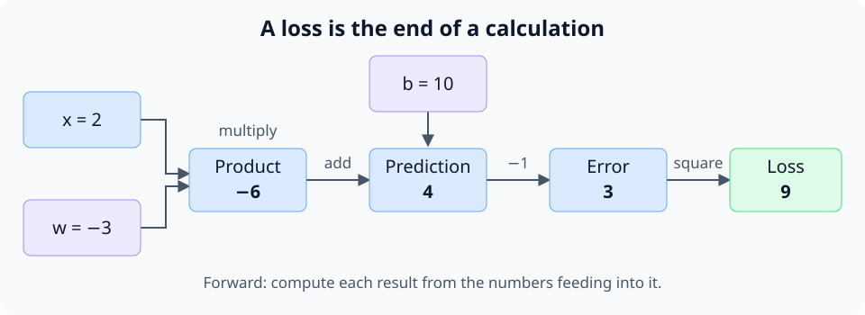
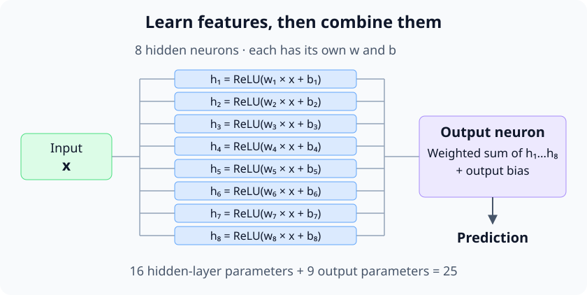

# micrograd — understand how a neural network learns

## ✅ 1. Start with one adjustable prediction

### ✅ 1.1. What training needs to solve

A neural network makes predictions using adjustable numbers. Training means
measuring its mistakes and changing those numbers to make the mistakes smaller.
The missing connection is: **how does a mistake at the output tell each number
inside the model how to change?**

Karpathy's [micrograd lecture](https://github.com/karpathy/nn-zero-to-hero/tree/master/lectures/micrograd)
builds that connection from ordinary arithmetic. This guide follows the same
progression with a small example you can calculate by hand, then expands it into
a network you can train. Basic Python is enough to start; we will introduce the
calculus as it becomes useful.

### ✅ 1.2. Define the prediction and loss

Suppose the input is `x = 2` and the desired answer, called the **target**, is `1`.
Our first model is:

```python
prediction = w * x + b
```

The **weight** `w` scales the input; the **bias** `b` adds an offset. Together they
are the model's **parameters**: the numbers training can change. Start with
`w = -3` and `b = 10`, so the prediction is `-3 × 2 + 10 = 4`.

We need one number that measures how wrong this answer is. Use the squared error,
called the **loss**:

```python
loss = (prediction - target) ** 2
```

Our loss is `(4 - 1)² = 9`. A perfect answer would give a loss of zero. Squaring
makes errors in either direction positive, and makes larger errors more costly.
The task is now concrete: adjust `w` and `b` to reduce this number.

### ✅ 1.3. Set up the experiment

Create a temporary workspace with [uv](https://docs.astral.sh/uv/getting-started/installation/):

```sh
mkdir -p /tmp/micrograd-lab
cd /tmp/micrograd-lab
uv venv --python 3.11
source .venv/bin/activate
uv pip install micrograd==0.1.0
```

[micrograd](https://github.com/karpathy/micrograd) works with individual numbers,
so you can inspect every operation. We will use its published implementation
while explaining the machinery the lecture builds from scratch.

## ✅ 2. Which way should a weight move?

### ✅ 2.1. Estimate the effect of a small change

Try increasing `w` slightly, from `-3` to `-2.999`. The prediction rises from `4`
to `4.002`, and the loss rises from `9` to `9.012004`. Increasing this weight
makes our current mistake worse, so we should move it in the other direction.

The **derivative** measures this local sensitivity: approximately how much the
loss changes per unit change in a parameter, for a very small change. We can
estimate it by taking a tiny step and dividing the loss change by the step size:

```python
def loss_at(w):
    return (w * 2.0 + 10.0 - 1.0) ** 2

h = 0.001
print(f"{(loss_at(-3.0 + h) - loss_at(-3.0)) / h:.3f}")
```

```text
12.004
```

The exact derivative here is `12`. Locally, a small increase of `0.001` in `w`
raises the loss by about `12 × 0.001`. This estimate is called a **finite
difference**. It is useful for checking derivatives, but repeating the calculation
separately for every parameter would require many forward calculations.

### ✅ 2.2. Follow the effect through the calculation

Break the prediction and loss into small operations. The resulting **computation
graph** records which numbers were used to produce each result. Computing those
results from inputs to loss is the **forward pass**.



To find how `w` affects the loss, work backward through those operations:

| Connection | Local sensitivity at our current values |
| --- | --- |
| Error → loss: `loss = error²` | `2 × error = 6` |
| Prediction → error: `error = prediction - 1` | `1` |
| Product → prediction: `prediction = product + b` | `1` |
| Weight → product: `product = w × x` | `x = 2` |

Multiply the sensitivities along the path: `6 × 1 × 1 × 2 = 12`. This is the
**chain rule**: a small change propagates through each connected operation, so
their effects multiply. For the bias, the path is shorter: `6 × 1 × 1 = 6`.

The derivatives with respect to all parameters together form the **gradient**.
Here that gradient is `(12, 6)` for `(w, b)`. A positive derivative says increasing
that parameter would locally increase the loss; a negative derivative says the
opposite. It describes the current calculation, so it must be recomputed after
the parameters change.

## 3. Make arithmetic remember how to go backward

### ⏳ 3.1. Follow the full backward pass

#### ⏳ 3.1.1. Apply the chain rule

If a value $a$ affects the loss $L$ through an intermediate value $z$, the chain
rule gives:

$$
\frac{\partial L}{\partial a}
= \frac{\partial L}{\partial z}\frac{\partial z}{\partial a}
$$

The first factor tells us how sensitive the loss is to $z$. The second tells us
how sensitive $z$ is to $a$. Multiplying them gives the loss's sensitivity to $a$
through this connection. A backward rule receives the first factor from the next
operation and multiplies it by its own local derivative.

#### 3.1.2. Work backward through every operation

Write our forward calculation as four connected operations. Here $p$ is the
product, $y$ is the prediction, $e$ is the error, and $t$ is the fixed target:

$$
p = wx, \qquad y = p + b, \qquad e = y - t, \qquad L = e^2
$$

The full chain from the weight to the loss is:

$$
\frac{\partial L}{\partial w}
= \frac{\partial L}{\partial e}
  \frac{\partial e}{\partial y}
  \frac{\partial y}{\partial p}
  \frac{\partial p}{\partial w}
= (2e)\cdot 1\cdot 1\cdot x
$$

Work backward through the forward calculation: start at the loss, then visit the
error, prediction, product, and its inputs. In the code, `.data` stores a forward
value and `.grad` stores the derivative of the final loss with respect to that
value. Starting with all gradients at zero, the manual backward pass is:

```python
# 1. Seed the loss: its derivative with respect to itself is 1.
loss.grad = 1.0

# 2. loss = error ** 2: the local derivative is 2 * error.
error.grad += 2 * error.data * loss.grad

# 3. error = prediction - target: the derivative with respect to prediction is 1.
prediction.grad += error.grad

# 4. prediction = product + b: both local derivatives are 1.
product.grad += prediction.grad
b.grad += prediction.grad

# 5. product = w * x: the local derivatives are x and w.
w.grad += x.data * product.grad
x.grad += w.data * product.grad
```

This explains where `product.grad` comes from: the square passes sensitivity to
the error, and subtraction and addition pass it on to the product. Multiplication
then passes it to `w` and `x`. The bias receives its contribution at the addition.
The target stays fixed, so we do not track a gradient for it here.

Each of `w`, `x`, and `b` has one path to the loss in this example. Their gradients
therefore each receive one contribution. The `*` applies the chain rule; `+=`
collects contributions so the same rules also work when a value has multiple paths.

#### 3.1.3. Let micrograd carry out these steps

A normal Python float stores a number. micrograd's `Value` also stores connections
to its input nodes and a backward function for the operation that produced it.
Calling `loss.backward()` seeds the loss gradient and runs those functions in
reverse order, after all operations using a node have contributed to its gradient.
It performs the steps above automatically; see the
[engine implementation](https://github.com/karpathy/micrograd/blob/master/micrograd/engine.py).

Passing sensitivities backward through the graph is **backpropagation**.
Recording the operations and applying their derivative rules automatically is
**automatic differentiation**, or **autograd**.

### 3.2. Why the gradients add

A parameter can affect the loss through several paths. For `a + a`, increasing
`a` increases both inputs to the addition, so its derivative is `1 + 1 = 2`.
The backward rules use `+=` to collect every contribution. This becomes essential
when the same weight is used to predict several training examples.

Backpropagation computes gradients. It does not change the parameters; that is
the next step.

## 4. Take one learning step

### 4.1. Use the gradient to update parameters

Move each parameter a little in the direction that reduces the loss:

```python
parameter.data -= learning_rate * parameter.grad
```

This update rule is **gradient descent**. The **learning rate** controls the size
of the step. With a rate of `0.01`, our weight moves from `-3` to `-3.12`, and the
bias moves from `10` to `9.94`. The input and target stay fixed: they define the
example we want the model to learn.

### 4.2. Run one complete learning step

Save this as `one_step.py` in your experiment folder:

```python
from micrograd.engine import Value

x = Value(2.0)
w = Value(-3.0)
b = Value(10.0)
target = 1.0

prediction = w * x + b
loss = (prediction - target) ** 2
loss.backward()
print(f"prediction: {prediction.data:.2f}; loss: {loss.data:.2f}")
print(f"gradients: w={w.grad:.2f}, b={b.grad:.2f}, x={x.grad:.2f}")

learning_rate = 0.01
for parameter in (w, b):
    parameter.data -= learning_rate * parameter.grad

new_prediction = w * x + b
new_loss = (new_prediction - target) ** 2
print(f"updated: w={w.data:.2f}, b={b.data:.2f}")
print(f"prediction: {new_prediction.data:.2f}; loss: {new_loss.data:.2f}")
```

Run `python one_step.py`:

```text
prediction: 4.00; loss: 9.00
gradients: w=12.00, b=6.00, x=-18.00
updated: w=-3.12, b=9.94
prediction: 3.70; loss: 7.29
```

The prediction moved toward `1`, and the loss fell. Although the graph also
computed a gradient for `x`, our update changed only `w` and `b`. We decide which
numbers are trainable parameters.

This is one complete learning step: **predict, measure the loss, compute
gradients, update parameters**. Repeating it requires a fresh forward calculation
with the updated values. A derivative is local guidance; an excessively large
learning rate can overshoot and increase the loss.

## 5. Give the model a pattern a line cannot fit

### 5.1. Add examples that require a bend

One input-target pair leaves many possible models. Add more examples, keeping
our original `x = 2 → target = 1`:

| Input `x` | Target |
| --- | --- |
| -2 | 1 |
| -1 | 0 |
| 0 | -1 |
| 1 | 0 |
| 2 | 1 |

These points form a V: `target = abs(x) - 1`. A model of the form `w * x + b`
always draws a straight line, so changing its two parameters cannot fit this
pattern. We need a model that can bend.

### 5.2. Add neurons and a hidden layer

A **neuron** combines inputs with weights and a bias, then can apply an
**activation function**. In this lab, that function is **ReLU**:
`ReLU(z) = max(0, z)`. It introduces a bend by setting negative values to zero
and leaving positive values unchanged.

Give eight neurons the same input, each with its own weight and bias. Their eight
outputs form a **hidden layer**: intermediate features used to make the final
prediction. An output neuron takes a weighted sum of those features and adds its
own bias. Combining the bends lets the model represent our V-shaped pattern.



This is a **multilayer perceptron**, or **MLP**. Without a nonlinear activation,
stacking these weighted sums would still produce a straight-line function of
`x`; more layers alone would not solve our problem.

The published [micrograd neural-network code](https://github.com/karpathy/micrograd/blob/master/micrograd/nn.py)
constructs this model as `MLP(1, [8, 1])`: one input, eight hidden neurons, one
output neuron. There are `8 × (1 weight + 1 bias) + (8 weights + 1 bias) = 25`
parameters. The output has no ReLU, so it can predict negative targets too.
The lecture notebooks build with `tanh`, a different nonlinear activation;
this runnable lab uses the package's ReLU implementation.

### 5.3. Train the network

We now average the squared errors across all five examples. Each example uses
the same model parameters, so backpropagation adds their contributions to each
parameter's gradient. One update can then improve the model across the examples.

Save this as `train_mlp.py`:

```python
import random
from micrograd.nn import MLP

random.seed(42)  # Reproduce the initial random weights.
model = MLP(1, [8, 1])
examples = [
    ([-2.0], 1.0),
    ([-1.0], 0.0),
    ([0.0], -1.0),
    ([1.0], 0.0),
    ([2.0], 1.0),
]

print("parameters:", len(model.parameters()))
for step in range(501):
    # Fresh forward pass: one scalar prediction per example.
    predictions = [model(x) for x, target in examples]
    loss = sum(
        (prediction - target) ** 2
        for prediction, (_, target) in zip(predictions, examples)
    ) / len(examples)

    if step in (0, 100, 500):
        print(f"step {step:3d}: loss = {loss.data:.6f}")
    if step == 500:
        break  # Report the result after 500 updates.

    model.zero_grad()  # Discard gradients from the previous step.
    loss.backward()   # Compute gradients for the current loss.
    for p in model.parameters():
        p.data -= 0.05 * p.grad

for x, target in examples:
    print(f"x={x[0]: .1f} target={target: .1f} prediction={model(x).data: .3f}")
```

Run `python train_mlp.py`:

```text
parameters: 25
step   0: loss = 3.185626
step 100: loss = 0.007636
step 500: loss = 0.000004
x=-2.0 target= 1.0 prediction= 0.998
x=-1.0 target= 0.0 prediction= 0.003
x= 0.0 target=-1.0 prediction=-1.001
x= 1.0 target= 0.0 prediction=-0.002
x= 2.0 target= 1.0 prediction= 1.001
```

`zero_grad()` matters because gradients accumulate with `+=`. We want to add
contributions from the five examples in the current step, then start the next
step from zero. The forward pass builds a new graph each time while reusing the
model's parameter objects.

The model has fitted these five examples. That alone does not establish how well
it predicts other inputs. Try `model([0.5]).data`, whose desired answer is `-0.5`,
to inspect an input between training points. Training reduced the error without
being given the formula `abs(x) - 1`; the code supplied only examples and a loss.

## 6. Read the lecture code with this model in mind

### 6.1. Follow the two notebooks

The lecture's [first notebook](https://github.com/karpathy/nn-zero-to-hero/blob/master/lectures/micrograd/micrograd_lecture_first_half_roughly.ipynb)
develops derivatives, computation graphs, and backward rules. Follow a multiplication
from its forward value to the gradients it sends to its inputs. Then look for why
the graph must be traversed backward and why contributions accumulate.

The [second notebook](https://github.com/karpathy/nn-zero-to-hero/blob/master/lectures/micrograd/micrograd_lecture_second_half_roughly.ipynb)
carries the engine into neurons, layers, and training. The network looks larger,
but its parameters are still numbers connected by arithmetic operations. The
same chain rule reaches every weight through those connections.

### 6.2. Connect micrograd to nanoGPT

In the [nanoGPT guide](nanogpt.md), the model processes text and PyTorch handles
arrays of numbers called tensors. Its learning step follows the same pattern:
compute predictions and a loss, call `backward()`, and update parameters.
micrograd makes that connection small enough to follow by hand.
