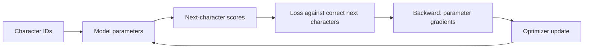
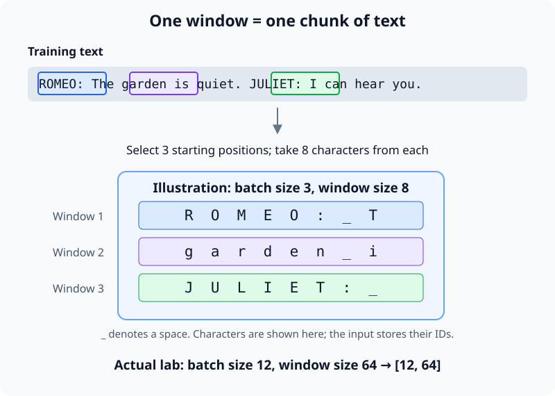
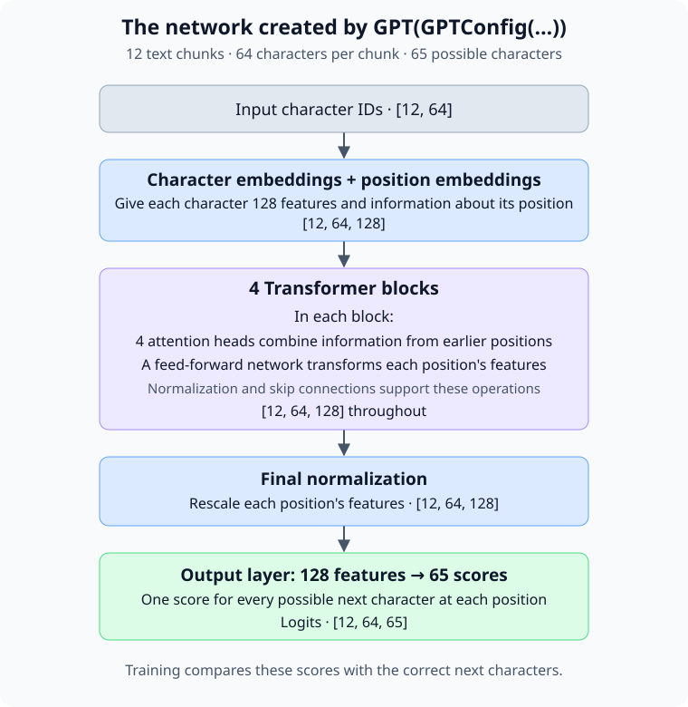

# nanoGPT — train a language model you can inspect

Training a language model means turning a collection of text into a program that
can generate more text with similar patterns. You provide examples of language
and a way to measure prediction errors. A learning algorithm repeatedly adjusts
the model's internal numbers, called **weights**, to reduce those errors. The
result is a set of learned weights that can be saved and used to generate text.

**GPT** stands for *Generative Pre-trained Transformer*. A **Transformer** turns words
into representations whose meanings depend on the surrounding words. **Pretraining** is the stage where the model learns from a text collection,
before any further training for tasks such as following instructions. This guide
focuses on that first stage: starting with random weights and learning from text.

**nanoGPT** is a small Python implementation of GPT and its training loop. It
makes the process visible: you can read how examples are constructed, inspect
the model's predictions, and watch an update change its weights. We will use
Shakespeare as our running example, moving from raw text to a trained model and
then to generated dialogue. Along the way, you will connect each command to the
part of learning it performs. See the
[nanoGPT source](https://github.com/karpathy/nanoGPT) for the implementation.

Start with one task: given `ROMEO:`, predict the next character. A language model
assigns a probability to every possible next token. Training adjusts its numbers
so that the characters actually found in the text become more probable.

In this lab, a **token** is one character, including spaces and newlines. We will
train a tiny GPT on Shakespeare, inspect one update, and generate new text. This
is the core learning mechanism used in much larger language models, at a scale
where you can follow the tensors. It will learn some spelling and dialogue
patterns; expect imperfect imitation rather than a useful assistant.

[nanoGPT](https://github.com/karpathy/nanoGPT) is deprecated upstream in favor of
nanochat. Its compact implementation remains useful for this exercise. The lab
uses revision `3adf61e154c3fe3fca428ad6bc3818b27a3b8291` so the code you read
matches the explanations.

You need basic Python, a terminal, Git, and [uv](https://docs.astral.sh/uv/getting-started/installation/). A CPU is enough;
training speed depends on your machine. Work through sections 1–6 in order,
then use the experiments to test your understanding. All commands after setup
run inside the separate `nanoGPT` checkout, with its virtual environment active.

## 1. Turn text into training examples

### 1.1. Create an isolated workspace

Create a temporary folder for the experiment:

```sh
mkdir -p /tmp/nanogpt-lab
cd /tmp/nanogpt-lab
git clone https://github.com/karpathy/nanoGPT.git
cd nanoGPT
git checkout 3adf61e154c3fe3fca428ad6bc3818b27a3b8291
uv venv --python 3.11
source .venv/bin/activate
uv pip install torch numpy requests tiktoken
python -c "import torch; print(torch.__version__); print(torch.rand(2, 3))"
```

**[tiktoken](https://github.com/openai/tiktoken)** is OpenAI's library for splitting
text into tokens, such as words or word fragments, and converting them into numeric
IDs that language models can process.

We only need these four packages for character training and sampling. We will
not download pretrained GPT-2 weights.

```sh
python data/shakespeare_char/prepare.py
```

```text
length of dataset in characters: 1,115,394
all the unique characters:
 !$&',-.3:;?ABCDEFGHIJKLMNOPQRSTUVWXYZabcdefghijklmnopqrstuvwxyz
vocab size: 65
train has 1,003,854 tokens
val has 111,540 tokens
```

The [preparation script](https://github.com/karpathy/nanoGPT/blob/3adf61e154c3fe3fca428ad6bc3818b27a3b8291/data/shakespeare_char/prepare.py)
downloads Tiny Shakespeare and builds a sorted vocabulary of 65 characters.
Each character gets an integer ID. The first 90% of the text becomes training
data; the final 10% is held out for validation. It writes:

| File under `data/shakespeare_char/` | Purpose |
|---|---|
| `input.txt` | Readable source text |
| `train.bin` | Training IDs stored as unsigned 16-bit integers |
| `val.bin` | Held-out IDs in the same format |
| `meta.pkl` | Character-to-ID and ID-to-character mappings |

`meta.pkl` stores a Python dictionary with three entries (mappings abbreviated):

```python
{
    "vocab_size": 65,
    "stoi": {"\n": 0, " ": 1, "!": 2, ..., "a": 39, ..., "z": 64},
    "itos": {0: "\n", 1: " ", 2: "!", ..., 39: "a", ..., 64: "z"},
}
```

`stoi` maps characters to IDs for encoding text; `itos` maps IDs back to
characters for decoding predictions. `vocab_size` is the number of unique
characters.

The tokenizer is a fixed lookup table here. Learning an ID does not give a
character meaning; the model will learn how IDs relate through prediction.

### 1.2. Learn to predict the next character

Every character in the training text gives us a question: given the text so far,
what comes next? The character that actually follows is the correct answer,
called the **target**.

Take `ROMEO:` followed by a newline. Given `R`, the model should predict `O`.
Given `RO`, it should predict `M`. Continue this way until, given `ROMEO:`, it
should predict a newline. This short passage supplies six training questions.

The text itself supplies the correct answers, so nobody needs to label them by
hand. This is called **self-supervised learning**.

The model assigns probabilities to possible next characters. We compare those
predictions with the correct answers, then adjust its weights to make those
answers more likely. Next, we will inspect one such learning step.

## 2. See one learning step before running thousands

The model contains trainable numbers called **parameters**. A forward pass uses
them to produce scores called **logits**. Softmax turns those scores into a
probability distribution. A loss measures how surprising the correct answers
were, and gradients tell an optimizer how to change the parameters.



### 2.1. The neural network we will create

The code below creates a small GPT neural network with random weights. Its
structure is defined in nanoGPT's
[`model.py`](https://github.com/karpathy/nanoGPT/blob/3adf61e154c3fe3fca428ad6bc3818b27a3b8291/model.py);
`GPTConfig` chooses its size, and `GPT(...)` builds it.

#### 2.1.1. Windows and batches

A **window** limits how much text the model processes at once, keeping memory
and computation manageable. Random starting positions give it varied examples
from across the training text. Windows can overlap; text left out of one step
remains available for later steps. A **batch** groups several windows so the
computer can process them together and each weight update uses prediction
errors from multiple examples. The SVG uses a small example with batch size 3
and window size 8; the lab uses batch size 12 and window size 64.



#### 2.1.2. From windows to predictions

We give it 12 text windows, each containing 64 character IDs. The network turns
each ID into a vector of 128 features and adds information about its position.
Four **Transformer blocks** then update those features using the preceding text.
Each block has four **attention heads**, which combine information from different
positions, and a **feed-forward network**, which transforms each position's
features. The output layer converts the final features into 65 scores per
position, one for each possible next character.



`model(x, y)` runs the inputs through this network and measures the prediction
loss against `y`. The remaining code computes gradients and updates the weights
once. Save it as `inspect_step.py`:

```python
import pickle
import numpy as np
import torch
from model import GPT, GPTConfig

torch.manual_seed(1337)
with open("data/shakespeare_char/meta.pkl", "rb") as f:
    meta = pickle.load(f)
data = np.memmap("data/shakespeare_char/train.bin", dtype=np.uint16, mode="r")
B, T, C = 12, 64, 128  # Batch size, sequence length, embedding width
# Pick B random starting positions in the training text, one per window.
# Leave room for T input characters plus the next character needed for targets.
starts = torch.randint(len(data) - T, (B,))  # [B] = [12]
x = torch.stack([
    torch.tensor(data[int(i):int(i) + T].astype(np.int64)) for i in starts
])  # x: [B, T] = [12, 64]
y = torch.stack([
    torch.tensor(data[int(i) + 1:int(i) + T + 1].astype(np.int64)) for i in starts
])  # y: [B, T] = [12, 64]
model = GPT(GPTConfig(
    vocab_size=meta["vocab_size"], block_size=T,
    n_layer=4, n_head=4, n_embd=C, dropout=0.0, bias=False,
))
optimizer = torch.optim.AdamW(model.parameters(), lr=1e-3, weight_decay=0.1)

logits, loss = model(x, y)  # logits: [B, T, 65] = [12, 64, 65]; loss: scalar []
print("input, target:", x.shape, y.shape)
print("logits:", logits.shape)
print("initial loss:", loss.item())
probs = logits[0, 0].softmax(dim=-1)  # [65]: probabilities at the first position
print("probability sum:", probs.sum().item())
print("first target probability:", probs[y[0, 0]].item())

parameter = model.transformer.h[0].attn.c_attn.weight  # [3*C, C] = [384, 128]
before = parameter.detach().clone()  # [384, 128]
optimizer.zero_grad(set_to_none=True)
loss.backward()  # parameter.grad: [384, 128], matching parameter
print("gradient norm:", parameter.grad.norm().item())
torch.nn.utils.clip_grad_norm_(model.parameters(), 1.0)
optimizer.step()
print("largest parameter change:", (parameter - before).abs().max().item())
with torch.no_grad():
    _, after_loss = model(x, y)  # after_loss: scalar []
print("same-batch loss after update:", after_loss.item())
```

```sh
python inspect_step.py
```

Expect input and target shapes `[12, 64]`, logits `[12, 64, 65]`, probabilities
adding to approximately 1, a nonzero gradient, and a nonzero parameter change.
The last loss often falls, but one update is not guaranteed to help, and
improvement on the same batch does not establish improvement on unseen text.

### 2.2. What the dimensions mean

One **batch** contains `B = 12` text windows. Each has `T = 64` positions, and
each position has a representation with `C = 128` learned features. The vocabulary
size is `V = 65`.

| Stage | Shape | Meaning |
|---|---|---|
| Input and target IDs | `[B, T]` | One integer at each position |
| Token embeddings plus position embeddings | `[B, T, C]` | One vector at each position |
| Each Transformer block | `[B, T, C]` | Context-aware vectors, same dimensions |
| Output logits during training | `[B, T, V]` | One score per possible next character |
| Mean loss | Scalar | Average error across `B × T` predictions |

The IDs stay integers. An **embedding** is a trainable table that looks up a
vector for each ID. Position embeddings add information about where a token is
in the window. Both tables learn along with the rest of the model.

### 2.3. Why the loss teaches probabilities

For one target character, cross-entropy loss is $-\ln p(\text{target})$. Assigning
the right character probability 0.5 gives loss about 0.69; probability 0.01 gives
about 4.61. Confident wrong predictions are expensive.

For the whole batch:

$$
L = -\frac{1}{BT}\sum_{b=1}^{B}\sum_{t=1}^{T}
\ln p_\theta(y_{b,t}\mid x_{b,1},\ldots,x_{b,t}).
$$

$\theta$ means all trainable parameters. Predicting every character uniformly
would give $\ln 65 \approx 4.17$. A random model will be near, rather than exactly
at, that baseline. nanoGPT passes raw logits into
[PyTorch cross-entropy](https://docs.pytorch.org/docs/stable/generated/torch.nn.functional.cross_entropy.html),
which performs the necessary normalization internally. Do not apply softmax
before passing logits to that function.

`loss.backward()` computes derivatives of the loss with respect to parameters;
it does not update them. `optimizer.step()` applies the update. Gradients
accumulate unless cleared, which is why we call `zero_grad`. See the
[autograd tutorial](https://docs.pytorch.org/tutorials/beginner/basics/autogradqs_tutorial.html).

The simplest update would be $\theta \leftarrow \theta - \eta\nabla_\theta L$,
where $\eta$ is the learning rate. nanoGPT uses
[AdamW](https://docs.pytorch.org/docs/stable/generated/torch.optim.AdamW.html),
which tracks gradient statistics to adapt updates and applies weight decay.
Clipping limits the overall gradient norm before the update. These mechanisms
make the optimization more controlled; the learning signal still comes from
predicting the next token.

**Checkpoint:** identify the exact line that measures error, the one that computes
gradients, and the one that changes weights. The inspected script is a simplified
step; nanoGPT's trainer also groups parameters for weight decay and schedules
the learning rate.

## 3. Give each prediction access to earlier characters

An embedding alone represents the current character. To distinguish the `O` in
`ROMEO` from an `O` elsewhere, the model needs context. **Self-attention** lets a
position gather information from other positions in its own input window.

### 3.1. Queries, keys, and values

Each position's vector is projected into three vectors:

- A **query** represents what information this position is looking for.
- A **key** represents what a position offers for matching.
- A **value** represents the information to mix into the result.

These are learned numerical projections, not explicit questions or dictionary
entries. For a query, dot products with keys produce relevance scores. Softmax
normalizes them, then the model takes a weighted sum of values.

$$
\operatorname{Attention}(Q,K,V)
= \operatorname{softmax}\left(\frac{QK^\top}{\sqrt{d}} + M\right)V.
$$

$d$ is the feature width of one attention head. The mask $M$ is zero at permitted
positions and negative infinity at forbidden ones, giving future positions zero
probability after softmax. This scaled dot-product construction is described in
[Attention Is All You Need](https://arxiv.org/abs/1706.03762).

For the `ROMEO:` window, the allowed connections are:

```text
                    key position
                 R O M E O :
query at R       ✓ · · · · ·
query at O       ✓ ✓ · · · ·
query at M       ✓ ✓ ✓ · · ·
query at E       ✓ ✓ ✓ ✓ · ·
query at O       ✓ ✓ ✓ ✓ ✓ ·
query at :       ✓ ✓ ✓ ✓ ✓ ✓
```

The `R` position predicts `O`, but cannot see that next `O`. The colon position
can see the whole prefix and predicts what follows it. This **causal mask** makes
parallel training valid: all targets are available for scoring, while each
prediction only sees its permitted prefix. Generation will build that prefix
one character at a time. See PyTorch's
[causal attention API](https://docs.pytorch.org/docs/stable/generated/torch.nn.functional.scaled_dot_product_attention.html).

### 3.2. Build one block, then repeat it

Our four heads each work with width `128 / 4 = 32`. Different learned projections
allow different mixtures of context; a head is not assigned a particular grammar
rule. Their outputs are concatenated and projected back to width 128.

After attention, a small feed-forward network, or **MLP**, transforms each
position independently: expand width 128 to 512, apply GELU, then project to 128.
Attention mixes positions; the MLP transforms features within each position.

Both parts use **residual connections**, adding their output to their input.
This preserves a path for existing information and gradients. Layer normalization
normalizes each position's features before each part. One block computes:

```text
x = x + attention(layer_norm(x))
x = x + mlp(layer_norm(x))
```

We repeat four blocks, apply a final normalization, and project each position
to 65 logits. The same model parameters serve every position. Read
[`GPT.forward`, `Block`, and `CausalSelfAttention`](https://github.com/karpathy/nanoGPT/blob/3adf61e154c3fe3fca428ad6bc3818b27a3b8291/model.py)
with the shape table beside you. nanoGPT also shares the token embedding weights
with the output projection.

**Try it:** in `inspect_step.py`, after the existing code, add this check:

```python
model.eval()
changed = x.clone()
changed[:, 32:] = (changed[:, 32:] + 1) % meta["vocab_size"]
with torch.no_grad():
    original, _ = model(x, y)
    modified, _ = model(changed, y)
print("earlier logits unchanged:", torch.allclose(
    original[:, :32], modified[:, :32], atol=1e-6,
))
```

It should print `True`: changing the future cannot change earlier predictions.
Passing targets here requests logits at every position; without targets,
nanoGPT returns only the last position's logits as an inference optimization.

## 4. Run a small training job

Now repeat that update on randomly sampled windows. Save this as
`config/train_lab.py`. This is a complete small lab configuration layered over
the trainer's defaults; do not run bare `python train.py`, whose defaults target
a much larger model and a different dataset.

```python
dataset = 'shakespeare_char'
out_dir = 'out-lab'
init_from = 'scratch'
device = 'cpu'
dtype = 'float32'
compile = False
wandb_log = False

n_layer = 4
n_head = 4
n_embd = 128
block_size = 64
bias = False
dropout = 0.0
batch_size = 12
gradient_accumulation_steps = 1

learning_rate = 1e-3
min_lr = 1e-4
warmup_iters = 20
max_iters = 2000
lr_decay_iters = 2000
eval_interval = 100
eval_iters = 20
log_interval = 10
always_save_checkpoint = False
```

This model has about 0.8 million parameters. Those are the numbers the optimizer
learns. Settings you choose, such as width, batch size, and learning rate, are
**hyperparameters**. Here, dropout is zero, so no activations are randomly dropped
during training. The learning rate warms up over 20 iterations, then follows a
cosine decay toward `min_lr` at iteration 2,000. Starting gently helps avoid large
early updates; reducing the rate later makes updates smaller as training proceeds.

### 4.1. Make checkpoint loading explicit

The pinned nanoGPT predates PyTorch 2.6's `torch.load` default of
`weights_only=True`. Its training checkpoints contain more than plain weights,
including validation statistics that can cause the restricted loader to fail.
Before sampling or resuming, run this once in your experiment checkout:

```sh
python - <<'PY'
from pathlib import Path
old = "torch.load(ckpt_path, map_location=device)"
new = "torch.load(ckpt_path, map_location=device, weights_only=False)"
for name in ("train.py", "sample.py"):
    path = Path(name)
    source = path.read_text()
    if old in source:
        path.write_text(source.replace(old, new))
        print("Updated", name)
    elif new in source:
        print("Already updated", name)
    else:
        raise RuntimeError(f"Unexpected checkpoint loading code in {name}")
PY
```

This enables pickle loading, so use it only for checkpoints you created in this
lab and trust. PyTorch explains the change and its implications in its
[serialization notes](https://docs.pytorch.org/docs/stable/notes/serialization.html#torch-load-with-weights-only-true).

### 4.2. Start with a short run

```sh
python train.py config/train_lab.py --out_dir=out-smoke --max_iters=200
```

The trainer prints `tokens per iteration will be: 768`, because
`12 × 64 × 1 = 768` next-character targets contribute to one optimizer update.
It samples windows with replacement; an iteration is not a full pass through
the corpus. Around 2,000 updates expose the model to about 1.536 million token
positions, with repeats. An **epoch** would instead mean one complete pass over
the training set.

Read the `step ... train loss ..., val loss ...` lines. They estimate loss on
random batches from each split, without updating weights. Individual `iter`
losses are noisier because they come from a training batch. Expect initially
near-random predictions and a downward trend, not a particular final number.

If the short run works, start the full experiment in its own output directory:

```sh
python train.py config/train_lab.py
```

Let it finish, or stop with Ctrl-C after a checkpoint has been saved. Look for
`saving checkpoint to out-lab`. Checkpoints are considered at evaluation
boundaries after step zero, and this config saves only when validation loss
improves. `out-lab/ckpt.pt` therefore holds the best observed checkpoint, which
may precede the final iteration. There is no separate automatic final save.
See the [training loop](https://github.com/karpathy/nanoGPT/blob/3adf61e154c3fe3fca428ad6bc3818b27a3b8291/train.py).

### 4.3. Decide whether learning generalizes

- **Training and validation losses both fall:** the model is improving on text
  used for updates and on held-out text.
- **Training falls while validation rises persistently:** suspect overfitting;
  more training is increasingly specializing to the training text.
- **Both remain high:** check targets, run length, learning rate, and model size.
  Twenty evaluation batches produce a noisy estimate; one uptick is not a trend.

The validation split helps choose a checkpoint, so it is not an untouched final
test set. Lower character loss measures better prediction on this distribution;
it does not establish reasoning ability or factual accuracy.

**Checkpoint:** explain why a model that memorizes training passages can have
excellent training loss and disappointing validation loss.

## 5. Generate text using the learned weights

```sh
python sample.py --out_dir=out-lab --device=cpu --dtype=float32 \
  --start='ROMEO:' --num_samples=2 --max_new_tokens=300 \
  --temperature=0.8 --top_k=65 --seed=1337
```

Use `--out_dir=out-smoke` to sample the short run instead. Keep
`data/shakespeare_char/meta.pkl` beside its data: the sampler uses the checkpoint's
dataset setting to find the character mappings. Its prompt can only contain
characters in that vocabulary; an emoji will fail to encode.

Generation repeatedly:

1. Encodes the prompt and passes its latest 64 characters through the model.
2. Takes the last position's logits and converts them to probabilities.
3. Samples one character, appends it, and repeats.

This is **autoregressive generation**: earlier generated characters become
inputs for later predictions. The model can print more than 64 characters, but
each prediction only uses the most recent 64. Sampling does not run backward
or update parameters. See [`sample.py`](https://github.com/karpathy/nanoGPT/blob/3adf61e154c3fe3fca428ad6bc3818b27a3b8291/sample.py).

**Temperature** divides the logits before softmax. Values below 1 sharpen the
distribution; values above 1 flatten it. Use a positive value. **Top-k** keeps
only the highest-scoring k candidates before sampling. Here `65` keeps the
whole vocabulary. Try temperature `0.5` and `1.2` with the same seed, prompt,
and checkpoint. More varied text does not mean better learned weights.

**Checkpoint:** describe the difference between training on the true continuation
and generating a continuation from the model's own predictions.

## 6. Run experiments that answer a question

Keep a small log so you can connect a change to evidence:

| Run | Changed setting | Best validation loss | Sample observations |
|---|---|---|---|
| Baseline | Lab config | Record yours | Spelling, speaker labels, repetition |
| Short context | `block_size=16` | Record yours | Which longer patterns deteriorate? |
| Wider model | `n_embd=256` | Record yours | Does validation improve enough to justify the cost? |

Use a fresh output directory for each training experiment. Keep other settings
fixed unless the experiment explicitly changes them.

### 6.1. How much history helps?

```sh
python train.py config/train_lab.py --out_dir=out-context16 --block_size=16
```

Predict what a 16-character window can still learn: local spelling may survive,
while longer structure is harder to use. There is a confound: keeping batch size
12 also reduces targets per update from 768 to 192. To hold that count fixed,
rerun with `--gradient_accumulation_steps=4` and a different output directory.
Accumulation averages gradients across four microbatches before one update.
The shorter context remains the intended difference.

### 6.2. Does more capacity help on the same data?

```sh
python train.py config/train_lab.py --out_dir=out-width256 --n_embd=256
```

Keep four heads: 256 is divisible by four. Wider layers add capacity and compute;
they do not add data. Compare validation loss as well as samples. If training
loss improves much more than validation loss, capacity may be helping fit the
training corpus more than generalize.

### 6.3. Can the model memorize one batch?

In `inspect_step.py`, repeat the forward/backward/update sequence 200 times on
the same `x, y`, clearing gradients each time. Print loss every 20 updates.
Then evaluate on a newly sampled batch without an update. A large gap is a
small, visible example of memorization. This is also a useful debugging exercise:
if a small model cannot fit a fixed batch, investigate the training code before
scaling up.

### 6.4. Continue a saved run

To extend the baseline to roughly 4,000 iterations:

```sh
python train.py config/train_lab.py --init_from=resume \
  --max_iters=4000 --lr_decay_iters=4000
```

This restores weights, optimizer state, and the saved iteration from `out-lab`.
Reusing the same config preserves the other settings. Extending the decay
schedule changes the learning-rate curve, so this is a continuation experiment,
not an exact replay of an uninterrupted run. The checkpoint also does not
restore all random-number state. Do not use resume to change architecture;
use a new scratch run and output directory.

## 7. Move beyond the CPU lab

First check which accelerator PyTorch can use:

```sh
python -c "import torch; print('CUDA:', torch.cuda.is_available()); print('MPS:', torch.backends.mps.is_available())"
```

On Apple Silicon, try `--device=mps`; on an NVIDIA machine with a compatible
PyTorch build, try `--device=cuda`. Keep `dtype=float32` and `compile=False`
initially to change one thing at a time. Pass the same device override to
`sample.py`. A tiny model can be dominated by overhead, so acceleration is not
guaranteed. CUDA mixed precision, compilation, and distributed training can
come after you understand a working single-device run.

For longer contexts, remember that ordinary attention considers pairs of
positions: its attention-score work grows approximately with $T^2$. Increasing
width, depth, batch size, or context length has different memory and compute
costs. Reduce batch size first if you run out of memory; accumulation can retain
the number of targets per update without holding all microbatches at once.

### 7.1. Train on your own text

After completing the baseline, create `data/my_text/` in the experiment checkout.
Copy `data/shakespeare_char/prepare.py` there and put your UTF-8 corpus at
`data/my_text/input.txt` before running the copied script. Because the file
exists, preparation uses it rather than downloading Shakespeare.

```sh
python data/my_text/prepare.py
python train.py config/train_lab.py --dataset=my_text --out_dir=out-my-text
```

Use enough text that both splits have more than `block_size` characters. Keep
the vocabulary within the script's `uint16` representation. The split is by
character offset, so repeated documents can leak across splits. For a serious
experiment, deduplicate and separate documents before tokenization. Keep the
resulting mappings with the checkpoint: a new vocabulary changes the meaning
of IDs and cannot be swapped into an old model.

### 7.2. Connect this to large language models

This lab is **pretraining from scratch**: randomly initialized parameters learn
to continue a text distribution. Modern text LLMs commonly use subword tokens,
larger corpora, and much larger models. Their exact architectures and training
recipes vary. Character-level and subword-level losses are not directly
comparable because the prediction units differ.

**Fine-tuning** starts with learned weights and performs further updates.
nanoGPT includes GPT-2 fine-tuning examples, but those need GPT-2's tokenizer and
compatible architecture; our 65-character checkpoint is not compatible with
GPT-2's vocabulary. **Instruction tuning** trains on examples of desired task or
conversation behavior. Preference-based training adds another learning signal.
Those steps are outside this lab. Use the
[LLM datasets note](../datasets/llm.md) to connect each training stage to its data.

You now have concrete objects behind the training process: text supplies
shifted targets; a causal Transformer produces logits; loss and backpropagation
produce gradients; an optimizer changes weights; validation checks held-out
prediction; generation repeatedly uses the learned distribution.

## 8. Troubleshooting and further reading

| Symptom | What to check |
|---|---|
| `train.bin` not found | Run preparation from the nanoGPT root and check `dataset`. |
| No `ckpt.pt` | Wait for a save message after a positive evaluation step. Step zero does not save. |
| Checkpoint weights-only loading error | Apply section 4.1 to your trusted local checkpoints. |
| `KeyError` when encoding a prompt | Use characters present in `meta.pkl`. |
| Garbled decoding or token-index errors | Keep the checkpoint with the dataset and tokenizer that created it. |
| Attention head assertion | `n_embd` must be divisible by `n_head`. |
| No CUDA, MPS failure, or device mismatch | Return both training and sampling to `--device=cpu --dtype=float32`. |
| Compile/backend error | Keep `--compile=False`. |
| CPU unexpectedly slow | Try `OMP_NUM_THREADS=4 python train.py config/train_lab.py` and compare iteration time; excess threads can hurt small workloads. |
| NaN loss | Use float32, inspect data/targets, and try a smaller learning rate in a fresh run. |

Read the source in the same order as the lab: preparation, `get_batch`,
`GPT.forward`, `Block`, `CausalSelfAttention`, the training loop, then `generate`.
For a longer derivation with code written step by step, see Andrej Karpathy's
[Let's build GPT](https://www.youtube.com/watch?v=kCc8FmEb1nY).
