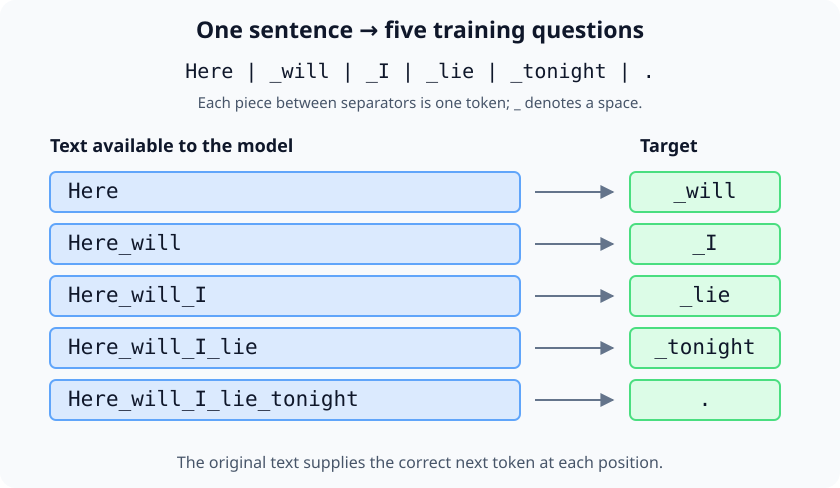
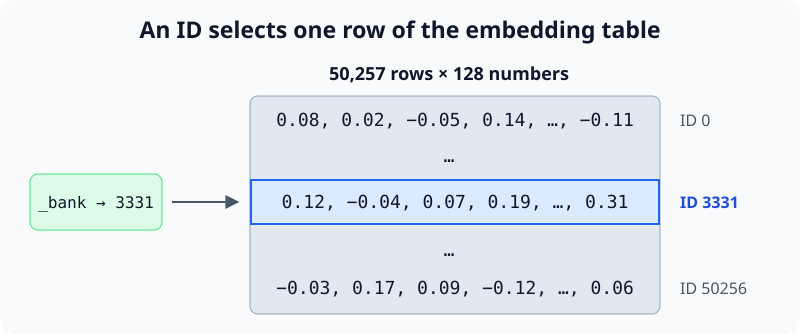
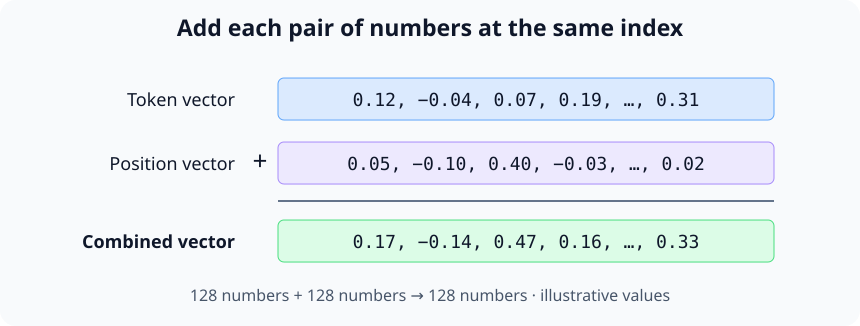
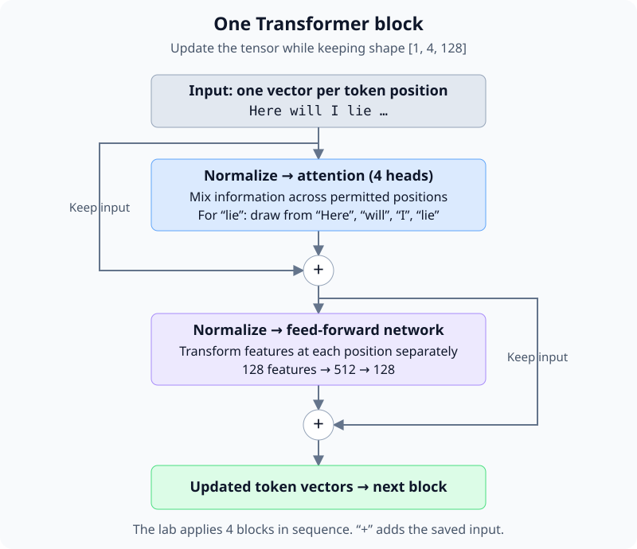
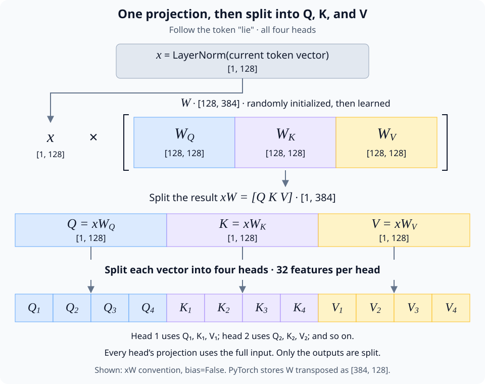
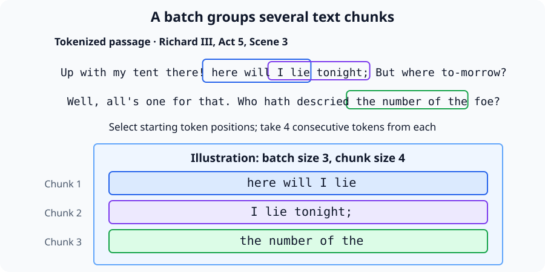

# nanoGPT — train a language model you can inspect

Training a language model means turning a collection of text into a program that
can generate more text with similar patterns. You provide examples of language
and a way to measure prediction errors. A learning algorithm repeatedly adjusts
the model's internal numbers, called **weights**, to reduce those errors. The
result is a set of learned weights that can be saved and used to generate text.

**GPT** stands for *Generative Pre-trained Transformer*. A **Transformer** turns words
into representations whose meanings depend on the surrounding words. **Pretraining** is the stage where the model learns from a text collection,
before any further training for tasks such as following instructions. This guide
focuses on that first stage: starting with random weights and learning from text.

**nanoGPT** is a small Python implementation of GPT and its training loop. It
makes the process visible: you can read how examples are constructed, inspect
the model's predictions, and watch an update change its weights. We will use
Shakespeare as our running example, moving from raw text to a trained model and
then to generated dialogue. Along the way, you will connect each command to the
part of learning it performs. See the
[nanoGPT source](https://github.com/karpathy/nanoGPT) for the implementation.

Start with one task: given `Here will I lie`, predict the next token. A language model
assigns a probability to every possible next token. Training adjusts its numbers
so that the tokens actually found in the text become more probable.

In this lab, a **token** can be a whole word, a word fragment, or punctuation.
We use GPT-2's subword tokenizer, train a small GPT on Shakespeare, inspect one
update, and generate new text. It will learn some language and dialogue patterns;
expect imperfect imitation rather than a useful assistant.

[nanoGPT](https://github.com/karpathy/nanoGPT) is deprecated upstream in favor of
nanochat. Its compact implementation remains useful for this exercise. The lab
uses revision `3adf61e154c3fe3fca428ad6bc3818b27a3b8291` so the code you read
matches the explanations.

You need basic Python, a terminal, Git, and [uv](https://docs.astral.sh/uv/getting-started/installation/). A CPU is enough;
training speed depends on your machine. Work through sections 1–6 in order,
then use the experiments to test your understanding. All commands after setup
run inside the separate `nanoGPT` checkout, with its virtual environment active.

## ✅ 1. Turn text into training examples

### ✅ 1.1. Create an isolated workspace

Create a temporary folder for the experiment:

```sh
mkdir -p /tmp/nanogpt-lab
cd /tmp/nanogpt-lab
git clone https://github.com/karpathy/nanoGPT.git
cd nanoGPT
git checkout 3adf61e154c3fe3fca428ad6bc3818b27a3b8291
uv venv --python 3.11
source .venv/bin/activate
uv pip install torch numpy requests tiktoken
python -c "import torch; print(torch.__version__); print(torch.rand(2, 3))"
```

### ✅ 1.2. See how text becomes tokens

**[tiktoken](https://github.com/openai/tiktoken)** is OpenAI's library for splitting
text into tokens, such as words or word fragments, and converting them into numeric
IDs that language models can process.

We use GPT-2's tokenizer with randomly initialized model weights. The tokenizer
already knows how to split text; our model still has to learn what those tokens
mean in context.

```sh
python data/shakespeare/prepare.py
```

```text
train has 301,966 tokens
val has 36,059 tokens
```

The [preparation script](https://github.com/karpathy/nanoGPT/blob/3adf61e154c3fe3fca428ad6bc3818b27a3b8291/data/shakespeare/prepare.py)
downloads Tiny Shakespeare, splits the text 90%/10% for training and validation,
and encodes each split with `tiktoken.get_encoding("gpt2")`.

| File under `data/shakespeare/` | Purpose |
|---|---|
| `input.txt` | Readable source text |
| `train.bin` | Training token IDs stored as unsigned 16-bit integers |
| `val.bin` | Held-out token IDs in the same format |

The vocabulary contains 50,257 tokens. Encoding turns text into IDs; decoding
turns those IDs back into text.

Use one sentence to see the tokenizer's output:

```sh
python - <<'PYCODE'
import tiktoken
enc = tiktoken.get_encoding("gpt2")
ids = enc.encode_ordinary("Here will I lie tonight.")
print("IDs:", ids)
print("Pieces:", [enc.decode([i]) for i in ids])
print("Word fragments:", [enc.decode([i]) for i in enc.encode_ordinary("tokenization")])
PYCODE
```

```text
IDs: [4342, 481, 314, 6486, 9975, 13]
Pieces: ['Here', ' will', ' I', ' lie', ' tonight', '.']
Word fragments: ['token', 'ization']
```

In this sentence, the words each fit into one token, and most include a leading
space. Combining a word with its preceding space can save a separate space token
while preserving the original text. Other words split into fragments, as
`tokenization` shows. A token is
therefore not always a whole word. In the diagrams, `_` denotes a space.

### ✅ 1.3. Learn to predict the next token

Every token after the first gives us a training question: given the text so far,
what comes next? The token that actually follows is the correct answer, called
the **target**.



The text itself supplies the correct answers, so nobody needs to label them by
hand. This is called **self-supervised learning**.

The model assigns probabilities to possible next tokens. We compare those
predictions with the correct answers, then adjust its weights to make those
answers more likely. First, follow how a forward pass makes a prediction; then
inspect how one learning step updates the weights.

## 2. Forward pass: predict the next token

Give the model `Here will I lie`. A **forward pass** uses its current weights
to turn this prefix into scores for the next token. In our Shakespeare example,
the continuation is ` tonight`. A model must learn to assign it a useful
probability.

GPT-2's tokenizer encodes this prompt as `[4342, 481, 314, 6486]`. We have one
prompt containing four tokens, so the input tensor has shape `[1, 4]`. Follow
those four positions through the network below. The model still supports up
to 64 tokens; we are using a shorter input to see the process clearly.

### ✅ 2.1. Embeddings: a learned table inside the model

A token ID tells us which token we have, but gives the network no useful
features to work with. An **embedding table** supplies a vector for each ID.
In this lab, `nn.Embedding(50257, 128)` creates 50,257 rows of 128 numbers;
looking up an ID simply selects its row.



The table is part of the model's weights. Its numbers start randomly, then
prediction errors produce gradients that update them during training. The
features have no predefined meanings, and the learned table is saved with the
rest of the model. nanoGPT names the table `wte` (word token embedding) and
performs the lookup with `self.transformer.wte(idx)` in
[`model.py`](https://github.com/karpathy/nanoGPT/blob/3adf61e154c3fe3fca428ad6bc3818b27a3b8291/model.py).

### ✅ 2.2. Add information about position

“Here will I lie tonight” uses **lie** to mean rest or sleep, while “I am a
villain: yet I lie” uses it to mean say something untrue. The model needs the
surrounding text to distinguish these meanings.

The token ` lie` starts with the same embedding in both passages, but the
surrounding text gives it different meanings. Transformer blocks combine that
context. They also need information about the order of tokens; a token embedding
by itself identifies a piece of text without saying where it occurs.

A second learned table, **`wpe`** (word position embedding), supplies that signal.
In this lab, `nn.Embedding(64, 128)` provides one vector for each token position
from 0 to 63 within a chunk. Our four-token prompt uses the first four rows.

At each position, the network adds each number in the 128-dimensional token
vector to the number at the same index in the 128-dimensional position vector.
The result is still one 128-dimensional vector. nanoGPT performs this addition
for the whole batch with `tok_emb + pos_emb`.



In the prompt “Here will I lie”, ` lie` receives the position-3 vector.
If we append ` tonight`, it receives the position-4 vector on the next forward
pass. Positions restart at 0 for each chunk. Like token embeddings, position embeddings start randomly
and learn during training. See the `wpe` definition and `GPT.forward` in
[`model.py`](https://github.com/karpathy/nanoGPT/blob/3adf61e154c3fe3fca428ad6bc3818b27a3b8291/model.py).

### 2.3. Build context with Transformer blocks

Token and position embeddings prepare the input; **Transformer blocks** update
its representations using context. For ` lie`, that context includes `Here`,
` will`, ` I`, and itself. A different prefix can produce a different
representation for the same token.

Our model has **four Transformer blocks in sequence**. Each block contains
attention with **four heads**, followed by a **multilayer perceptron (MLP)**,
a feed-forward network. Attention mixes information across permitted token
positions; the MLP transforms the features at each position.

Each stage normalizes its input, computes an update, and adds that update back
to its input. This addition is a **residual connection**: it preserves a path
for existing information and gradients while the stage learns what to change.
The block's input and output both have shape `[1, 4, 128]` for our four-token
prompt. We will follow one block before repeating it.



#### 2.3.1. Prepare Q, K, and V for four heads

An **attention head** computes one mixture of information from permitted token
positions. Four heads let the block form four different mixtures in parallel.
Each learns its own way of matching positions; their roles are learned rather
than assigned.

To decide what to mix, each head needs three vectors at every position:

- A **query (Q)** represents what information this position is looking for.
- A **key (K)** represents what a position offers for matching.
- A **value (V)** represents the information to mix into the result.

Q, K, and V are all derived from the same input sequence, which is why this is
called **self-attention**.

Follow ` lie` across all four heads in this block. Layer normalization takes
the token’s existing 128-feature vector and normalizes its values. Call the resulting row vector
$x$. Multiplying it by three different matrices gives
$Q = xW_Q$, $K = xW_K$, and $V = xW_V$. Each matrix has shape
`[128, 128]`, so each result has 128 features covering all four heads.
The lab uses `bias=False`, so these projections do not add a bias vector.

The three matrices form one combined matrix $W = [W_Q\;W_K\;W_V]$ of shape
`[128, 384]`. One multiplication computes $xW = [Q\;K\;V]$. Split this
384-feature result into three 128-feature vectors, then split each into four
32-feature head vectors. The matrix weights start randomly and learn through
backpropagation how strongly each input feature contributes to each output
feature. Q, K, and V are recomputed from the current input on each forward pass.



All four heads receive the **full 128-feature input**. Each uses different
portions of the combined matrix $W$ to produce its own 32-feature Q, K, and V
vectors. Within a Transformer block, every token uses the same learned projection
matrices, producing different Q, K, and V vectors from its own input.
Different Transformer blocks have separate matrices. Each position is still
projected independently here. Mixing information across positions comes next.

#### 2.3.2. Mask future tokens

Before mixing information across positions, we must prevent predictions from
seeing future tokens. At ` lie`, position 3, all four prompt positions are
permitted. Earlier positions must have later positions masked out.

For the first four tokens of “Here will I lie tonight.”, the allowed
connections are:

```text
                      key position
                   Here  _will  _I  _lie
query at Here       ✓      ·     ·    ·
query at _will      ✓      ✓     ·    ·
query at _I         ✓      ✓     ✓    ·
query at _lie       ✓      ✓     ✓    ✓
```

The `Here` position predicts ` will`, but cannot see it. The ` lie` position
can see all four input tokens and predicts ` tonight`. This **causal mask** makes
parallel training valid: all targets are available for scoring, while each
prediction only sees its permitted prefix. Generation builds that prefix one
token at a time. See PyTorch's
[causal attention API](https://docs.pytorch.org/docs/stable/generated/torch.nn.functional.scaled_dot_product_attention.html).

#### 2.3.3. Compare keys and blend values

Think of attention as a **soft lookup**: compare a query with available keys,
then blend information from their associated **value vectors** instead of
selecting one exact match.

Follow one head at ` lie`. Its 32-number query is compared with the keys at
`Here`, ` will`, ` I`, and itself. Each comparison is a **dot product** that
produces one scalar match score. The four scores are each scaled by dividing
by $\sqrt{32}$. They determine how strongly to draw from each position after
masking and softmax; they do not test whether two tokens are equal.

Set forbidden scores to negative infinity, then apply **softmax** across the
key positions. This gives forbidden positions zero weight and makes the allowed
weights nonnegative and sum to 1. For the ` lie` query, one head might produce
`[0.1, 0.2, 0.1, 0.6]`. These values are illustrative, not measured from our model.

Multiply each position's 32-feature value vector by its corresponding scalar
weight and add the four results. This produces **one 32-feature output for
this head at ` lie`**. Q and K determine the mixture's weights; V supplies the
information being mixed.


The same computation, written for all query positions in one head, is:

$$
\operatorname{Attention}(Q,K,V)
= \operatorname{softmax}\left(\frac{QK^\top}{\sqrt{d}} + M\right)V.
$$

Here $d=32$. The mask $M$ is zero at permitted positions and negative infinity
at forbidden ones; softmax operates across keys for each query. This
scaled dot-product construction is described in
[Attention Is All You Need](https://arxiv.org/abs/1706.03762).

Repeating the calculation for every query position and head gives attention
weights shaped `[1, 4, 4, 4]`: **prompt × head × query position × key position**.
Multiplying those weights by V gives outputs shaped `[1, 4, 4, 32]`:
**prompt × head × query position × features**. The weights describe relationships
between positions; the outputs contain the mixed features. **Attention** names
the whole operation, while **attention weights** name the coefficients used to
mix V.

#### 2.3.4. Join the heads and add the attention update

At each position, join the four 32-feature head outputs into one 128-feature
vector. A learned output projection transforms it into the attention update.
Add that update to the vector that entered the block, before normalization.
This completes the attention stage's residual connection.

| Stage | Shape for the whole prompt |
|---|---|
| Four head outputs | `[1, 4, 4, 32]` — prompt, head, position, features |
| Joined heads | `[1, 4, 128]` — prompt, position, features |
| Output projection and residual addition | `[1, 4, 128]` |

For ` lie`, the resulting vector now includes information mixed from the
permitted positions. Call it $h$. It is ready for the MLP inside the same block.

#### 2.3.5. Transform each position's features with the MLP

The MLP processes each token position independently using the same learned
matrices. At ` lie`, its input already contains context gathered by attention.

A second layer normalization within the block gives $z = \operatorname{LayerNorm}(h)$, still with 128 features. The MLP
computes:

$$
\operatorname{MLP}(z) = \operatorname{GELU}(zW_1)W_2.
$$

Using row vectors, the dimensions are:

| Step | Computation | Shape for one token |
|---|---|---|
| Normalized input | $z$ | `[1, 128]` |
| Expand features | $u = zW_1$, with $W_1$ shaped `[128, 512]` | `[1, 512]` |
| Apply a nonlinearity | $a = \operatorname{GELU}(u)$ | `[1, 512]` |
| Project back | $m = aW_2$, with $W_2$ shaped `[512, 128]` | `[1, 128]` |

$W_1$ and $W_2$ are learned matrices. Expanding to 512 features gives the network
more intermediate combinations of the input features to work with. Projecting
back to 128 makes the result compatible with the residual addition and the next
block. This expands the **feature dimension**, not the number of tokens.
Our lab uses `bias=False` and `dropout=0.0`, so these equations omit bias terms
and dropout. PyTorch stores each linear weight matrix transposed relative to
the mathematical convention above. See nanoGPT's
[`MLP` implementation](https://github.com/karpathy/nanoGPT/blob/3adf61e154c3fe3fca428ad6bc3818b27a3b8291/model.py).

**GELU gives the MLP a nonlinear transformation.** It acts separately on each
of the 512 numbers:

$$
\operatorname{GELU}(u_i) = u_i\Phi(u_i),
$$

where $\Phi$ is the standard normal cumulative distribution function. For
example, GELU maps $-2$ to approximately $-0.046$, $0$ to $0$, and $2$ to
approximately $1.954$. It smoothly suppresses strongly negative values while
largely preserving strongly positive ones. It does not mix positions or
normalize probabilities. See [PyTorch's GELU definition](https://docs.pytorch.org/docs/stable/generated/torch.nn.GELU.html).

Without this nonlinearity, the two matrix multiplications would collapse to
$zW_1W_2 = z(W_1W_2)$, equivalent to one linear projection. GELU lets the MLP
learn transformations that a single linear projection cannot express.

**The residual connection adds the MLP's update to $h$:**

$$
h_{\text{out}} = h + \operatorname{MLP}(\operatorname{LayerNorm}(h)).
$$

The MLP uses the same weights at all token positions in this block. For the
whole prompt, its intermediate tensor expands to `[1, 4, 512]`, then returns
to `[1, 4, 128]` for the residual addition.

#### 2.3.6. Pass the result to the next block

Putting the two stages together, one block computes:

```text
h = block_input + attention(layer_norm_1(block_input))
output = h + mlp(layer_norm_2(h))
```

The two layer normalizations have separate learned parameters. The next block
takes `output` as its input and repeats the
same structure with its own attention and MLP weights.

We run four such blocks sequentially. There are four attention heads and one
MLP in each block: sixteen heads and four MLPs across the model. Throughout
the stack, each block's input and output have shape `[1, 4, 128]`, while their
values are refined by successive attention and MLP updates. nanoGPT defines
this sequence in
[`GPT.forward` and `Block`](https://github.com/karpathy/nanoGPT/blob/3adf61e154c3fe3fca428ad6bc3818b27a3b8291/model.py).

### 2.4. Turn the final vector into next-token probabilities

After the fourth block, a final normalization rescales the features. The
**output layer** maps each 128-dimensional vector to 50,257 scores called
**logits**, one per possible token. Its weights are shared with the token
embedding table from section 2.1.

To continue `Here will I lie`, we use the logits at the final position, ` lie`.
**Softmax** converts those scores into probabilities that sum to 1. Selecting a
token and decoding it gives the next piece of text. For example, ID `9975`
decodes to ` tonight`; appending it produces `Here will I lie tonight`.
Choosing the most probable token and sampling from the probabilities are two
different selection strategies; section 5 uses sampling.


| Stage | Shape for this prompt | Meaning |
|---|---|---|
| Input IDs | `[1, 4]` | Four token IDs in one prompt |
| Token plus position embeddings | `[1, 4, 128]` | One vector per position |
| Each Transformer block | `[1, 4, 128]` | Updated vectors with context |
| Logits at all positions | `[1, 4, 50257]` | Scores for each position's next token |
| Final-position probabilities | `[1, 50257]` | Distribution used to continue the prompt |

When called without targets, nanoGPT only applies its output layer at the final
position, returning logits of shape `[1, 1, 50257]`. During training, it returns
logits at every position so all next-token predictions can contribute to loss.
The forward pass itself does not update any weights.

### 2.5. Count the model's parameters

This lab model has **7,228,672 unique trainable parameters**, about **7.23
million**. A parameter is one learned scalar, such as one entry in an embedding
table or projection matrix. This count uses 50,257 tokens, a maximum context
of 64 positions, width 128, four Transformer blocks, four heads per block,
and `bias=False`.


Start with the two embedding tables. The **token table** has one row of 128
learned numbers for every token ID. The **position table** has one row of 128
learned numbers for each position from 0 to 63. A forward pass selects rows
from these tables; the tables themselves are saved model parameters. Our
four-token example uses four positions, but the model still contains all 64
position rows.

| Part of the model | Calculation | Unique parameters | Share of model |
|---|---|---:|---:|
| Token embeddings, `wte` | 50,257 rows × 128 features | 6,432,896 | 88.991% |
| Position embeddings, `wpe` | 64 rows × 128 features | 8,192 | 0.113% |
| Four Transformer blocks | 4 × 196,864, detailed below | 787,456 | 10.894% |
| Final layer normalization, `ln_f` | 128 learned scale factors | 128 | 0.002% |
| Output projection, `lm_head` | Reuses `wte` | 0 additional | 0% |
| **Total** | **6,432,896 + 8,192 + 787,456 + 128** | **7,228,672** | **100%** |

The token table accounts for about **89%** of the parameters. It also serves as
the output projection: after final normalization, the model compares each
position's vector with the vocabulary rows to produce logits. This **weight
tying** uses the same learned numbers for input embeddings and output scores,
so we count the table once.

**Inside one Transformer block**, parameters appear in this order. Projection
dimensions below use the mathematical input-by-output convention from the
earlier sections; transposing storage in PyTorch does not change the count.

| Step | Learned parameters | Count per block | Share of block |
|---|---|---:|---:|
| Normalize before attention | 128 scale factors in `ln_1` | 128 | 0.065% |
| Project to Q, K, and V | Combined matrix: 128 × 384 | 49,152 | 24.967% |
| Project the joined head outputs | Matrix: 128 × 128 | 16,384 | 8.322% |
| Normalize before the MLP | 128 scale factors in `ln_2` | 128 | 0.065% |
| Expand MLP features | Matrix: 128 × 512 | 65,536 | 33.290% |
| Project MLP features back | Matrix: 512 × 128 | 65,536 | 33.290% |
| **One block total** | **Two scale vectors and four matrices** | **196,864** | **100%** |

The QKV count already covers **all four heads**. Equivalently, each head uses
three `128 × 32` projections: `4 × 3 × 128 × 32 = 49,152`. Splitting the
projection outputs into heads adds no parameters. Each Transformer block has
its own matrices, which is why the block total is multiplied by four.

With `bias=False`, layer normalization still learns one scale factor per
feature, but has no learned offset. Linear layers also omit biases. The mean
and variance used by normalization are computed from the current input.

Several steps have **no learned parameters**: adding token and position
embeddings, computing query–key dot products, scaling scores, applying the
causal mask and softmax, mixing values, joining heads, GELU, and residual
addition. Q, K, V, attention weights, and intermediate feature vectors are
**activations** computed on each forward pass. They are not extra model
parameters. Increasing the batch size or using more of the available context
changes the activations and computation, but leaves this model's parameter
count unchanged.

You can verify the total from the nanoGPT checkout:

```python
from model import GPT, GPTConfig

model = GPT(GPTConfig(
    vocab_size=50257, block_size=64, n_embd=128,
    n_layer=4, n_head=4, bias=False, dropout=0.0,
))
print(sum(p.numel() for p in model.parameters()))  # 7,228,672
print(model.lm_head.weight is model.transformer.wte.weight)  # True
```

nanoGPT's constructor prints `7.22M` because its default reporting method
excludes the **8,192 positional embedding parameters**. The total above includes
every unique trainable parameter. See the table definitions, weight tying,
`LayerNorm`, and `get_num_params` in
[`model.py`](https://github.com/karpathy/nanoGPT/blob/3adf61e154c3fe3fca428ad6bc3818b27a3b8291/model.py).

## 3. One learning step

The forward pass produces predictions. A **learning step** compares them with
correct next tokens, computes how the model's weights contributed to the error,
and updates those weights. We now use batches from the training text so one
update can learn from many predictions at once.

### 3.1. Text chunks and batches

Each training step needs text for the model to learn from. Rather than process
the entire dataset at once, we take short, consecutive **text chunks**.
Their length (`block_size`) limits how much context the model can use and keeps
memory and computation manageable.

We group several chunks into a **batch**, process them together, and use their
combined prediction errors to update the weights once. For the next step, we
choose new random starting positions so the model sees varied parts of the
dataset. Chunks can overlap; tokens left out of one batch remain available
for later batches.

The illustration uses batch size 3 and chunk size 4; the lab uses batch size 12
and chunk size 64. Chunk size counts tokens, so a chunk can contain different
numbers of words or characters. In the code below, `B = 12` is the batch size
and `T = 64` is the number of token positions per chunk. Inputs and targets
each have shape `[B, T] = [12, 64]`.



### 3.2. Why the loss teaches probabilities

For one target token, cross-entropy loss is $-\ln p(\text{target})$. Assigning
the right token probability 0.5 gives loss about 0.69; probability 0.01 gives
about 4.61. Confident wrong predictions are expensive.

For the whole batch:

$$
L = -\frac{1}{BT}\sum_{b=1}^{B}\sum_{t=1}^{T}
\ln p_\theta(y_{b,t}\mid x_{b,1},\ldots,x_{b,t}).
$$

$\theta$ means all trainable parameters. Predicting every token uniformly
would give $\ln 50257 \approx 10.82$. A random model will be near, rather than exactly
at, that baseline. nanoGPT passes raw logits into
[PyTorch cross-entropy](https://docs.pytorch.org/docs/stable/generated/torch.nn.functional.cross_entropy.html),
which performs the necessary normalization internally. Do not apply softmax
before passing logits to that function.

`loss.backward()` computes derivatives of the loss with respect to parameters;
it does not update them. `optimizer.step()` applies the update. Gradients
accumulate unless cleared, which is why we call `zero_grad`. See the
[autograd tutorial](https://docs.pytorch.org/tutorials/beginner/basics/autogradqs_tutorial.html).

The simplest update would be $\theta \leftarrow \theta - \eta\nabla_\theta L$,
where $\eta$ is the learning rate. nanoGPT uses
[AdamW](https://docs.pytorch.org/docs/stable/generated/torch.optim.AdamW.html),
which tracks gradient statistics to adapt updates and applies weight decay.
Clipping limits the overall gradient norm before the update. These mechanisms
make the optimization more controlled; the learning signal still comes from
predicting the next token.

### 3.3. Run one learning step

`model(x, y)` performs the forward pass and measures prediction loss against
the correct next tokens in `y`. Here `x` and `y` are both `[12, 64]`, so the
logits are `[12, 64, 50257]`. The remaining code computes gradients and updates the weights
once. Save it as `inspect_step.py`:

```python
import numpy as np
import torch
import tiktoken
from model import GPT, GPTConfig

torch.manual_seed(1337)
enc = tiktoken.get_encoding("gpt2")
V = enc.n_vocab  # 50,257 token IDs
data = np.memmap("data/shakespeare/train.bin", dtype=np.uint16, mode="r")
B, T, C = 12, 64, 128  # Batch size, sequence length, embedding width
# Pick B random starting positions in the training text, one per chunk.
# Leave room for T input tokens plus the next token needed for targets.
starts = torch.randint(len(data) - T, (B,))  # [B] = [12]
x = torch.stack([
    torch.tensor(data[int(i):int(i) + T].astype(np.int64)) for i in starts
])  # x: [B, T] = [12, 64]
y = torch.stack([
    torch.tensor(data[int(i) + 1:int(i) + T + 1].astype(np.int64)) for i in starts
])  # y: [B, T] = [12, 64]
model = GPT(GPTConfig(
    vocab_size=V, block_size=T,
    n_layer=4, n_head=4, n_embd=C, dropout=0.0, bias=False,
))
optimizer = torch.optim.AdamW(model.parameters(), lr=1e-3, weight_decay=0.1)

logits, loss = model(x, y)  # logits: [B, T, V] = [12, 64, 50257]; loss: scalar []
print("input, target:", x.shape, y.shape)
print("logits:", logits.shape)
print("initial loss:", loss.item())
probs = logits[0, 0].softmax(dim=-1)  # [50257]: probabilities at the first position
print("probability sum:", probs.sum().item())
print("first target probability:", probs[y[0, 0]].item())

parameter = model.transformer.h[0].attn.c_attn.weight  # [3*C, C] = [384, 128]
before = parameter.detach().clone()  # [384, 128]
optimizer.zero_grad(set_to_none=True)
loss.backward()  # parameter.grad: [384, 128], matching parameter
print("gradient norm:", parameter.grad.norm().item())
torch.nn.utils.clip_grad_norm_(model.parameters(), 1.0)
optimizer.step()
print("largest parameter change:", (parameter - before).abs().max().item())
with torch.no_grad():
    _, after_loss = model(x, y)  # after_loss: scalar []
print("same-batch loss after update:", after_loss.item())
```

```sh
python inspect_step.py
```

Expect input and target shapes `[12, 64]`, logits `[12, 64, 50257]`, probabilities
adding to approximately 1, a nonzero gradient, and a nonzero parameter change.
The last loss often falls, but one update is not guaranteed to help, and
improvement on the same batch does not establish improvement on unseen text.

**Checkpoint:** identify the exact line that measures error, the one that computes
gradients, and the one that changes weights. The inspected script is a simplified
step; nanoGPT's trainer also groups parameters for weight decay and schedules
the learning rate.

### 3.4. Check that future tokens stay hidden

In `inspect_step.py`, after the existing code, add this check:

```python
model.eval()
changed = x.clone()
changed[:, 32:] = (changed[:, 32:] + 1) % V
with torch.no_grad():
    original, _ = model(x, y)
    modified, _ = model(changed, y)
print("earlier logits unchanged:", torch.allclose(
    original[:, :32], modified[:, :32], atol=1e-6,
))
```

It should print `True`: changing the future cannot change earlier predictions.
Passing targets here requests logits at every position; without targets,
nanoGPT returns only the last position's logits as an inference optimization.

## 4. Run a small training job

Now repeat that update on randomly sampled chunks. Save this as
`config/train_lab.py`. This is a complete small lab configuration layered over
the trainer's defaults; do not run bare `python train.py`, whose defaults target
a much larger model and a different dataset.

```python
dataset = 'shakespeare'
out_dir = 'out-subword-lab'
init_from = 'scratch'
device = 'cpu'
dtype = 'float32'
compile = False
wandb_log = False

n_layer = 4
n_head = 4
n_embd = 128
block_size = 64
bias = False
dropout = 0.0
batch_size = 12
gradient_accumulation_steps = 1

learning_rate = 1e-3
min_lr = 1e-4
warmup_iters = 20
max_iters = 2000
lr_decay_iters = 2000
eval_interval = 100
eval_iters = 20
log_interval = 10
always_save_checkpoint = False
```

This model has about 7.2 million parameters, mostly in the shared token embedding
and output table. The larger vocabulary makes this more expensive than a
character-level model, especially on a CPU. Settings you choose, such as width,
batch size, and learning rate, are
**hyperparameters**. Here, dropout is zero, so no activations are randomly dropped
during training. The learning rate warms up over 20 iterations, then follows a
cosine decay toward `min_lr` at iteration 2,000. Starting gently helps avoid large
early updates; reducing the rate later makes updates smaller as training proceeds.

### 4.1. Match the vocabulary and load checkpoints

The upstream trainer rounds GPT-2's vocabulary up to 50,304 entries. This lab
uses exactly 50,257, matching the inspection code and keeping every possible
output ID decodable. The following patch changes that fallback in `train.py`.

The pinned nanoGPT predates PyTorch 2.6's `torch.load` default of
`weights_only=True`. Its training checkpoints contain more than plain weights,
including validation statistics that can cause the restricted loader to fail.
Before training, run this once in your experiment checkout:

```sh
python - <<'PY'
from pathlib import Path
old = "torch.load(ckpt_path, map_location=device)"
new = "torch.load(ckpt_path, map_location=device, weights_only=False)"
for name in ("train.py", "sample.py"):
    path = Path(name)
    source = path.read_text()
    if old in source:
        path.write_text(source.replace(old, new))
        print("Updated", name)
    elif new in source:
        print("Already updated", name)
    else:
        raise RuntimeError(f"Unexpected checkpoint loading code in {name}")
path = Path("train.py")
source = path.read_text()
source = source.replace("else 50304", "else 50257")
source = source.replace("50304 (50257 rounded up for efficiency)", "50257")
path.write_text(source)
PY
```

This enables pickle loading, so use it only for checkpoints you created in this
lab and trust. PyTorch explains the change and its implications in its
[serialization notes](https://docs.pytorch.org/docs/stable/notes/serialization.html#torch-load-with-weights-only-true).

### 4.2. Start with a short run

```sh
python train.py config/train_lab.py --out_dir=out-subword-smoke --max_iters=200
```

The trainer prints `tokens per iteration will be: 768`, because
`12 × 64 × 1 = 768` next-token targets contribute to one optimizer update.
It samples chunks with replacement; an iteration is not a full pass through
the corpus. Around 2,000 updates expose the model to about 1.536 million token
positions, with repeats. An **epoch** would instead mean one complete pass over
the training set.

Read the `step ... train loss ..., val loss ...` lines. They estimate loss on
random batches from each split, without updating weights. Individual `iter`
losses are noisier because they come from a training batch. Expect initially
near-random predictions and a downward trend, not a particular final number.

If the short run works, start the full experiment in its own output directory:

```sh
python train.py config/train_lab.py
```

Let it finish, or stop with Ctrl-C after a checkpoint has been saved. Look for
`saving checkpoint to out-subword-lab`. Checkpoints are considered at evaluation
boundaries after step zero, and this config saves only when validation loss
improves. `out-subword-lab/ckpt.pt` therefore holds the best observed checkpoint, which
may precede the final iteration. There is no separate automatic final save.
See the [training loop](https://github.com/karpathy/nanoGPT/blob/3adf61e154c3fe3fca428ad6bc3818b27a3b8291/train.py).

### 4.3. Decide whether learning generalizes

- **Training and validation losses both fall:** the model is improving on text
  used for updates and on held-out text.
- **Training falls while validation rises persistently:** suspect overfitting;
  more training is increasingly specializing to the training text.
- **Both remain high:** check targets, run length, learning rate, and model size.
  Twenty evaluation batches produce a noisy estimate; one uptick is not a trend.

The validation split helps choose a checkpoint, so it is not an untouched final
test set. Lower token loss measures better prediction on this distribution;
it does not establish reasoning ability or factual accuracy.

**Checkpoint:** explain why a model that memorizes training passages can have
excellent training loss and disappointing validation loss.

## 5. Generate text using the learned weights

```sh
python sample.py --out_dir=out-subword-lab --device=cpu --dtype=float32 \
  --start='Here will I lie' --num_samples=2 --max_new_tokens=300 \
  --temperature=0.8 --top_k=200 --seed=1337
```

Use `--out_dir=out-subword-smoke` to sample the short run instead. With no
`meta.pkl` in `data/shakespeare/`, nanoGPT's sampler uses GPT-2's tiktoken
encoder and decoder, matching preparation.

Generation repeatedly:

1. Encodes the prompt and passes its latest 64 tokens through the model.
2. Takes the last position's logits and converts them to probabilities.
3. Samples one token, appends it, and repeats.

This is **autoregressive generation**: earlier generated tokens become
inputs for later predictions. The model can print more than 64 tokens, but
each prediction only uses the most recent 64. Sampling does not run backward
or update parameters. See [`sample.py`](https://github.com/karpathy/nanoGPT/blob/3adf61e154c3fe3fca428ad6bc3818b27a3b8291/sample.py).

**Temperature** divides the logits before softmax. Values below 1 sharpen the
distribution; values above 1 flatten it. Use a positive value. **Top-k** keeps
only the highest-scoring k candidates before sampling. Here `200` keeps the
200 highest-scoring tokens. Try temperature `0.5` and `1.2` with the same seed, prompt,
and checkpoint. More varied text does not mean better learned weights.

**Checkpoint:** describe the difference between training on the true continuation
and generating a continuation from the model's own predictions.

## 6. Run experiments that answer a question

Keep a small log so you can connect a change to evidence:

| Run | Changed setting | Best validation loss | Sample observations |
|---|---|---|---|
| Baseline | Lab config | Record yours | Spelling, speaker labels, repetition |
| Short context | `block_size=16` | Record yours | Which longer patterns deteriorate? |
| Wider model | `n_embd=256` | Record yours | Does validation improve enough to justify the cost? |

Use a fresh output directory for each training experiment. Keep other settings
fixed unless the experiment explicitly changes them.

### 6.1. How much history helps?

```sh
python train.py config/train_lab.py --out_dir=out-subword-context16 --block_size=16
```

Predict what a 16-token chunk can still learn: nearby word patterns may survive,
while longer relationships are harder to use. There is a confound: keeping batch size
12 also reduces targets per update from 768 to 192. To hold that count fixed,
rerun with `--gradient_accumulation_steps=4` and a different output directory.
Accumulation averages gradients across four microbatches before one update.
The shorter context remains the intended difference.

### 6.2. Does more capacity help on the same data?

```sh
python train.py config/train_lab.py --out_dir=out-subword-width256 --n_embd=256
```

Keep four heads: 256 is divisible by four. Wider layers add capacity and compute;
they do not add data. Compare validation loss as well as samples. If training
loss improves much more than validation loss, capacity may be helping fit the
training corpus more than generalize.

### 6.3. Can the model memorize one batch?

In `inspect_step.py`, repeat the forward/backward/update sequence 200 times on
the same `x, y`, clearing gradients each time. Print loss every 20 updates.
Then evaluate on a newly sampled batch without an update. A large gap is a
small, visible example of memorization. This is also a useful debugging exercise:
if a small model cannot fit a fixed batch, investigate the training code before
scaling up.

### 6.4. Continue a saved run

To extend the baseline to roughly 4,000 iterations:

```sh
python train.py config/train_lab.py --init_from=resume \
  --max_iters=4000 --lr_decay_iters=4000
```

This restores weights, optimizer state, and the saved iteration from `out-subword-lab`.
Reusing the same config preserves the other settings. Extending the decay
schedule changes the learning-rate curve, so this is a continuation experiment,
not an exact replay of an uninterrupted run. The checkpoint also does not
restore all random-number state. Do not use resume to change architecture;
use a new scratch run and output directory.

## 7. Move beyond the CPU lab

First check which accelerator PyTorch can use:

```sh
python -c "import torch; print('CUDA:', torch.cuda.is_available()); print('MPS:', torch.backends.mps.is_available())"
```

On Apple Silicon, try `--device=mps`; on an NVIDIA machine with a compatible
PyTorch build, try `--device=cuda`. Keep `dtype=float32` and `compile=False`
initially to change one thing at a time. Pass the same device override to
`sample.py`. A tiny model can be dominated by overhead, so acceleration is not
guaranteed. CUDA mixed precision, compilation, and distributed training can
come after you understand a working single-device run.

For longer contexts, remember that ordinary attention considers pairs of
positions: its attention-score work grows approximately with $T^2$. Increasing
width, depth, batch size, or context length has different memory and compute
costs. Reduce batch size first if you run out of memory; accumulation can retain
the number of targets per update without holding all microbatches at once.

### 7.1. Train on your own text

After completing the baseline, create `data/my_text/` in the experiment checkout.
Copy `data/shakespeare/prepare.py` there and put your UTF-8 corpus at
`data/my_text/input.txt` before running the copied script. Because the file
exists, preparation uses it rather than downloading Shakespeare.

```sh
python data/my_text/prepare.py
python train.py config/train_lab.py --dataset=my_text --out_dir=out-my-text
```

Use enough text that both encoded splits have more than `block_size` tokens.
Keep GPT-2's tokenizer so the IDs retain the same meaning. The split is by
character offset before tokenization, so repeated documents can leak across
splits. For a serious experiment, deduplicate and separate documents first.

### 7.2. Connect this to large language models

This lab is **pretraining from scratch**: randomly initialized parameters learn
to continue a text distribution. Larger models use far more data and parameters,
with varying architectures and training recipes. Losses from different
tokenizers are not directly comparable because their prediction units differ.

**Fine-tuning** starts with learned weights and performs further updates.
nanoGPT includes GPT-2 fine-tuning examples. We share GPT-2's tokenizer, but our
four-layer, 128-feature network has different dimensions, so GPT-2's pretrained
weights do not fit this architecture. **Instruction tuning** trains on examples
of desired task or conversation behavior. Preference-based training adds another
learning signal.
Those steps are outside this lab. Use the
[LLM datasets note](../datasets/llm.md) to connect each training stage to its data.

You now have concrete objects behind the training process: text supplies
next-token targets; a causal Transformer produces logits; loss and backpropagation
produce gradients; an optimizer changes weights; validation checks held-out
prediction; generation repeatedly uses the learned distribution.

## 8. Troubleshooting and further reading

| Symptom | What to check |
|---|---|
| `train.bin` not found | Run preparation from the nanoGPT root and check `dataset`. |
| No `ckpt.pt` | Wait for a save message after a positive evaluation step. Step zero does not save. |
| Checkpoint weights-only loading error | Apply section 4.1 to your trusted local checkpoints. |
| Token ID cannot be decoded | Apply section 4.1 before training so the output vocabulary matches tiktoken. |
| Garbled decoding or token-index errors | Keep the checkpoint with the dataset and tokenizer that created it. |
| Attention head assertion | `n_embd` must be divisible by `n_head`. |
| No CUDA, MPS failure, or device mismatch | Return both training and sampling to `--device=cpu --dtype=float32`. |
| Compile/backend error | Keep `--compile=False`. |
| CPU unexpectedly slow | Try `OMP_NUM_THREADS=4 python train.py config/train_lab.py` and compare iteration time; excess threads can hurt small workloads. |
| NaN loss | Use float32, inspect data/targets, and try a smaller learning rate in a fresh run. |

Read the source in the same order as the lab: preparation, `get_batch`,
`GPT.forward`, `Block`, `CausalSelfAttention`, the training loop, then `generate`.
For a longer derivation with code written step by step, see Andrej Karpathy's
[Let's build GPT](https://www.youtube.com/watch?v=kCc8FmEb1nY).
