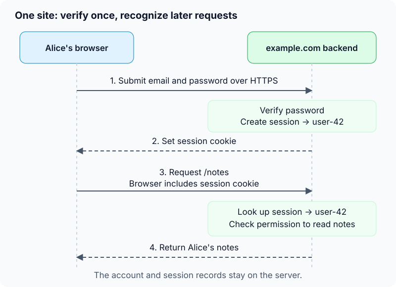
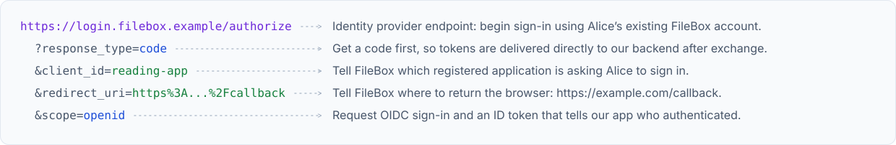
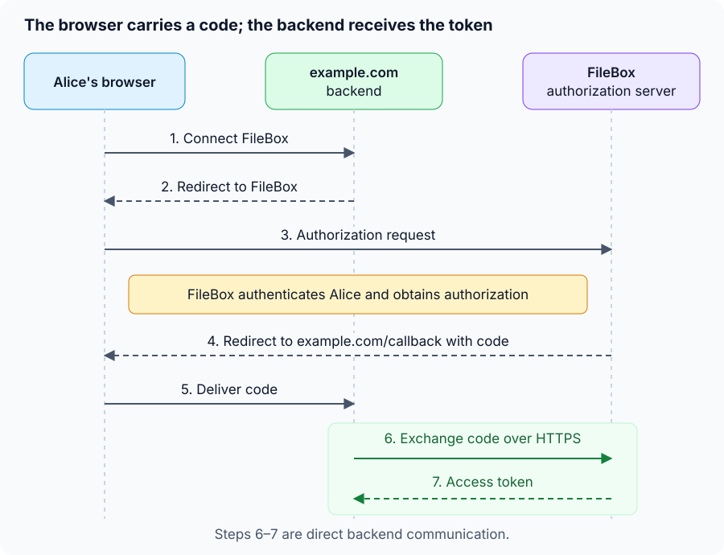
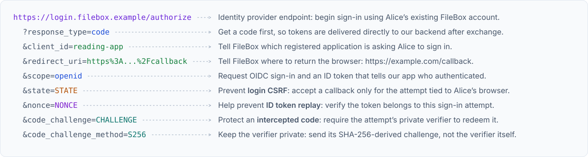
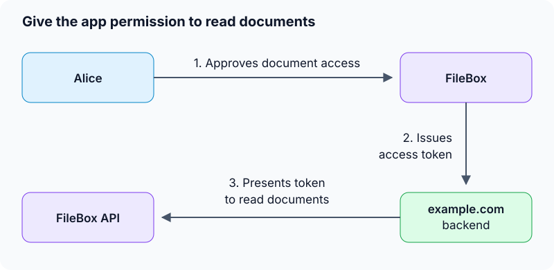

# Authentication and OIDC

Alice opens `https://example.com`, a reading app where she keeps private notes.
How does the site know which notes belong to her?

Start with just this one site. It has a backend and a database. Alice uses a
browser to interact with it.

## ✅ 1. Basic authentication of a single site

### ✅ 1.1. Create an account to identify Alice

The app needs a record representing Alice. When she registers, it creates an
account with an internal user ID:

| User ID | Email | Password hash |
|---|---|---|
| `user-42` | `alice@example.net` | Encoded password hash |

The user ID connects Alice to her notes. Her email helps her find her account,
but typing an email address does not prove she owns it.

For this example, she chooses a password. The backend stores a **password hash**
using a password-hashing library, such as one supporting Argon2id. This is a
one-way checkable representation, rather than a password the app can decrypt.
The library generates a unique salt and records the parameters needed for later
verification. A plain SHA-256 hash is unsuitable for password storage because it
is too fast to compute. See [OWASP password storage guidance](https://cheatsheetseries.owasp.org/cheatsheets/Password_Storage_Cheat_Sheet.html).

### ✅ 1.2. Verify Alice's password when she signs in

Alice submits her email and password to `https://example.com/login` over HTTPS.
The backend looks up her account and uses the library's password-verification
function to check the submitted password against the stored hash.

On success, the app has **authenticated** Alice: it has verified her claim to
this account using her credential. The backend makes that decision; displaying
a success message in the browser would not establish trust.



This password flow is one way to authenticate. Passkeys are another. For now,
keep the password example so we can focus on what happens after verification.
See [OWASP authentication guidance](https://cheatsheetseries.owasp.org/cheatsheets/Authentication_Cheat_Sheet.html).

### ✅ 1.3. Remember the login with a session

Alice next opens `/notes`. We do not want her to submit her password on every
page. The app creates a **session** after successful authentication.

In our design, the server stores a record like this:

| Session ID | User ID | Expires at |
|---|---|---|
| `******` | `user-42` | Server-defined expiry |

The server generates an unguessable session ID when the session starts. Here,
`******` hides its value. The browser reuses that same value on later requests.
It does not change on every request. It stays the same until the session ends
or the server deliberately replaces it.

The session ID is an opaque lookup key. It does not need to contain Alice's user
ID or be a JWT. Generate a fresh session ID when she signs in to prevent session
fixation, where an attacker tries to make a victim use a known session ID.
See [OWASP session management](https://cheatsheetseries.owasp.org/cheatsheets/Session_Management_Cheat_Sheet.html).

The backend sends that identifier to the browser in a cookie:

```http
Set-Cookie: __Host-session=******; Path=/; Secure; HttpOnly; SameSite=Lax
```

- **`Set-Cookie`** is a response header telling the browser to store a cookie.
  Here, its name is `__Host-session` and its value is the session ID.
- **`Secure`** tells the browser to send the cookie only over HTTPS, protecting
  it from exposure over an unencrypted connection to example.com.
- **`HttpOnly`** prevents page JavaScript from reading or modifying this cookie
  through cookie APIs. The browser still attaches it to matching requests,
  including requests initiated by JavaScript.
- **`SameSite=Lax`** limits when the browser sends the cookie with requests from
  another site. “Lax” means relaxed or less strict. Suppose Alice is already
  signed into example.com:
  - She follows a link from another site to example.com: the browser sends
    her session cookie on this top-level GET navigation, so she arrives signed in.
  - Another site submits a POST form to example.com: the browser leaves the
    cookie out. This helps prevent that site from performing actions as Alice,
    a type of attack called cross-site request forgery (CSRF).
  - She navigates within example.com: the browser sends the cookie normally.
  - With `SameSite=Strict`: the browser would also withhold the cookie on the
    initial navigation from another site. `Lax` allows ordinary links to bring
    Alice back to her signed-in session.

See [MDN's Set-Cookie reference](https://developer.mozilla.org/en-US/docs/Web/HTTP/Reference/Headers/Set-Cookie).

On a later matching request, the browser sends:

```http
GET /notes HTTP/1.1
Host: example.com
Cookie: __Host-session=******
```

The backend looks up the session, checks it is valid and unexpired, and learns
that this request belongs to `user-42`. The cookie carries the identifier; the
session record supplies its meaning.

**Users can modify their own cookies**, for example through browser developer
tools, or send a custom request with a different value. These attributes govern
browser behavior; they do not make client-supplied values trustworthy.

Changing the cookie does not change the server's session record. If Alice sends
an invented ID, the server finds no valid session and treats her as signed out.
She cannot become another user simply by editing her cookie: she would need
that user's valid session ID. This is why IDs must be unguessable and protected
from theft. `HttpOnly` restricts page scripts, rather than the person controlling
the browser. See [OWASP session ID guidance](https://cheatsheetseries.owasp.org/cheatsheets/Session_Management_Cheat_Sheet.html#session-id-properties).

**We can now explain a complete login:** verify a credential once, then recognize
later requests through a session.

### ✅ 1.4. Authentication vs Authorization

Recognizing Alice does not mean she may read every note. For a request such as
`GET /notes/note-7`, the backend must also check that the note belongs to
`user-42`, or that she otherwise has permission to read it.

This is **authorization**: deciding whether an identified caller may perform an
operation. Authentication establishes who is calling. Authorization checks what
they may do. Both checks belong on the server; hiding a button does not protect
the underlying operation. See [OWASP authorization guidance](https://cheatsheetseries.owasp.org/cheatsheets/Authorization_Cheat_Sheet.html).

A naming curiosity: HTTP calls status 401 “Unauthorized,” even though it means
the request lacks valid authentication credentials. “Unauthenticated” would
fit our distinction more clearly. An API might return 401 when Alice has no
valid session, and 403 “Forbidden” when she is signed in but tries to read
Bob's private note. A 403 can also indicate refusal for reasons unrelated to
authentication, so it does not always imply a signed-in user. See the HTTP
definitions of [401](https://www.rfc-editor.org/rfc/rfc9110.html#section-15.5.2)
and [403](https://www.rfc-editor.org/rfc/rfc9110.html#section-15.5.4).

### ✅ 1.5. End and protect the session

When Alice signs out, the backend invalidates the server-side session and
expires the browser cookie. It also enforces idle and absolute timeouts on the
server. Deleting the cookie alone would leave a copied identifier usable until
the session expires.

A session ID is a credential: someone who steals it may impersonate Alice.
Use HTTPS, protect session storage, and apply CSRF protection to state-changing
requests. Cookie attributes help, but do not replace those checks.
See [OWASP session expiration](https://cheatsheetseries.owasp.org/cheatsheets/Session_Management_Cheat_Sheet.html#session-expiration).

**One site is enough for this model.** Accounts, credential verification,
sessions, and permission checks already let Alice use her private notes. OAuth
and OIDC become useful when we introduce another responsibility or service.

## 2. Sign in through FileBox using OIDC

Alice wants to sign into example.com using an account she already has. Introduce
FileBox, a fictional service that supports sign-in for other applications.
FileBox becomes our identity provider: example.com trusts it to authenticate
Alice.

OpenID Connect (OIDC) standardizes how FileBox communicates the result. It builds
on OAuth 2.0's authorization code flow and adds an ID token: a signed statement
about the user who signed in. See [the OIDC overview](https://openid.net/specs/openid-connect-core-1_0.html#Overview).

### ✅ 2.1. Follow the basic authentication flow

The initial authorization request has four required parameters: `response_type`,
`client_id`, `redirect_uri`, and `scope`. Start with those to trace the exchange.
A working sign-in also needs protection against forged callbacks; the following
subsections add those checks. See [OIDC request parameters](https://openid.net/specs/openid-connect-core-1_0.html#AuthRequest).

#### ✅ 2.1.1. Prerequisite: register example.com with FileBox

Before Alice can sign in, we register our app with FileBox. For our backend-based
app, the registration supplies:

| Setting | Value in our example | Purpose |
|---|---|---|
| Client ID | `reading-app` | Identifies our application to FileBox |
| Redirect URI | `https://example.com/callback` | Where FileBox may return the browser |
| Client authentication | A credential held by our backend | Lets FileBox authenticate the app during token exchange |

A client ID is public. A client secret, if used, stays on the backend. FileBox
checks the redirect URI against the registration so the app cannot redirect the
result to an arbitrary destination. See [client registration](https://www.rfc-editor.org/rfc/rfc6749#section-2)
and [redirect URI matching](https://www.rfc-editor.org/rfc/rfc9700#section-4.1.3).

#### ✅ 2.1.2. Backend sends Alice's browser to FileBox

Alice clicks “Sign in with FileBox” at example.com. Our backend redirects her
browser to FileBox's authorization endpoint. Each query parameter tells FileBox
something about the request:



`response_type` specifies what FileBox returns through the browser after
authorization. Its main building blocks are:

- `code`: returns an authorization code that our backend exchanges for tokens.
- `id_token`: returns an ID token describing who authenticated.
- `token`: returns an access token for calling a protected API.

These values can be combined in supported flows. Our example uses only `code`:
the browser carries the code, then our backend obtains the ID token and access
token directly from FileBox's token endpoint. See [response type definitions](https://openid.net/specs/oauth-v2-multiple-response-types-1_0.html).

`scope` is a space-separated list of what our app requests: `openid` enables
OIDC sign-in, while `profile` and `email` request user information. For example,
`scope=openid%20email` requests sign-in and email claims (`%20` means a space).
An API can define additional scopes, such as FileBox's fictional `documents.read`.
FileBox decides what access to grant; requesting a scope does not grant it
automatically. See [OIDC scopes](https://openid.net/specs/openid-connect-core-1_0.html#ScopeClaims).

Alice authenticates on FileBox's own page. If she already has a suitable FileBox
session, it may recognize her without asking for her password again. FileBox
also obtains any required approval. Her FileBox password goes to FileBox.
See [OIDC authentication requests](https://openid.net/specs/openid-connect-core-1_0.html#AuthRequest).

#### ✅ 2.1.3. FileBox returns a code through the browser

FileBox redirects the browser to `https://example.com/callback?code=CODE`.

The browser follows the redirect and sends a request to our callback route,
carrying the code. Our backend still needs to exchange it and validate the
result before creating a session.

The authorization code is short-lived and single-use. Receiving it is an
intermediate step, rather than proof that Alice is signed into example.com.
See [authorization codes](https://www.rfc-editor.org/rfc/rfc6749#section-4.1.2).

#### ✅ 2.1.4. Backend exchanges the code directly with FileBox

Our backend sends the code to FileBox's token endpoint over HTTPS, with the
registered redirect URI and required client authentication.
FileBox checks the request and returns tokens. The browser does not carry these
tokens in the redirect URL.



The response includes an ID token and an access token. For signing Alice into
our app, the ID token is the relevant identity assertion. The access token has
an API access role, which we will use in section 3.
See [OIDC token responses](https://openid.net/specs/openid-connect-core-1_0.html#TokenResponse).

#### ✅ 2.1.5. Why not get id_token directly?

Our backend runs on servers we control. It can keep client credentials and
tokens private. Frontend code runs on the user's device, where we do not control
the environment:

- Users can inspect downloaded JavaScript, browser storage, and network traffic
  with developer tools. A secret shipped to the frontend cannot remain private
  from the person controlling that browser.
- Browser extensions with sufficient permissions may read page contents or
  observe and modify requests, potentially exposing information handled there.
- Users can bypass the frontend entirely and send their own requests with tools
  such as `curl`, changing parameters or submitting fabricated values. The
  backend must validate requests regardless of which client sends them; the
  presence of a frontend field or a disabled button does not establish trust.

These capabilities do not let someone forge FileBox's signature on an ID token.
They explain why we keep app credentials on the backend and validate identity
assertions there instead of trusting a client-supplied claim that Alice signed in.

Code flow fits this boundary: the browser carries a temporary code, while our
backend receives and stores the actual tokens directly from FileBox. With PKCE,
introduced below, redeeming the code also requires a private verifier. Someone
who intercepts only the code cannot exchange it without that verifier and our
backend's client credentials. The benefit comes from these protections and
reduced token exposure, rather than from adding another step by itself.
See [OAuth code flow security](https://www.rfc-editor.org/rfc/rfc9700#section-2.1.1).

Direct ID-token delivery can also be implemented securely. We choose code flow
with PKCE because it suits our backend app and supports obtaining API access
tokens without returning them through the browser's authorization response.
The backend still needs protection, and the browser's session cookie remains a
credential. See [OAuth guidance on token delivery](https://www.rfc-editor.org/rfc/rfc9700#section-2.1.2).

#### ✅ 2.1.6. Verify FileBox's statement about Alice

The ID token is a signed JWT (JSON Web Token). Its payload contains claims:
statements that the backend must validate before trusting them.

| Claim | What the backend checks |
|---|---|
| `iss` — issuer | Is it the expected FileBox issuer, `https://login.filebox.example`? |
| `aud` — audience | Is this token intended for our app, `reading-app`? |
| `exp` — expiration | Is it still valid? |
| `sub` — subject | Which user does FileBox identify? For Alice, suppose it is `alice-42`. |

The backend also verifies the signature using FileBox's trusted public keys and
applies the remaining protocol checks. Decoding a JWT only reveals its contents;
it does not establish that those contents are authentic. See [ID token
validation](https://openid.net/specs/openid-connect-core-1_0.html#IDTokenValidation).

#### ✅ 2.1.7. Create the familiar local session

The app identifies the external account by the combination of issuer and
subject, then looks up its local account mapping. For Alice, suppose that mapping
has already been established:

| External issuer | External subject | Local user ID |
|---|---|---|
| `https://login.filebox.example` | `alice-42` | `user-42` |

A first-time user needs a new account, or an explicit linking flow for an
existing account. An email match alone should not silently establish that link.
See [OWASP federated account linking](https://cheatsheetseries.owasp.org/cheatsheets/Authentication_Cheat_Sheet.html#secure-federated-account-linking).

Once Alice's identity is verified and mapped, example.com creates a local
session for `user-42` and sets the session cookie from section 1. Her later
requests use that cookie, and our backend checks access to her notes as before.

FileBox verifies Alice's credentials; example.com verifies FileBox's assertion.
The provider's login session and our app's session are separate. The same
separation appears in [Google's OIDC server flow](https://developers.google.com/identity/openid-connect/openid-connect#server-flow),
where validating the ID token precedes establishing the application's session.

### ✅ 2.2. Add state to protect the callback

What if an attacker starts a sign-in using the attacker's FileBox account, then
tricks Alice's browser into submitting that callback? Without a check tying the
callback to Alice's attempt, our app could sign Alice into the attacker's account.
This is login CSRF.

Add `state` to the authorization URL:
`https://login.filebox.example/authorize?...&state=STATE`.

- Our backend generates a random, unguessable value once for this attempt and
  stores it bound to Alice's browser session. It must have enough randomness;
  a timestamp or counter is predictable even if the string is long.
- FileBox echoes the same value with the code:
  `https://example.com/callback?code=CODE&state=STATE`.
- Our backend checks it against the stored attempt and rejects a missing,
  mismatched, or already consumed value before proceeding.

`state` is recommended in the OIDC code flow. CSRF protection is required;
properly bound and validated PKCE or OIDC `nonce` can also provide it, so `state`
is not mandatory in every secure design. Our example uses it explicitly.
See [OAuth CSRF protection](https://www.rfc-editor.org/rfc/rfc9700#section-4.7).

### ✅ 2.3. Add nonce to bind the ID token to this attempt

An ID token can have a valid signature and still belong to an earlier or
unrelated sign-in. `nonce` helps prevent that token from being replayed as the
result of Alice's current attempt.

“Nonce” is commonly explained as “number used once.” Here, “once” means one
sign-in attempt; the value can be a random string. Add it to the authorization
URL: `https://login.filebox.example/authorize?...&state=STATE&nonce=NONCE`.

- Our backend generates a separate random, unguessable nonce for the attempt
  and stores it for comparison.
- FileBox includes that same value in the signed ID token's `nonce` claim.
- Our backend validates the token and requires its nonce to match the stored
  value. A new attempt gets a new nonce.

`nonce` is optional in this OIDC code flow. Once we send it, checking it in the
ID token is required. `state` returns in the callback URL; `nonce` returns inside
the signed identity assertion. See [OIDC request parameters](https://openid.net/specs/openid-connect-core-1_0.html#AuthRequest)
and [nonce validation](https://openid.net/specs/openid-connect-core-1_0.html#IDTokenValidation).

### 2.4. Add a code challenge to protect code redemption

What if someone intercepts the authorization code? PKCE (Proof Key for Code
Exchange) makes that code insufficient by requiring a private verifier created
for this attempt.

- Our backend generates a random code verifier once and keeps it privately.
- It derives a code challenge and sends that in the authorization request.
  FileBox associates the challenge with the issued code.
- Our backend sends the original verifier when exchanging the code. FileBox
  checks it against the challenge before issuing tokens.

With the `S256` method, the derivation is:

```text
code_challenge = BASE64URL(SHA256(ASCII(code_verifier)))
```

The base64url encoding omits padding. Add these parameters to the request:

```text
&code_challenge=CHALLENGE
&code_challenge_method=S256
```

The challenge travels through the browser; the verifier stays on our backend
until it is sent directly to the token endpoint. Someone who obtains only the
code and challenge cannot redeem the code without the verifier. See [PKCE](https://www.rfc-editor.org/rfc/rfc7636#section-4).

Current guidance requires PKCE for public clients, such as browser-only and
mobile apps, and recommends it for confidential clients such as our backend
app. The `code_challenge` is required when using PKCE. A client secret
authenticates the app; PKCE binds code redemption to a particular attempt.
See [OAuth code flow security](https://www.rfc-editor.org/rfc/rfc9700#section-2.1.1).

Our example now includes all three protections. The complete request looks like
this; the callback and token exchange stay the same, with the checks added above:



## 3. Add document access using OAuth

Alice can now sign in. Suppose she also wants example.com to import documents
stored at FileBox. This introduces a separate permission: our app must be
allowed to call FileBox's document API on her behalf.

### 3.1. Request permission with a scope

OAuth 2.0 supplies the framework for this delegated access. Our fictional
`documents.read` scope requests permission to read documents. To request sign-in
and document access together, change the scope in the existing request:

```text
scope=openid%20documents.read
```

FileBox obtains the required authorization and issues an access token with the
approved access. Our backend receives it through the code exchange we already
understand. OIDC's `openid` scope alone does not grant document access.
See [OAuth scopes](https://www.rfc-editor.org/rfc/rfc6749#section-3.3).



### 3.2. Present the access token to the API

Our backend calls FileBox over HTTPS:

```http
GET /documents HTTP/1.1
Host: api.filebox.example
Authorization: Bearer ******
```

The API checks that the access token is valid for it and permits reading the
requested documents. A read-only token should not authorize deleting them.

“Bearer” means possession is enough to use the token. Keep it protected on the
backend and out of URLs. See [bearer token usage](https://www.rfc-editor.org/rfc/rfc6750#section-2.1)
and [token disclosure risks](https://www.rfc-editor.org/rfc/rfc6750#section-5).

The app can offer FileBox sign-in without document access. It can also request
document access for a user who signs into example.com with a local password.
OAuth access and OIDC sign-in address different needs, even when one flow
requests both.
